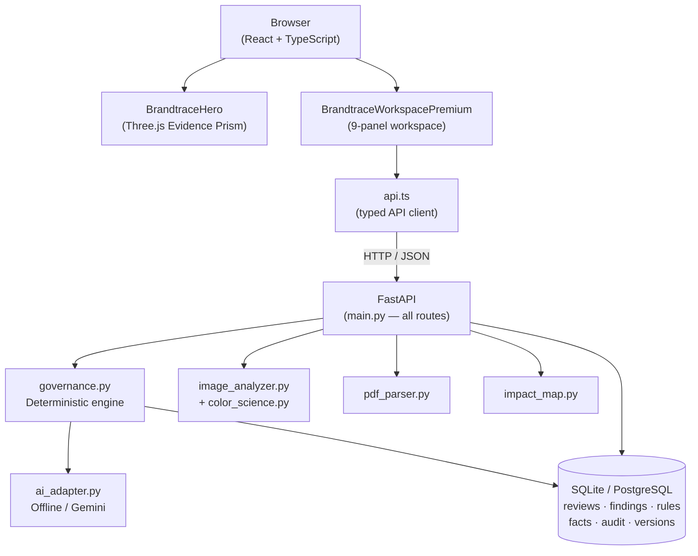

<div align="center">

# BRANDTRACE

**Every finding has a source. Every decision has an owner.**

Evidence-Aware Brand Governance and Content Review Platform

[](#testing)
[](#11-windows-local-setup)
[](./LICENSE)
[](#6-product-walkthrough)

</div>

---

## ? Quick Navigation for Judges & Evaluators

| Guide | Description |
| :--- | :--- |
| ?? **[Judge's Guide](./docs/JUDGE_GUIDE.md)** | **Start here.** 5-minute walkthrough, core problem, presentation-claim-to-code matrix. |
| ?? **[Quick Start](./docs/QUICK_START.md)** | Step-by-step PowerShell setup for backend and frontend. |
| ??? **[User Manual](./docs/USER_GUIDE.md)** | Operator manual covering all 9 workspace panels. |
| ??? **[Architecture](./docs/ARCHITECTURE.md)** | Complete system architecture, component boundaries, and sequence diagrams. |
| ?? **[End-to-End Workflow](./docs/WORKFLOW_AND_STATE_MACHINE.md)** | State machine: submission, exact-span edit, approval gate, and audit logging. |
| ?? **[API Reference](./docs/API_REFERENCE.md)** | All implemented endpoints, request schemas, and HTTP status codes. |
| ?? **[Testing Guide](./docs/TESTING_AND_QA.md)** | Automated test suites (75 backend tests, 27 smoke tests) and verification proof. |
| ?? **[Known Limitations](./docs/SECURITY_AND_LIMITATIONS.md)** | Full transparency on simulated authentication, OCR requirements, and visual bounds. |
| ?? **[Round 2 Summary](./docs/ROUND2_SUMMARY.md)** | Complete executive summary of Round 2 deliverables and architectural evolution. |
| ??? **[Round 3 Roadmap](./docs/ROUND3_ROADMAP.md)** | Three major planned additions with measurable acceptance criteria. |
| ?? **[Full Documentation Directory](./docs/INDEX.md)** | Browse all 50+ project-specific Markdown specifications and manuals. |

---

## Table of Contents

1. [Overview](#1-overview)
2. [Problem Statement](#2-problem-statement)
3. [Solution](#3-solution)
4. [Key Features](#4-key-features)
5. [Product Walkthrough](#5-product-walkthrough)
6. [Architecture](#6-architecture)
7. [Technology Stack](#7-technology-stack)
8. [Repository Structure](#8-repository-structure)
9. [Prerequisites](#9-prerequisites)
10. [Windows Local Setup](#10-windows-local-setup)
11. [Environment Configuration](#11-environment-configuration)
12. [API Documentation](#12-api-documentation)
13. [Database and Data Lifecycle](#13-database-and-data-lifecycle)
14. [Testing](#14-testing)
15. [Security and Data Handling](#15-security-and-data-handling)
16. [Known Limitations](#16-known-limitations)
17. [Deployment](#17-deployment)
18. [Roadmap](#18-roadmap)
19. [Licence and Acknowledgements](#19-licence-and-acknowledgements)
20. [Contributing](#20-contributing)

---

## 1. Overview

BRANDTRACE reviews marketing and brand content **before publication** — flagging violations, linking every finding to the evidence that justifies it, and recording every human decision in an immutable audit trail.

It is designed for organisations where multiple contributors (employees, agencies, AI tools) create content against shared brand guidelines. Without a governance layer, prohibited phrases slip through, unsupported factual claims reach audiences, and approval decisions exist only in email chains or memories.

BRANDTRACE closes that gap: every finding explains *why* something was flagged, every correction is human-reviewed, and every approval is blocked by the server if unresolved high-risk issues remain.

> Built for the **Inkloom AI CodeAxis Round 2** hackathon on top of the MIT-licensed [LoomFrog](https://github.com/kaimir-auth/LoomFrog) frontend foundation.

---

## 2. Problem Statement

Modern brand governance has four interconnected problems:

| Problem | Real consequence |
|---------|-----------------|
| **Prohibited phrases used unconsciously** | Legal exposure, regulatory risk, consumer trust damage |
| **Factual claims without evidence** | Misleading advertising, retraction costs, reputation damage |
| **Evidence expires silently** | A "98% satisfaction" claim stays in circulation long after the survey was superseded |
| **Approval decisions are untraceable** | Who approved what, when, and why — impossible to reconstruct after the fact |

BRANDTRACE is designed to address all four. It does not replace human judgment — it ensures that judgment is informed, documented, and retrievable.

---

## 3. Solution

BRANDTRACE implements a **deterministic-first, human-gated** review workflow:

```
Submit Draft → Deterministic Rule Check → Evidence Matching → Finding Generation
    → Human Review (resolve / dismiss / escalate) → Approval Gate → Audit Record
```

Key design choices:
- **Deterministic checks run without an AI key.** Pattern matching and evidence comparison are rule-based and reproducible.
- **Optional AI layer.** Gemini AI can perform additional tone and messaging triage — but only if a server-side API key is configured. Demo runs fully offline.
- **Server-side approval gate.** The backend blocks approval if any HIGH or CRITICAL severity finding remains unresolved. The frontend cannot bypass this.
- **Immutable audit trail.** Every action (submission, disposition, approval, version restore) is recorded as a timestamped audit event. Records are append-only.

---

## 4. Key Features

| Feature | What it does | Status | Evidence |
|---------|-------------|--------|----------|
| **Brand rule detection** | Flags prohibited phrases, superlatives, and required terminology against configurable rules | ✅ Implemented | `backend/app/governance.py` |
| **Evidence-linked findings** | Each finding cites the rule ID and approved fact ID that triggered it | ✅ Implemented | `backend/app/models.py` findings table |
| **Claim expiry** | Facts have `effective_from` / `valid_until` dates; expired evidence triggers OUTDATED status | ✅ Implemented | `backend/app/governance.py` |
| **Geographic claim classification** | Broad claims are NEEDS_REVIEW unless exclusive contradiction exists; narrow evidence doesn't contradict a broad claim | ✅ Implemented | `test_qa_phase2_regression.py` |
| **Exact-span corrections** | Proposed replacement matches the precise passage; no word duplication | ✅ Implemented | `test_best_choice_correction_is_neutral` |
| **Disposition reason integrity** | Reason string cannot overwrite draft content; cross-contamination guards enforced server-side | ✅ Implemented | `test_disposition_integrity.py` |
| **Version history** | Every accepted edit, file upload, or restoration creates a versioned snapshot | ✅ Implemented | `review_versions` table |
| **Approval gate** | Approval blocked server-side if HIGH/CRITICAL findings are unresolved | ✅ Implemented | `test_approval_blocked_on_unresolved_high_risk` |
| **Audit history** | Append-only audit events with actor, timestamp, action, and notes | ✅ Implemented | `audit` table |
| **Claim impact map** | Shows which drafts are affected when a rule or fact changes | ✅ Implemented | `backend/app/impact_map.py` |
| **PDF extraction** | Text extracted from PDF uploads via pypdf | ✅ Implemented | `test_pdf_parser.py` |
| **Image palette analysis** | Colour palette, WCAG contrast ratios, Delta-E compliance | ✅ Implemented | `backend/app/color_science.py` |
| **Role simulation** | `contributor`, `reviewer`, `brand_manager`, `brand_admin` — enforced server-side | ✅ Implemented | `X-Demo-Role` header, role checks in routes |
| **Health score** | Review clearance score based on unresolved findings; labelled as review completion, not compliance | ✅ Implemented | `calculate_health_score()` |
| **OCR (image→text)** | Requires Tesseract on PATH | ⚠️ Partial | Reported unavailable if Tesseract absent |
| **Logo placement detection** | Bounding-box-level logo position | ❌ Not implemented | Planned for Round 3 |
| **Font identification** | Typeface detection from rendered text | ❌ Not implemented | Planned for Round 3 |
| **Automated re-review worker** | Background job on rule/fact expiry | ❌ Not implemented | Planned for Round 3 |
| **AI rule refinement** | Suggests rule clarifications from waiver patterns | ❌ Not implemented | Planned for Round 3 |

---

## 5. Product Walkthrough

The demo uses pre-seeded fictional data. **No API key required.**

### Step 1 — Launch the application

```powershell
# Terminal 1: Backend
cd C:\Projects\BRANDTRACE\BRANDTRACE
.\.venv\Scripts\Activate.ps1
uvicorn app.main:app --app-dir backend --reload --port 8000

# Terminal 2: Frontend
cd C:\Projects\BRANDTRACE\BRANDTRACE
npm run dev
```

Open **<http://localhost:3000>**

### Step 2 — Submit a test draft

1. Click **Enter the Workspace** from the hero screen.
2. Navigate to **Content Review** in the sidebar.
3. Click **New Review**.
4. Paste content that includes prohibited phrases, a factual claim, and a missing required term.

Example draft:
```
Discover why our platform is the best choice for modern businesses.
Get guaranteed results with zero risk and uninterrupted service across every region.
Our solution delivers 99.9% uptime and helps teams save 50% of their time on daily tasks.
```

### Step 3 — Inspect source-linked findings

Each finding shows:
- The exact passage that triggered it
- The rule ID (e.g. `R-VOICE-01`) or fact ID (e.g. `F-2026-01`)
- Severity: LOW / MEDIUM / HIGH / CRITICAL
- Evidence status: SUPPORTED / CONTRADICTED / OUTDATED / NEEDS_REVIEW / UNSUPPORTED

### Step 4 — Examine an unsupported claim

Select a finding classified `UNSUPPORTED`. Note that:
- The evidence block shows which fact was compared.
- No suggested replacement is provided for claims that require evidence.
- Editorial guidance is separate from replacement text.

### Step 5 — Accept a correction

For a finding with a neutral suggested correction (e.g. "best" → "effective"):
1. Click **Accept Correction**.
2. Confirm the draft text changed only the flagged word — no word duplication, no inserted editorial text.
3. Check **Version History** to see the new revision.

### Step 6 — Test approval blocking

1. Leave a HIGH severity finding unresolved.
2. Navigate to **Approval Queue**.
3. Attempt to approve — the backend returns HTTP 409 with a clear error message.
4. Resolve the finding, then approve successfully.

### Step 7 — Inspect Audit History

Every action (submission, edit, dismiss, escalate, approve) appears in the **Audit History** tab with actor role and timestamp.

### Step 8 — Inspect the Claim Impact Map

Navigate to **Governance Insights → Impact Map**. The map shows which reviews contain claims linked to an expired or updated fact.

### Step 9 — Test file upload

Upload a PDF or PNG file in the Content Review upload panel. Text is extracted from PDFs; colour palette and WCAG contrast is analysed for images.

---

## 6. Architecture



See [`docs/ARCHITECTURE.md`](./docs/ARCHITECTURE.md) for the full ER diagram and route table.

---

## 7. Technology Stack

| Layer | Technology | Version |
|-------|-----------|---------|
| Frontend framework | React | ^19.0.1 |
| Language | TypeScript | ~5.8.2 |
| Build tool | Vite | ^6.2.3 |
| 3D graphics | Three.js | ^0.186.0 |
| Animation | Motion (Framer) | ^12.23.24 |
| Icons | Lucide React | ^0.546.0 |
| CSS framework | Tailwind CSS v4 | ^4.1.14 |
| DOMPurify | dompurify | ^3.4.14 |
| Backend framework | FastAPI | >=0.115,<1 |
| ASGI server | Uvicorn | >=0.30 |
| Data validation | Pydantic | >=2.7 |
| Database ORM | SQLAlchemy | >=2.0 |
| Database (demo) | SQLite | stdlib |
| Database (production) | PostgreSQL | via psycopg 3 |
| PDF extraction | pypdf | >=5 |
| Image processing | Pillow | >=10 |
| AI provider (optional) | Google Gemini | @google/genai ^2.4.0 |
| Testing | pytest + httpx | >=8, >=0.27 |

Versions from `package.json` and `backend/requirements.txt`.

---

## 8. Repository Structure

```
BRANDTRACE/
├── backend/
│   ├── app/
│   │   ├── main.py            # FastAPI app, all API routes (~950 lines)
│   │   ├── models.py          # SQLAlchemy schema, DB helpers
│   │   ├── schemas.py         # Pydantic request/response models
│   │   ├── governance.py      # Deterministic analysis orchestrator
│   │   ├── ai_adapter.py      # OfflineProvider / GeminiProvider
│   │   ├── color_science.py   # WCAG 2.1 + CIELAB Delta-E
│   │   ├── image_analyzer.py  # Pillow palette extraction
│   │   ├── pdf_parser.py      # pypdf text extraction
│   │   ├── impact_map.py      # Rule/fact impact analysis
│   │   └── config.py          # Configuration and URL normalisation
│   ├── tests/
│   │   ├── conftest.py
│   │   ├── test_api.py
│   │   ├── test_color_and_visual.py
│   │   ├── test_pdf_parser.py
│   │   ├── test_ai_adapter.py
│   │   ├── test_qa_comprehensive.py
│   │   ├── test_qa_phase2_regression.py
│   │   └── test_disposition_integrity.py
│   └── requirements.txt
├── src/
│   ├── components/
│   │   ├── BrandtraceWorkspacePremium.tsx  # Active workspace (premium UI)
│   │   ├── BrandtraceWorkspace.tsx         # Legacy workspace (preserved)
│   │   ├── BrandtraceHero/                 # Landing page with Three.js prism
│   │   ├── EvidencePrism/                  # Three.js 3D component
│   │   └── LandingPage/                    # Inherited LoomFrog UI (attributed)
│   ├── services/
│   │   └── api.ts              # Typed API client, role simulation
│   ├── index.css               # Design tokens + BRANDTRACE components
│   ├── App.tsx                 # Root component, routing
│   └── main.tsx
├── docs/
│   ├── INDEX.md
│   ├── ARCHITECTURE.md
│   ├── ROUND2_DEMO_SCRIPT.md
│   ├── ROUND2_SUBMISSION.md
│   ├── ROUND3_PLAN.md
│   └── [35 numbered guides — see docs/INDEX.md]
├── public/
│   ├── manifest.webmanifest
│   ├── sw.js
│   └── favicon.svg
├── scripts/
│   ├── prerender.ts            # Static HTML prerender for SSR fallback
│   └── smoke_test.py           # 27 end-to-end ASGI assertions
├── index.html                  # HTML entry point (title: BRANDTRACE)
├── package.json
├── vite.config.ts
├── LICENSE                     # MIT — Amir Asadullah Chowdhury
├── CONTRIBUTING.md
├── CHANGELOG.md
├── SECURITY.md
├── THIRD_PARTY_NOTICES.md
└── .env.example
```

---

## 9. Prerequisites

| Requirement | Minimum | Recommended |
|-------------|---------|-------------|
| Python | 3.10 | 3.10 or 3.11 |
| Node.js | 18 LTS | 20 LTS |
| npm | 9 | 10 |
| Git | 2.30 | latest |
| Tesseract OCR | optional | — |

No Docker required for local development.

---

## 10. Windows Local Setup

### Backend

```powershell
cd C:\Projects\BRANDTRACE\BRANDTRACE

# Create and activate a virtual environment
py -3.10 -m venv .venv
.\.venv\Scripts\Activate.ps1

# Install backend dependencies
pip install -r backend\requirements.txt

# Set the database path (SQLite — no PostgreSQL required for demo)
$env:DATABASE_URL = "sqlite:///./brandtrace.db"
$env:AI_PROVIDER = "offline"

# Start the API server (seeds demo data automatically on first run)
uvicorn app.main:app --app-dir backend --reload --port 8000
```

Verify: <http://127.0.0.1:8000/api/health> should return `{"status": "ok"}`.

Interactive API docs: <http://127.0.0.1:8000/docs>

### Frontend (second PowerShell window)

```powershell
cd C:\Projects\BRANDTRACE\BRANDTRACE
npm install
npm run dev
```

Open **<http://localhost:3000>**

### Running both simultaneously

Keep the backend terminal open. The frontend dev server proxies API requests to port 8000 (see `vite.config.ts`).

---

## 11. Environment Configuration

Copy `.env.example` and adjust as needed:

```powershell
Copy-Item .env.example .env
```

| Variable | Default | Purpose |
|----------|---------|---------|
| `DATABASE_URL` | `sqlite:///./brandtrace.db` | Database connection (SQLite for demo, PostgreSQL for production) |
| `AI_PROVIDER` | `offline` | `offline` (demo) or `gemini` (requires key) |
| `GEMINI_API_KEY` | — | Server-side only; never exposed to the browser |
| `CORS_ORIGINS` | `http://localhost:3000` | Allowed CORS origins for the API |
| `MAX_UPLOAD_BYTES` | `10485760` | Maximum file upload size (10 MB) |

> **No API key is required for the full demo.** The offline provider performs deterministic checks and keyword-based triage. AI assistance is an optional enhancement.

---

## 12. API Documentation

With the backend running, open the interactive OpenAPI docs at:

**<http://127.0.0.1:8000/docs>**

Key endpoint groups:

| Group | Path prefix | Purpose |
|-------|------------|---------|
| Health | `/api/health` | Liveness check |
| Reviews | `/api/reviews` | Submit, list, get, update reviews |
| Findings | `/api/reviews/{id}/findings/{id}/actions` | Disposition actions |
| Approval | `/api/reviews/{id}/approval` | Approve, waive, request-changes |
| Versions | `/api/reviews/{id}/versions` | Version history and restoration |
| Audit | `/api/reviews/{id}/audit` | Audit event log |
| Rules | `/api/rules` | Brand rule CRUD |
| Facts | `/api/facts` | Approved fact CRUD |
| Insights | `/api/insights` | Governance analytics |
| Impact Map | `/api/governance/impact-map` | Affected-draft analysis |
| Demo | `/api/demo/setup` | Reset to clean demo state |

Full endpoint documentation: [`docs/08_API_REFERENCE.md`](./docs/08_API_REFERENCE.md)

---

## 13. Database and Data Lifecycle

**Local development:** SQLite database at `./brandtrace.db` (gitignored).

**Demo seeding:** Calling `POST /api/demo/setup` seeds a set of fictional brand rules, approved facts, and a pre-seeded draft review. This happens automatically on first run.

**Test isolation:** Each test file creates its own temporary SQLite database via a `tempfile.mkstemp()` pattern, so tests never touch the development database.

**Version history:** Every content mutation (edit, upload, restoration) records a new entry in `review_versions` with the full content snapshot.

**Reset:** To restore the demo to its original state: `POST /api/demo/setup` re-seeds all demo records.

See [`docs/11_DATABASE_AND_DATA_LIFECYCLE.md`](./docs/11_DATABASE_AND_DATA_LIFECYCLE.md) for schema details.

---

## 14. Testing

### Backend tests

```powershell
cd C:\Projects\BRANDTRACE\BRANDTRACE
.\.venv\Scripts\Activate.ps1
python -m pytest backend/tests -v
```

Expected: **75 passed, 1 skipped** (the skipped test requires a live `GEMINI_API_KEY`).

| Test file | Coverage |
|-----------|----------|
| `test_api.py` | Full demo workflow, role permissions, version restoration, file upload, impact map, DB persistence |
| `test_color_and_visual.py` | WCAG luminance, contrast ratios, Delta-E colour distance, palette compliance |
| `test_pdf_parser.py` | Empty, corrupted, blank-page, encrypted PDF handling |
| `test_ai_adapter.py` | Offline claim detection, harmless text pass-through, Gemini fallback, live provider skip |
| `test_qa_comprehensive.py` | Health score semantics, geographic claim classification, approval enforcement, file analysis, demo reset |
| `test_qa_phase2_regression.py` | Deduplication, claim detection, span integrity, neutral corrections, terminology semantics |
| `test_disposition_integrity.py` | Reason-cannot-overwrite-content, QA metadata rejection, version creation, refetch accuracy |

### Smoke tests

```powershell
python scripts/smoke_test.py
```

Runs 27 end-to-end assertions against the ASGI application directly (no live server needed).

### Frontend checks

```powershell
# Type check
npx tsc --noEmit

# Production build
npm run build
```

See [`docs/26_TESTING_AND_AUTOMATED_QA.md`](./docs/26_TESTING_AND_AUTOMATED_QA.md) for full test documentation.

---

## 15. Security and Data Handling

- **Demo roles are simulated.** The `X-Demo-Role` header is not real authentication. Any client can impersonate any role. This is explicitly labelled in the UI.
- **No credentials in frontend bundles.** The AI API key is server-side only (`GEMINI_API_KEY` environment variable).
- **File upload validation.** MIME type and byte-size limits are enforced server-side.
- **Audit records.** Audit events are append-only in the database; there is no delete or overwrite endpoint.
- **Disposition integrity.** The backend rejects replacements that equal the reason string (cross-contamination guard).
- **Input sanitization.** Content is stored as plain text; DOMPurify is used on the frontend for any rendered HTML.

This is a demonstration application. It has no production authentication, encrypted storage, or network-level security controls.

See [`SECURITY.md`](./SECURITY.md) and [`docs/24_SECURITY_AND_PRIVACY.md`](./docs/24_SECURITY_AND_PRIVACY.md).

---

## 16. Known Limitations

| Limitation | Detail |
|-----------|--------|
| **Demo authentication** | Role enforcement uses a header, not real auth tokens or sessions |
| **OCR** | Requires Tesseract on PATH; reported as unavailable if absent |
| **Logo detection** | Not implemented; planned for Round 3 |
| **Font identification** | Not implemented; planned for Round 3 |
| **Automated re-review** | No background worker for rule/fact expiry events |
| **AI rule refinement** | Pattern analysis for rule improvement is planned, not delivered |
| **Production hardening** | No rate limiting, no row-level security, no encryption at rest |
| **PostgreSQL SSL** | SSL configuration not yet documented |
| **Browser verification** | Interactive browser tests not automated; manual QA required |

Full limitations list: [`docs/33_KNOWN_LIMITATIONS.md`](./docs/33_KNOWN_LIMITATIONS.md)

---

## 17. Deployment

BRANDTRACE has not been deployed to a public URL. The repository is prepared for local-only demonstration.

Production deployment would require:
- A persistent PostgreSQL database (`DATABASE_URL` set to a PostgreSQL connection string)
- A server-side `GEMINI_API_KEY` if AI analysis is required
- CORS configuration (`CORS_ORIGINS`) set to the frontend domain
- A process manager (e.g. gunicorn + uvicorn workers) for the FastAPI backend
- A static file host or CDN for the Vite-built frontend
- HTTPS termination at the load balancer or reverse proxy

See [`docs/29_DEPLOYMENT_GUIDE.md`](./docs/29_DEPLOYMENT_GUIDE.md).

---

## 18. Roadmap

### Completed (Round 2)

- Deterministic brand rule engine with rule/fact evidence linking
- Claim expiry and evidence status classification
- Finding lifecycle (create, disposition, escalate, resolve)
- Exact-span corrections with version history
- Server-side approval gate (HIGH/CRITICAL unresolved → 409)
- Immutable audit history
- PDF text extraction and image palette analysis
- Claim/rule impact map
- 75-test automated suite

### Planned (Round 3)

1. **Time-aware Claim Ledger and Rule-Change Impact Map** — Automated background re-review when facts expire or rules change; webhook notifications; scheduled expiry alerts.
2. **Multimodal Visual Compliance** — Bounding-box logo placement, font identification from rendered regions, full brand-visual compliance scoring.
3. **AI-assisted Rule Refinement** — Identifies frequently waived or dismissed rules and proposes clarifications; multi-stakeholder approval before rule changes take effect.

See [`docs/32_ROUND3_IMPROVEMENT_ROADMAP.md`](./docs/32_ROUND3_IMPROVEMENT_ROADMAP.md) for measurable acceptance criteria.

---

## 19. Licence and Acknowledgements

This project is distributed under the **MIT License**. See [`LICENSE`](./LICENSE).

BRANDTRACE is built on the [LoomFrog](https://github.com/kaimir-auth/LoomFrog) React/Vite frontend scaffold, designed and built by **Amir Asadullah Chowdhury** (Chattogram, Bangladesh). The inherited LoomFrog UI components remain in the repository for attribution and licence compliance.

Third-party dependency licences and source provenance: [`THIRD_PARTY_NOTICES.md`](./THIRD_PARTY_NOTICES.md)

---

## 20. Contributing

See [`CONTRIBUTING.md`](./CONTRIBUTING.md) for branch conventions, development setup, code organization, and pull-request guidelines.

---

<div align="center">

**BRANDTRACE** · Evidence-Aware Brand Governance · MIT License

*Every finding has a source. Every decision has an owner.*

</div>
