# BRANDTRACE Data Model & Entity Specifications

## Relational Schema Architecture

```mermaid
erDiagram
    WORKSPACES ||--o{ BRAND_PROFILES : configures
    WORKSPACES ||--o{ RULES : contains
    WORKSPACES ||--o{ FACTS : contains
    WORKSPACES ||--o{ REVIEWS : contains
    WORKSPACES ||--o{ AUDIT : logs

    REVIEWS ||--o{ FINDINGS : generates
    REVIEWS ||--o{ REVIEW_VERSIONS : tracks
    REVIEWS ||--o{ AUDIT : targets

    RULES ||--o{ FINDINGS : cites
    FACTS ||--o{ FINDINGS : cites

    WORKSPACES {
        string id PK
        string name
        string created_at
    }

    BRAND_PROFILES {
        string id PK
        string workspace_id FK
        string brand_name
        string primary_color
        string secondary_color
        string accent_colors
        float min_contrast_ratio
        float approved_logo_aspect
        string updated_at
    }

    RULES {
        string id PK
        string workspace_id FK
        string title
        string category
        string kind
        string pattern
        string requirement
        string severity
        string version
        string status
        string owner
        string source_id
        string source_title
        string source_excerpt
        string effective_at
        string expires_at
        string created_at
    }

    FACTS {
        string id PK
        string workspace_id FK
        string claim
        string value
        string owner
        string status
        string version
        string source_id
        string source_title
        string source_excerpt
        string review_at
        string effective_at
        string expires_at
        string created_at
    }

    REVIEWS {
        string id PK
        string workspace_id FK
        string title
        string content
        string content_type
        string status
        int score
        string author
        string reviewer
        string file_name
        string file_mime
        int file_size
        string analysis_method
        string rule_versions
        string created_at
        string updated_at
    }

    FINDINGS {
        string id PK
        string review_id FK
        string category
        string type
        string severity
        string status
        string passage
        string explanation
        string suggested_correction
        string source_id FK
        string source_title
        string source_excerpt
        string source_version
        string analysis_method
        string uncertainty
        string disposition
        string disposition_reason
        string disposition_by
        string disposition_at
    }

    REVIEW_VERSIONS {
        string id PK
        string review_id FK
        string content
        string created_at
        string created_by
        string reason
    }

    AUDIT {
        string id PK
        string workspace_id FK
        string review_id FK
        string action
        string actor
        string actor_role
        string reason
        string details
        string created_at
    }
```

BRANDTRACE utilizes a relational schema optimized for audit traceability, point-in-time versioning, and deterministic rule verification. Primary keys across core domain entities utilize structured, collision-resistant deterministic identifiers prefixed by entity type (e.g., `rev_<hex>`, `finding_<hex>`, `aud_<hex>`, `version_<hex>`).

---

## Detailed Table Specifications

### 1. `workspaces`
Represents an enterprise tenant or department partition.
* `id` (`TEXT PRIMARY KEY`): Unique workspace identifier (e.g., `ws_default`).
* `name` (`TEXT NOT NULL`): Human-readable workspace name.
* `created_at` (`TEXT NOT NULL`): UTC ISO 8601 creation timestamp.

### 2. `brand_profiles`
Maintains visual brand tokens and accessibility thresholds.
* `id` (`TEXT PRIMARY KEY`): Profile identifier (`profile_<hex>`).
* `workspace_id` (`TEXT NOT NULL`): Foreign key referencing `workspaces.id`.
* `brand_name` (`TEXT NOT NULL`): Official corporate entity name.
* `primary_color` (`TEXT NOT NULL`): Hex color code (e.g., `#0f766e`).
* `secondary_color` (`TEXT NOT NULL`): Hex color code (e.g., `#2dd4bf`).
* `accent_colors` (`TEXT NOT NULL`): JSON array of approved hex color strings.
* `min_contrast_ratio` (`REAL NOT NULL DEFAULT 4.5`): Minimum acceptable WCAG contrast ratio.
* `approved_logo_aspect` (`REAL`): Required aspect ratio ($W/H$) for official brand logo assets.
* `updated_at` (`TEXT NOT NULL`): UTC ISO 8601 modification timestamp.

### 3. `rules`
Codified brand guidelines, forbidden vocabulary, and voice directives.
* `id` (`TEXT PRIMARY KEY`): Rule code (e.g., `R-VOICE-01`, `R-TERM-02`).
* `workspace_id` (`TEXT NOT NULL DEFAULT 'ws_default'`): References `workspaces.id`.
* `title` (`TEXT NOT NULL`): Concise rule description.
* `category` (`TEXT NOT NULL DEFAULT 'terminology'`): Domain (`terminology`, `voice`, `legal`, `style`).
* `kind` (`TEXT NOT NULL`): Rule classification (`prohibited_phrase`, `required_phrase`, `approved_term`, `forbidden_term`, `tone_rule`).
* `pattern` (`TEXT NOT NULL`): Regex or string pattern matched against draft content.
* `requirement` (`TEXT NOT NULL`): Directive explaining mandatory compliance behavior.
* `severity` (`TEXT NOT NULL`): Finding penalty level (`LOW`, `MEDIUM`, `HIGH`, `CRITICAL`).
* `version` (`TEXT NOT NULL`): Semantic version of the rule (e.g., `1.0`, `1.2`).
* `status` (`TEXT NOT NULL`): Operational state (`APPROVED`, `DRAFT`, `RETIRED`).
* `owner` (`TEXT NOT NULL DEFAULT 'Brand Admin'`): Team or individual responsible for rule.
* `source_id` (`TEXT`): Originating guideline reference ID.
* `source_title` (`TEXT NOT NULL`): Document title (e.g., "Brand Voice Standard").
* `source_excerpt` (`TEXT NOT NULL`): Verifiable citation text from policy manual.
* `effective_at` (`TEXT`): UTC timestamp when rule becomes active.
* `expires_at` (`TEXT`): UTC timestamp when rule automatically expires.
* `created_at` (`TEXT NOT NULL DEFAULT ''`): UTC creation timestamp.

### 4. `facts`
The approved corporate claim ledger containing verified evidentiary assertions.
* `id` (`TEXT PRIMARY KEY`): Fact code (e.g., `F-2026-01`).
* `workspace_id` (`TEXT NOT NULL DEFAULT 'ws_default'`): References `workspaces.id`.
* `claim` (`TEXT NOT NULL`): High-level topic or assertion (e.g., "Product availability").
* `value` (`TEXT NOT NULL`): Exact approved phrasing (e.g., "Available in India").
* `owner` (`TEXT NOT NULL`): Department owning the fact (e.g., "Product Marketing").
* `status` (`TEXT NOT NULL`): Operational state (`APPROVED`, `DRAFT`, `RETIRED`).
* `version` (`TEXT NOT NULL`): Semantic version of fact assertion.
* `source_id` (`TEXT`): Source document reference ID.
* `source_title` (`TEXT NOT NULL`): Source name (e.g., "Q4 India Launch Brief").
* `source_excerpt` (`TEXT NOT NULL`): Specific verifying citation text.
* `review_at` (`TEXT`): Scheduled compliance review date.
* `effective_at` (`TEXT`): Activation timestamp.
* `expires_at` (`TEXT`): Timestamp when evidence lapses and claims become `OUTDATED`.
* `created_at` (`TEXT NOT NULL DEFAULT ''`): UTC creation timestamp.

### 5. `reviews`
Primary content submission records.
* `id` (`TEXT PRIMARY KEY`): Prefixed identifier (e.g., `review_<hex>` or `rev_<slug>`).
* `workspace_id` (`TEXT NOT NULL DEFAULT 'ws_default'`): References `workspaces.id`.
* `title` (`TEXT NOT NULL`): Human-readable campaign or document title.
* `content` (`TEXT NOT NULL`): Active working draft text.
* `content_type` (`TEXT NOT NULL`): Media type (`marketing_copy`, `email`, `social`, `web`, `document`, `image`).
* `status` (`TEXT NOT NULL`): State (`IN_REVIEW`, `APPROVED`, `CHANGES_REQUESTED`, `WAIVED`).
* `score` (`INTEGER NOT NULL`): Governance clearance score (0 to 100).
* `author` (`TEXT NOT NULL DEFAULT 'creator@demo.com'`): Author identity.
* `reviewer` (`TEXT`): Final approver or reviewer identity.
* `file_name` (`TEXT`): Original uploaded filename if ingested from file.
* `file_mime` (`TEXT`): Ingested MIME type (e.g., `application/pdf`, `image/png`).
* `file_size` (`INTEGER`): File byte size.
* `analysis_method` (`TEXT NOT NULL DEFAULT 'DETERMINISTIC_FIRST'`): Analysis pipeline mode.
* `rule_versions` (`TEXT NOT NULL`): JSON dictionary capturing rule IDs and versions active at submission.
* `created_at` (`TEXT NOT NULL`): UTC creation timestamp.
* `updated_at` (`TEXT NOT NULL`): UTC modification timestamp.

### 6. `findings`
Specific compliance, factual, or visual issues detected within a review.
* `id` (`TEXT PRIMARY KEY`): Identifier format `finding_<hex>`.
* `review_id` (`TEXT NOT NULL`): References `reviews.id`.
* `category` (`TEXT NOT NULL DEFAULT 'general'`): Category (`terminology`, `claims`, `voice`, `visual`).
* `type` (`TEXT NOT NULL`): Specific issue type (`prohibited_phrase`, `required_phrase`, `expired_fact`, `visual_property`).
* `severity` (`TEXT NOT NULL`): Severity level (`LOW`, `MEDIUM`, `HIGH`, `CRITICAL`).
* `status` (`TEXT NOT NULL`): Evidentiary status (`SUPPORTED`, `CONTRADICTED`, `OUTDATED`, `UNSUPPORTED_BY_APPROVED_EVIDENCE`, `NEEDS_REVIEW`).
* `passage` (`TEXT NOT NULL`): Exact matched text span from draft (or missing pattern).
* `explanation` (`TEXT NOT NULL`): Clear diagnostic explanation of the issue.
* `suggested_correction` (`TEXT`): Recommended neutral replacement text (or `NULL`).
* `source_id` (`TEXT`): Cites `rules.id` or `facts.id`.
* `source_title` (`TEXT`): Cited document title.
* `source_excerpt` (`TEXT`): Cited evidence excerpt.
* `source_version` (`TEXT`): Version of cited rule or fact.
* `analysis_method` (`TEXT NOT NULL DEFAULT 'DETERMINISTIC'`): Engine that flagged issue (`DETERMINISTIC_RULE_MATCH`, `FACT_LEDGER_AUDIT`, `OFFLINE_TRIAGE`, `GEMINI_AI`).
* `uncertainty` (`TEXT`): Audit notes regarding confidence or ambiguity.
* `disposition` (`TEXT`): Human action (`ACCEPTED_EDIT`, `EDITED`, `DISMISSED`, `ESCALATED`, `WAIVED`).
* `disposition_reason` (`TEXT`): Mandatory documented justification for dismissal, edit, or waiver.
* `disposition_by` (`TEXT`): Actor who recorded disposition.
* `disposition_at` (`TEXT`): UTC timestamp of disposition.

### 7. `review_versions`
Immutable content snapshots captured on every modification.
* `id` (`TEXT PRIMARY KEY`): Format `version_<hex>`.
* `review_id` (`TEXT NOT NULL`): References `reviews.id`.
* `content` (`TEXT NOT NULL`): Full working copy text at this snapshot.
* `created_at` (`TEXT NOT NULL`): Snapshot UTC timestamp.
* `created_by` (`TEXT NOT NULL DEFAULT 'demo.user'`): Actor responsible for change.
* `reason` (`TEXT NOT NULL`): Trigger event (`ORIGINAL_SUBMISSION`, `FINDING_ACCEPT`, `FINDING_EDIT`, `VERSION_RESTORED`).

### 8. `audit`
Append-only tamper-evident event log.
* `id` (`TEXT PRIMARY KEY`): Format `aud_<hex>`.
* `workspace_id` (`TEXT NOT NULL DEFAULT 'ws_default'`): References `workspaces.id`.
* `review_id` (`TEXT NOT NULL`): References `reviews.id`.
* `action` (`TEXT NOT NULL`): Event classification (`REVIEW_CREATED`, `FINDING_ACCEPT`, `FINDING_EDIT`, `FINDING_DISMISS`, `FINDING_ESCALATE`, `APPROVAL_APPROVE`, `APPROVAL_WAIVE`, `VERSION_RESTORED`).
* `actor` (`TEXT NOT NULL`): Human actor identifier.
* `actor_role` (`TEXT NOT NULL DEFAULT 'reviewer'`): Active role (`contributor`, `reviewer`, `brand_admin`, `auditor`).
* `reason` (`TEXT`): Documented justification.
* `details` (`TEXT`): Additional structured metadata or finding references.
* `created_at` (`TEXT NOT NULL`): UTC timestamp.
