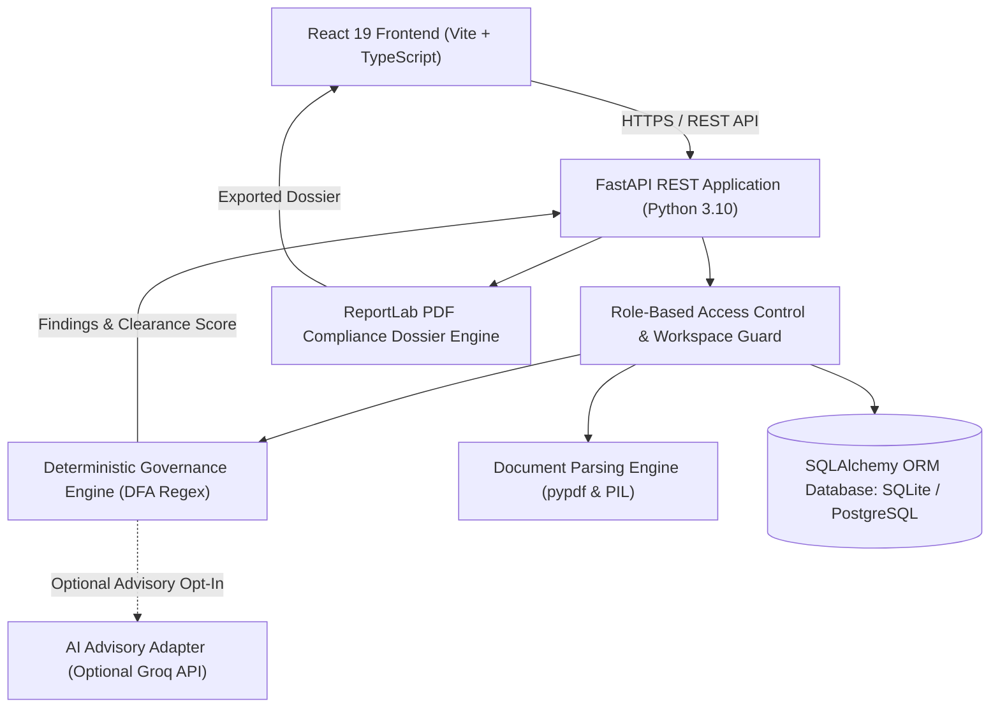

# 11 — SYSTEM ARCHITECTURE
**Platform:** BRANDTRACE
**Status:** **VERIFIED IMPLEMENTED**

---

## 1. High-Level Architecture Overview

BRANDTRACE is built as a modular, decoupled full-stack enterprise application. It strictly separates deterministic governance checks from downstream generative AI advisories.

---

## 2. Core Subsystems

1. **Presentation Tier:** Built with React 19, TypeScript, and Vite. Implements static HTML prerendering for instantaneous first paint.
2. **API & Orchestration Tier:** FastAPI backend providing asynchronous ASGI endpoints, Pydantic data validation, and strict HTTP status contracts.
3. **Deterministic Governance Core:** Evaluates text against active Brand Constitution rules using pure-Python regex without external network calls.
4. **Data Persistence Tier:** SQLAlchemy abstraction layer supporting both local disposable SQLite engines and cloud-hosted PostgreSQL/Neon clusters.
5. **Compliance Exporter:** ReportLab engine dynamically compiling tamper-evident PDF dossiers with embedded cryptographic SHA-256 hashes.
