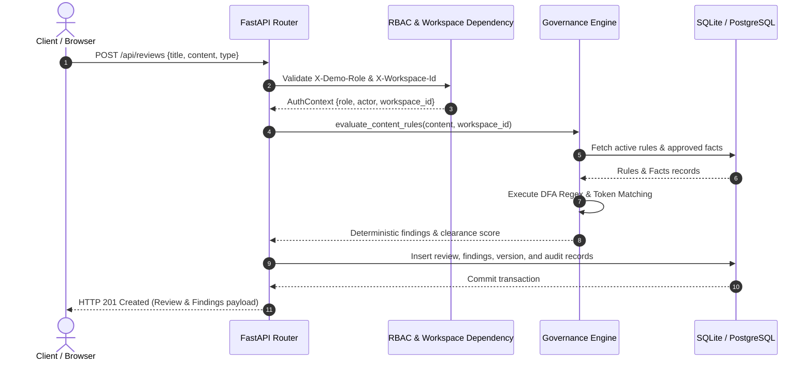

# 13 — BACKEND ARCHITECTURE & REQUEST LIFECYCLE
**Platform:** BRANDTRACE
**Status:** **VERIFIED IMPLEMENTED**

---

## 1. Request Lifecycle Diagram



---

## 2. Service Layer Organization

```
backend/app/
├── main.py                             # FastAPI application entry point & route definitions
├── models.py                           # SQLAlchemy metadata, schema definitions, and helpers
├── schemas.py                          # Pydantic v2 validation models & request/response contracts
├── governance.py                       # Core deterministic rule evaluation engine
├── image_analyzer.py                   # Multimodal visual analysis, Delta-E & WCAG contrast
├── pdf_parser.py                       # Digital PDF extraction via pypdf
├── ai_adapter.py                       # Downstream AI provider adapter (Groq API)
└── services/
    ├── guideline_importer.py           # Digital guideline PDF extraction & candidate rules
    ├── compliance_exporter.py          # Downloadable PDF & JSON compliance evidence dossiers
    ├── rule_conflict_detector.py       # Deterministic rule contradiction & overlap detection
    ├── expiry_monitor.py               # Multi-interval lookahead worker & re-review task engine
    └── visual_intelligence.py          # 64-bit dHash perceptual hashing & logo clearspace
```
