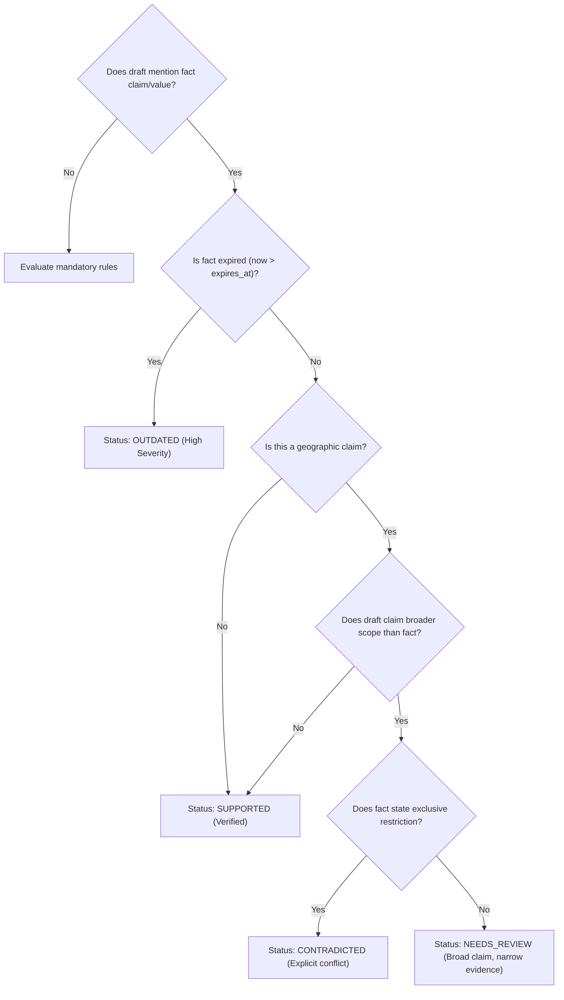

# The Approved Claim Ledger and Temporal Validity

## Purpose of the Corporate Claim Ledger

Marketing claims regarding geographic availability, market share, performance benchmarks, and compliance certifications must be grounded in verified corporate evidence. The **Approved Claim Ledger** (`facts` table) serves as BRANDTRACE's single source of truth for factual assertions. 

Rather than allowing authors or generative AI to synthesize unsubstantiated claims, every factual statement in publishable copy must correspond to an active, unexpired record in the ledger.

```
+--------------------------------------------------------------------------+
|                        APPROVED CLAIM LEDGER RECORD                      |
+--------------------------------------------------------------------------+
  - Fact ID: F-2026-01                   - Claim: "Product availability"
  - Approved Value: "Available in India" - Owner: "Product Marketing"
  - Source Title: "Launch brief"         - Source Excerpt: "BRANDTRACE is..."
  - Effective At: 2026-01-01             - Expires At: 2027-01-01
```

---

## Detailed Fact Entity Structure

* `id`: Unique identifier formatted by year and sequence (e.g., `F-2026-01`).
* `claim`: High-level topic or assertion category (e.g., "Product availability", "Uptime Guarantee").
* `value`: Authoritative approved claim statement (e.g., "Available in India").
* `owner`: Department or executive responsible for substantiating the claim.
* `status`: Operational state (`APPROVED`, `DRAFT`, `RETIRED`).
* `version`: Version identifier of the evidentiary backing (e.g., `2.0`).
* `source_id`: Reference identifier linking to an external documentation store or contract.
* `source_title`: Title of the source document (e.g., "Q4 Commercial Launch Brief").
* `source_excerpt`: Verifiable excerpt providing evidentiary proof.
* `effective_at`: UTC ISO timestamp marking the beginning of validity.
* `expires_at`: UTC ISO timestamp marking the hard expiration date of the evidence.

---

## Evidence Status Determination Logic

The Governance Engine evaluates copy against facts to determine one of five evidentiary states:



### Detailed Status Definitions
1. **`SUPPORTED`**: The draft text directly incorporates the verified fact value, and the fact is currently active (`now < expires_at`).
2. **`OUTDATED`**: The draft incorporates the claim, but the fact has passed its `expires_at` date. Reviewers are alerted that the claim must be re-substantiated or removed.
3. **`CONTRADICTED`**: The draft makes a statement that is explicitly refuted by an approved fact (e.g., claiming "Available across North America" when an exclusive fact states "Available exclusively in India").
4. **`NEEDS_REVIEW`**: The draft asserts a broader scope than what approved evidence substantiates, but no exclusive contradiction exists (e.g., claiming "Available globally" when evidence confirms only India).
5. **`UNSUPPORTED_BY_APPROVED_EVIDENCE`**: A mandatory fact or approved claim is missing from the required sections of the draft.

---

## Geographic Claim Classification Mechanics

A common failure mode in enterprise governance is treating broad claims as either completely verified or falsely contradicted. BRANDTRACE introduces nuanced geographic triage in `ai_adapter.py`:

### Broad vs. Narrow Scope Analysis
* Suppose the claim ledger contains Fact `F-2026-01`: `"Available in India"`.
* If a draft states: `"Brandtrace is available in India."` $\to$ **`SUPPORTED`**.
* If a draft states: `"Brandtrace is available globally."`:
  * **Incorrect naive check**: Marking this as `CONTRADICTED` is factually wrong; India is part of the globe, so availability in India does not prove lack of global availability.
  * **BRANDTRACE behavior**: The engine checks if any approved fact contains an *exclusive* territorial restriction (e.g., "only", "exclusively", "restricted to").
  * Since `F-2026-01` confirms India without asserting exclusivity, the engine assigns status **`NEEDS_REVIEW`**:
    > *"Broad territory claim 'globally' is not substantiated by the approved claim ledger. The relevant approved fact confirms India, which confirms a narrower region without establishing global availability."*

---

## Fact Updates and Impact Map Propagation

When a corporate fact reaches its expiration date or is retired:
* The fact status transitions to `EXPIRED` or `RETIRED`.
* The Claim Impact Map (`GET /api/governance/impact-map`) immediately flags all historical reviews whose content incorporates that fact or whose findings cite its ID.
* Brand administrators can trigger targeted re-review notifications (`POST /api/governance/re-review-impact`) without disrupting unrelated collateral.
