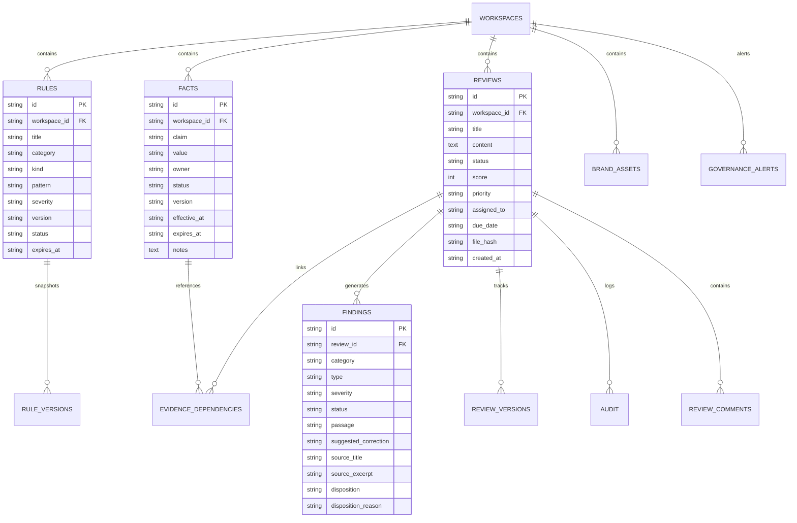

# 14 — DATABASE SCHEMA AND DATA DICTIONARY
**Platform:** BRANDTRACE
**Status:** **VERIFIED IMPLEMENTED**

---

## 1. Entity-Relationship Diagram

---

## 2. Table Inventory (All 16 Schema Tables)

1. `workspaces`: Multi-tenant organization boundaries.
2. `rules`: Brand Constitution policies across voice, terminology, and claims.
3. `rule_versions`: Immutable historical snapshots of modified rules.
4. `facts`: Corporate Claim Ledger entries with validity dates and owner attribution.
5. `reviews`: Content submissions with clearance scores and workflow states.
6. `findings`: Exact-span compliance violations linked to source rules and evidence.
7. `review_versions`: Content draft revision snapshots preserving author history.
8. `audit`: Append-only chronological event ledger with actor attribution.
9. `brand_assets`: Registered visual creative assets with SHA-256 binary hashes.
10. `brand_profiles`: Workspace brand design tokens and reference color palettes.
11. `rule_suggestions`: Telemetry-generated clarification proposals requiring admin gate.
12. `evidence_dependencies`: Bi-directional mapping between reviews, facts, and rules.
13. `guideline_candidate_rules`: Digital PDF extracted candidate rules awaiting approval.
14. `review_comments`: Collaborative reviewer discussion notes.
15. `governance_alerts`: Deduplicated proactive expiry notifications.
16. `governance_jobs`: Background worker execution tracking and retry ledger.
