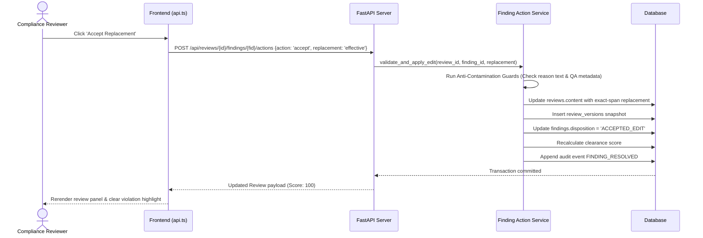

# 17 — API INTEGRATION AND CLIENT DATA FLOW
**Platform:** BRANDTRACE
**Status:** **VERIFIED IMPLEMENTED**

---

## 1. Client SDK Architecture

All frontend-to-backend communication is channeled through `src/services/api.ts`. The client provides:
- Automatic header injection: `X-Demo-Role` and `X-Workspace-Id`.
- Unified error parsing: Formats FastAPI HTTP 422 and 409 errors into user-friendly notifications.
- Typed response payloads: TypeScript interfaces mirror backend Pydantic models.

---

## 2. Finding Action Data Flow

