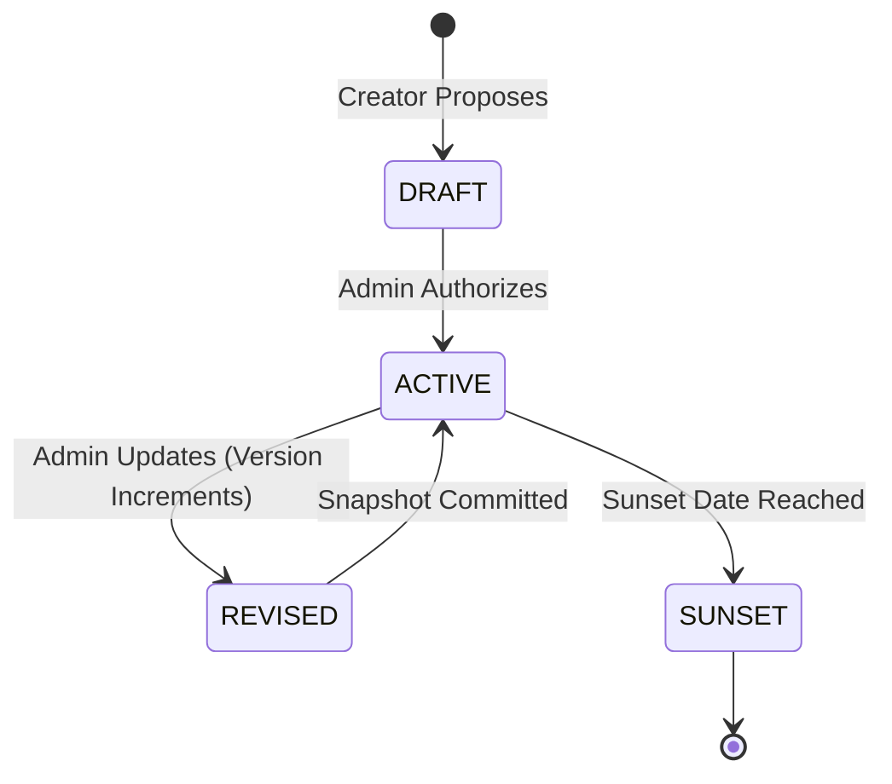

# 20 — BRAND CONSTITUTION AND POLICY MODEL
**Platform:** BRANDTRACE
**Status:** **VERIFIED IMPLEMENTED**

---

## 1. Policy Hierarchy

The Brand Constitution formalizes corporate brand standards into four discrete operational categories:
1. **Voice & Tone:** Prohibits hyperbolic superlatives (*"best"*, *"cheapest"*, *"guaranteed"*) without legal substantiation.
2. **Approved Terminology:** Enforces preferred corporate wording (*"accessible"* instead of *"cheap"*).
3. **Required Language:** Mandates essential brand identifiers (*"Brandtrace"* must appear in all product copy).
4. **Visual Identity:** Enforces hex color boundaries, contrast minimums, and approved logo variants.

---

## 2. Rule Lifecycle & Concurrency Control

Every rule update captures an immutable snapshot in `rule_versions`. When an administrator updates a rule, the backend verifies `expected_rule_version` to prevent concurrent administrative overwrites.
