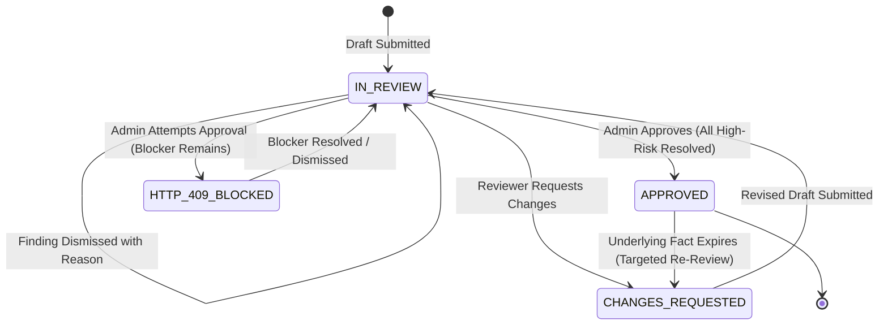

# 29 — HUMAN REVIEW & APPROVAL WORKFLOW
**Platform:** BRANDTRACE
**Status:** **VERIFIED IMPLEMENTED**

---

## 1. Approval State Machine

---

## 2. Server-Side Approval Enforcement

The approval transition is guarded at the HTTP API layer (`POST /api/reviews/{id}/approval`):
- If `disposition IS NULL` for any finding with `severity in ('HIGH', 'CRITICAL')`, the server aborts the transaction with **HTTP 409 Conflict**.
- The response body provides an explicit diagnostic message naming the blocking passage, policy violation, and requirement.
- Client-side state cannot override or forge this validation check.
