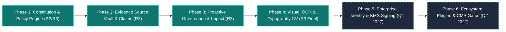

# 43 — PRODUCT ROADMAP & DEVELOPMENT LIFECYCLE (PHASES 1 TO 6)
**Platform:** BRANDTRACE Evidence-Linked Brand Governance
**Roadmap Status:** ✅ PHASES 1–4 COMPLETED & VERIFIED; PHASES 5–6 PLANNED
**Date:** October 31, 2026
**Target Milestone:** Enterprise Production GA & Ecosystem Federation

---

## 1. Executive Roadmap Summary

BRANDTRACE has successfully executed four major engineering phases, delivering thirty-six (36) production capabilities across deterministic governance, time-aware claim ledgers, visual brand intelligence, provider-independent OCR, typography compliance, and autonomous background monitoring.

Phases 5 and 6 define the enterprise development horizon, focusing on enterprise identity federation, hardware-backed cryptographic audit signing, and native design tool integrations.

---

## 2. Phase-by-Phase Engineering Breakdown

### Phase 1: Brand Constitution & Policy Engine (COMPLETED)
- **Status:** ✅ 100% Operational & Verified
- **Milestone Deliverables:**
  - Deterministic DFA regex rule evaluation engine (`backend/app/governance.py`).
  - Brand Constitution management API with bi-temporal version history (`rules`, `rule_versions`).
  - Exact-span passage highlighting and neutral replacement suggestions.
  - Reviewer friction telemetry, disagreement tracking, and health scoring.
  - Human-in-the-loop rule suggestion triage and activation workflow.

### Phase 2: Evidence Source Vault & Corporate Claim Ledger (COMPLETED)
- **Status:** ✅ 100% Operational & Verified
- **Milestone Deliverables:**
  - Corporate Claim Ledger with ISO-8601 UTC validity windows (`facts`, `fact_versions`).
  - Evidence source registry linking factual claims to primary documents.
  - Proactive 30-day `EXPIRING_SOON` and `EXPIRED` status evaluations.
  - Rule conflict detector scanning semantic overlap and polarity clashes (`rule_conflict_detector.py`).
  - Guideline Constitution PDF importer converting brand manuals into staging candidates (`guideline_importer.py`).

### Phase 3: Proactive Governance & Impact Tracking (COMPLETED)
- **Status:** ✅ 100% Operational & Verified
- **Milestone Deliverables:**
  - Directed Acyclic Graph (DAG) dependency mapping between facts and draft reviews (`impact_map.py`).
  - Targeted re-review execution transitioning affected approved reviews to `CHANGES_REQUESTED`.
  - Immutable append-only governance audit ledger (`audit` table).
  - Tamper-evident compliance evidence packet exports in JSON and formal PDF formats (`compliance_exporter.py`).
  - Collaborative threaded review comments (`review_comments`).

### Phase 4: Advanced Visual, OCR & Typography CV (COMPLETED)
- **Status:** ✅ 100% Operational & Verified
- **Milestone Deliverables:**
  - CIELAB $\Delta E$ perceptual color distance and WCAG 2.1 AA contrast math (`color_science.py`).
  - 64-bit difference hashing (`dHash`) perceptual similarity engine (`visual_intelligence.py`).
  - Provider-independent OCR pipeline for scanned PDFs and raster graphics (`ocr_service.py`).
  - Multi-scale OpenCV template matching for logo placement and bounding-box coordinates (`logo_detector.py`).
  - Measurable logo clearspace exclusion zone verification ($M \ge 0.5H$).
  - Embedded PDF font dictionary extraction and typography guideline compliance checks (`typography_analyzer.py`).
  - Daemon background scheduler for automated periodic expiry sweeps (`expiry_worker.py`).

---

## 3. Future Development: Enterprise Scaling (Phases 5 & 6)

### Phase 5: Enterprise Identity & Cryptographic Security (PLANNED — Q1 2027)
- **Status:** ⏳ In Architectural Planning
- **Scope & Deliverables:**
  - **Enterprise SSO Federation:** Native OpenID Connect (OIDC) and SAML 2.0 integrations with Okta, Azure Active Directory, and Ping Identity.
  - **Hardware Asymmetric Audit Signing:** Hardware Security Module (HSM) signing of exported compliance packets using AWS KMS or Google Cloud KMS asymmetric RSA-4096 / ECDSA keys.
  - **Per-Tenant Database Envelope Encryption:** Unique customer-managed encryption keys (CMEK) via AES-256-GCM for tenant database tables at rest.
  - **Granular RBAC Permission Matrix:** Custom role definitions beyond the four preset roles (Admin, Reviewer, Creator, Auditor).

### Phase 6: Ecosystem Extensions & Workflow Plugins (PLANNED — Q2 2027)
- **Status:** ⏳ In Architectural Planning
- **Scope & Deliverables:**
  - **Figma Design Plugin:** Desktop plugin inspecting active canvas selections for typography, color palette compliance, and logo clearspace exclusion zones in real time.
  - **Google Workspace Marketplace Add-on:** Live Google Docs and Slides sidebar validating claims against the corporate Claim Ledger during copy generation.
  - **Canva App Integration:** In-editor guardrails verifying brand assets and contrast ratios before creative export.
  - **Headless CMS Webhook Dispatcher:** Webhook connectors for Contentful, Strapi, and Sanity CMS to automatically gate publish workflows based on clearance status.
  - **CI/CD Build Action:** GitHub Action and GitLab CI runner to evaluate marketing copy repositories and static documentation sites against Brand Constitution rules.

---

## 4. Architectural Summary

| Phase | Core Theme | Capabilities | Status | Target Delivery |
| :--- | :--- | :---: | :---: | :---: |
| **Phase 1** | Constitution & Policy Model | 6 | ✅ Complete | Round 2 / Round 3 |
| **Phase 2** | Claim Ledger & Evidence Vault | 8 | ✅ Complete | Round 3 |
| **Phase 3** | Proactive Governance & Impact | 10 | ✅ Complete | Round 3 |
| **Phase 4** | Visual, OCR & Typography CV | 12 | ✅ Complete | Round 3 Final Release |
| **Phase 5** | Enterprise Identity & KMS | 4 | ⏳ Planned | Q1 2027 |
| **Phase 6** | Ecosystem Plugins & Integrations | 5 | ⏳ Planned | Q2 2027 |
