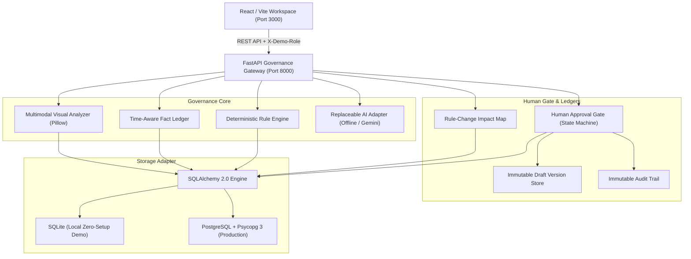
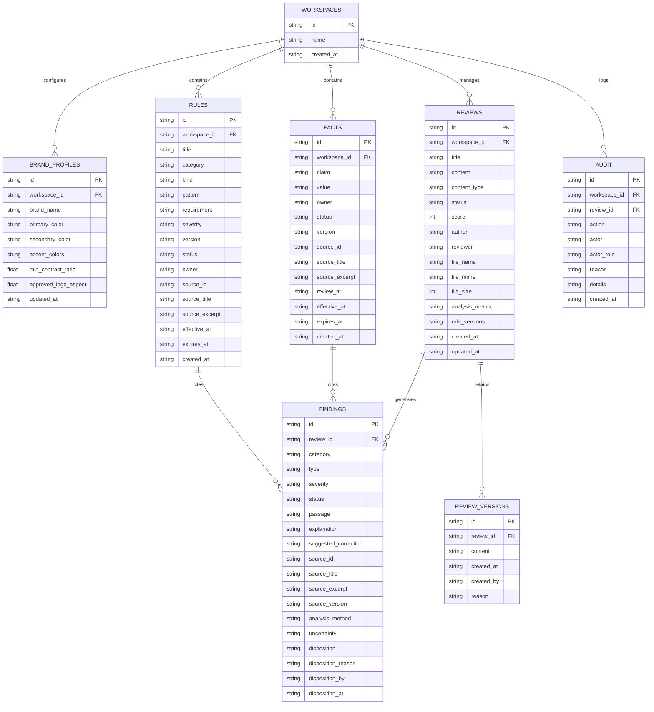

# BRANDTRACE System Architecture

BRANDTRACE is an evidence-linked brand governance platform for organizations managing content across multiple creators, agencies, and generative AI tools. It ensures that every published asset adheres to verified brand rules, fact ledgers, and visual standards through a deterministic-first engine backed by an immutable human approval gate.

---

## 1. Backend Modules & Responsibilities

| Module | Purpose |
|---|---|
| `app.main` | FastAPI application, CORS configuration, lifespan database initialization, and HTTP endpoints for reviews, brand constitution, approvals, insights, and file uploads. |
| `app.config` | Central environment-driven settings (database dialect normalization, CORS origins, payload bounds, AI provider options). |
| `app.models` | SQLAlchemy database engine, connection context manager, parameterized execution, schema migration, and audit logging helpers. |
| `app.schemas` | Pydantic request and response schemas enforcing strict typing and input validation. |
| `app.governance` | Unified governance analyzer orchestrating deterministic pattern matching, fact ledger validation, AI/offline triage, and health scoring. |
| `app.color_science` | W3C WCAG 2.1 relative luminance calculations (`(L1+0.05)/(L2+0.05)`) and CIELAB Delta-E (CIE76) perceptual colour difference math. |
| `app.pdf_parser` | Safe text-bearing PDF parsing via `pypdf`, page-boundary preservation (`[Page N]`), and empty/scanned document failure handling. |
| `app.image_analyzer` | Safe image loading via Pillow, dominant palette extraction via quantization, brand palette distance check, contrast verification, logo aspect check, and honest OCR limitation reporting. |
| `app.ai_adapter` | Replaceable model adapter interface with `OfflineProvider` (deterministic BM25/keyword triage) and `GeminiProvider` (server-side REST API with strict citation validation). |
| `app.impact_map` | Time-aware dependency analysis linking expired or updated facts/rules to historical drafts for targeted re-review. |

---

## 2. Evidence Data Model & Relational Schema

All data access is mediated through SQLAlchemy with SQLite and PostgreSQL compatibility.

---

## 3. Evidence Distinction & Grounding Policy

Every finding returned by BRANDTRACE is categorized into one of five explicit evidence states:

1. **`SUPPORTED`**: The draft content exactly reflects an active approved fact or fulfills a mandatory brand guideline.
2. **`CONTRADICTED`**: The draft directly matches a prohibited term or contradicts an approved claim value.
3. **`OUTDATED`**: The cited rule or fact record exists in storage but has passed its `expires_at` validity window.
4. **`UNSUPPORTED_BY_APPROVED_EVIDENCE`**: The draft lacks required mandatory language or makes assertions on approved topics without backed evidence.
5. **`NEEDS_REVIEW`**: Model-assisted or offline triage detected an unverified promotional claim or potential issue. **Critically, no citation ID is hallucinated**; the citation remains `None` with an explicit uncertainty explanation until an authorized human reviews it.

---

## 4. Multimodal Governance Pipeline

- **Text & Markdown**: Direct regex and token-overlap evaluation.
- **PDF Documents**: Parsed with `pypdf`. Extracted text preserves page markers (`[Page 1]`, `[Page 2]`) for contextual grounding. Scanned PDFs without embedded text fail safely with a transparent notification that OCR is unconfigured.
- **Visual Assets (PNG/JPEG)**:
  - Validates image headers, sizes (max 10MB), and dimensions (max 4096×4096px).
  - Uses Pillow to extract the top dominant color palette.
  - Computes perceptual colour distance (CIELAB Delta-E CIE76) against approved brand colors; flags deviations exceeding tolerance (Delta-E > 15.0).
  - Calculates W3C WCAG 2.1 relative luminance contrast ratios for dominant foreground/background pairs; flags pairs below the 4.5:1 standard.
  - Tests logo fixture aspect ratio tolerances.
  - Transparently checks Tesseract OCR availability and outputs a structured limitation notice rather than a false pass.

---

## 5. Role-Based Permissions & Human Approval Gate

Simulated roles are transmitted via `X-Demo-Role` and verified server-side:
- **`creator`**: May submit drafts, accept corrections, and make manual edits. Cannot dismiss findings without reviewer authorization, and cannot approve or waive reviews.
- **`reviewer`**: May evaluate findings, accept edits, edit manually, dismiss findings with documented reasons, escalate findings, approve compliant drafts, and grant waivers with reasons.
- **`brand_admin`**: Full administrative authority; may configure brand rules, facts, and visual profiles, as well as approve and waive reviews.
- **`auditor`**: Strict read-only access to drafts, versions, audit ledgers, and governance insights. Mutative operations return `403 Forbidden`.

### Server-Side Approval Invariant
A draft **cannot** be approved or waived while any `HIGH` or `CRITICAL` finding remains undisposed. The backend returns a strict `409 Conflict` if approval is attempted prematurely.
