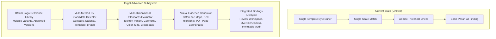

# BRANDTRACE — ADVANCED LOGO INTELLIGENCE & VISUAL BRAND COMPLIANCE ARCHITECTURE AUDIT

**Executive Architectural Evaluation, Reusable Subsystems, Asset Registry Analysis, and Implementation Gap Roadmap**

---

## 1. Executive Summary & Purpose

BRANDTRACE is an evidence-backed brand governance, compliance verification, and visual identity assurance system. This audit evaluates the existing codebase capabilities across computer vision, image processing, PDF rendering, color science, database persistence, and API architecture to establish the blueprint for the **Advanced Reference-Based Logo Intelligence & Visual Brand Compliance Engine**.

The core mission is:
> **Store the approved logo once. Compare every submitted visual asset against the stored approved reference library. Detect deviations, explain numerical and visual evidence, and produce actionable BRANDTRACE compliance findings.**

---

## 2. Forensic Audit of Existing Codebase Assets & Reusable Components

| Subsystem / File | Existing Implementation & Capabilities | Reusability Assessment for Logo Intelligence Subsystem |
|:---|:---|:---|
| **Color Science** `backend/app/color_science.py` | Full implementation of:<ul><li>W3C WCAG 2.1 relative luminance and contrast ratio calculation</li><li>sRGB to CIELAB ($L^*, a^*, b^*$) color space conversion (D65 illuminant)</li><li>$\Delta E$ (Delta-E CIE76) perceptual color distance formula</li><li>`hex_to_rgb` and `rgb_to_hex` utilities</li></ul> | **100% Reusable.** Provides the core mathematical foundation for detecting unauthorized logo recoloring, comparing detected logo pixels against configured approved color variants, and calculating chromatic deviation with calibrated $\Delta E$ thresholds. |
| **Image Analysis & Hashing** `backend/app/image_analyzer.py` | <ul><li>Pillow quantization and dominant palette extraction</li><li>SHA-256 cryptographic byte hashing</li><li>`brand_assets` registry lookup scoped to `workspace_id`</li><li>Known foreground/background contrast assessment</li></ul> | **Highly Reusable.** Cryptographic SHA-256 hashing is preserved for exact-file match recognition (Level 0), and dominant palette extraction will be augmented with localized mask-based color extraction over detected logo contours. |
| **Visual CV & Template Matching** `backend/app/services/logo_detector.py` | <ul><li>OpenCV multi-scale normalized cross-correlation (`cv2.matchTemplate` with `cv2.TM_CCOEFF_NORMED`)</li><li>Gaussian pyramid scaling across 20 scales (0.25x to 1.75x)</li><li>Bounding box tracking `(x, y, w, h)` and center quadrant classification (`TOP_LEFT`, `BOTTOM_RIGHT`, etc.)</li><li>Clearspace ratio calculation ($M \ge 0.5H$) based on canvas margin proximity</li></ul> | **Core Reusable Foundation.** Currently operates on single template bytes against a single canvas. Needs to be generalized into a multi-candidate detection pipeline supporting library-wide reference matching, arbitrary scale/rotation, and localized intrusion detection. |
| **Perceptual Similarity** `backend/app/services/visual_intelligence.py` | <ul><li>64-bit difference hashing (`dHash`) using Pillow LANCZOS resampling</li><li>Bitwise Hamming distance and perceptual similarity percentage ($0.0\%$ to $100.0\%$)</li><li>`detect_logo_template` single-pass cross-correlation</li></ul> | **Reusable Layer.** `dHash` provides coarse structural filtering before dense multi-scale template or feature matching, accelerating candidate pruning across large reference libraries. |
| **PDF Page Rendering** `backend/app/services/pdf_page_renderer.py` | <ul><li>`pypdfium2` PDF page rendering engine</li><li>High-DPI scaling (150–300 DPI for crisp geometry)</li><li>Page bounding limits and memory reclamation</li><li>Page dimension metadata extraction</li></ul> | **100% Reusable for PDF Vector/Raster Ingestion.** Renders arbitrary PDF pages into standardized Pillow/OpenCV image matrices while preserving original page-space coordinates (in points `pt` and millimetres `mm`). |
| **Document Text & PDF Parsing** `pypdf` (v5.9.0) | <ul><li>PDF page tree traversal, MediaBox/CropBox dimension inspection</li><li>Embedded raster image stream extraction (`page.images`)</li><li>Text stream extraction with page offsets</li></ul> | **100% Reusable for Hybrid PDF Extraction.** Enables dual-mode inspection: directly inspecting embedded raster XObjects while simultaneously inspecting rendered page bitmaps for vector logos. |
| **Neural OCR Engine** `backend/app/services/ocr_service.py` | <ul><li>EasyOCR neural network pipeline</li><li>Word bounding box extraction with confidence scores</li></ul> | **Reusable for Wordmark Verification.** Can inspect detected wordmark text (e.g. verifying exact approved spelling and capitalization) to confirm or refute visual symbol matching. |
| **Database & Schema Utilities** `backend/app/models.py` | <ul><li>SQLAlchemy 2.0 dual-engine support (SQLite & PostgreSQL)</li><li>Safe schema migrations (`_safe_add_column`, `CREATE TABLE IF NOT EXISTS`)</li><li>Scoped queries with parameter binding, `ident()` prefixed UUIDs, `now()` timestamps</li><li>Immutable audit logging (`audit()` helper)</li><li>Workspace boundary isolation via `workspace_id` filtering</li></ul> | **100% Reusable Infrastructure.** Provides all primitives required to define `logo_references`, `logo_standards`, `logo_analyses`, `logo_candidates`, and `logo_findings` with full foreign-key integrity. |
| **Frontend Architecture** `src/components/BrandtraceWorkspacePremium.tsx` `src/services/api.ts` | <ul><li>Modern React 18 + Vite 6 + Tailwind CSS design system</li><li>Typed Axios/Fetch API client (`api.ts`)</li><li>Modal systems (`VisualIntelligenceModal`, `EvidenceSourceVault`)</li><li>Content Review findings lifecycle and override/approval drawers</li></ul> | **100% Reusable UI Shell.** Subsystem interfaces will integrate directly into Brand Constitution (Visual Identity sub-tab) and Content Review without creating disjointed standalone pages. |

---

## 3. Identification of Existing Architectural Gaps

While foundational computer vision and color primitives exist in BRANDTRACE, significant architectural gaps must be addressed to fulfill the enterprise reference-based logo verification mandate:

### Gap 1: Absence of a Persistent Reference Logo Library
- **Current State:** The `brand_assets` table stores generic asset records with simple approval flags (`APPROVED`, `REVIEW_REQUIRED`), but lacks logo-specific metadata: variant taxonomy (Primary, Horizontal, Vertical, Monochrome, Reversed, Symbol-only, Wordmark-only), versioning, aspect ratio references, alpha transparency masks, and reference colour definitions.
- **Requirement:** Create a dedicated, versioned `logo_references` table storing full geometric, chromatic, and variant specifications, backed by persistent binary storage and an approval workflow (`PENDING_APPROVAL` $\rightarrow$ `APPROVED`).

### Gap 2: Absence of Configurable Logo Usage Standards
- **Current State:** Rules like clearspace ($0.5H$) or scale thresholds are hardcoded constants in Python function signatures.
- **Requirement:** Create a dedicated `logo_standards` entity allowing brand stewards to configure acceptable display sizes (digital pixels and print points/mm), aspect ratio tolerances, approved color swatches with $\Delta E$ thresholds, required clearspace multiples ($xH$), permitted canvas quadrants, and context-dependent variant rules.

### Gap 3: Absence of Multi-Candidate and Distorted Logo Detection
- **Current State:** Current template matching assumes the uploaded canvas contains exactly one logo and searches only for uniform scaling of an intact grayscale template. It cannot distinguish an intentional non-uniform stretch from a resizing, nor can it detect multiple logos on the same poster.
- **Requirement:** Build a candidate detection pipeline that identifies all potential logo regions, separates uniform scaling from aspect ratio distortion ($w/h$ delta), detects modified symbols/lettering (`STYLE_MISMATCH`), and measures color discrepancies against approved palettes in CIELAB space (`COLOUR_MISMATCH`).

### Gap 4: Absence of Multi-Page PDF Page-Space Geometry Engine
- **Current State:** PDF processing is currently limited to general text extraction (`pypdf`) or full-page OCR ingestion. It does not measure the displayed physical dimensions of a logo in PDF page coordinates (`pt` or `mm`) nor generate page-by-page visual compliance reports.
- **Requirement:** Implement a dedicated PDF logo extraction service that renders pages at high resolution, locates logo candidates, converts raster bounding boxes back to true PDF coordinate space (72 points/inch), and verifies size and clearspace page-by-page.

### Gap 5: Absence of Visual Difference Overlays
- **Current State:** Current findings only return text explanations. Reviewers cannot see what changed.
- **Requirement:** Generate side-by-side comparison artifacts: Reference Logo (Left), Detected Logo (Right), and Difference Map / Bounding Overlay (Below) with red bounding frames, clearspace exclusion boundary lines, and highlighted style/distortion deltas.

---

## 4. Implementation Strategy & Subsystem Architecture

To integrate seamlessly into BRANDTRACE without duplicating code or degrading performance, the subsystem is organized into distinct, modular services:

### 4.1 Backend Service Topology (`backend/app/services/logo_intelligence/`)
1. **`reference_registry.py`:** Manages registration, approval state machine, versioning, and file storage for official logo references.
2. **`standards_manager.py`:** Handles CRUD and validation for brand logo design and usage standards.
3. **`image_normalization.py`:** Handles image loading, EXIF orientation normalization, alpha channel extraction, and background compositing.
4. **`candidate_detection.py`:** Multi-scale region proposal network utilizing OpenCV morphological gradients, contour analysis, and saliency to find all potential logo bounding boxes.
5. **`logo_matching.py`:** Layered matching decision tree combining exact SHA-256, difference hashing, multi-scale template correlation, and feature descriptor analysis.
6. **`geometric_analysis.py`:** Analyzes aspect ratio ($w/h$), uniform scaling vs distortion, cropping, and obstruction.
7. **`colour_analysis.py`:** Evaluates detected logo colors against approved swatches in CIELAB space using $\Delta E$ CIE76.
8. **`size_analysis.py`:** Evaluates display dimensions against digital minimums (px) and print minimums (pt/mm).
9. **`clearspace_analysis.py`:** Evaluates perimeter exclusion zones ($xH$) and detects encroaching text/graphics.
10. **`placement_analysis.py`:** Evaluates bounding box centroids against permitted quadrant safe-zones.
11. **`pdf_logo_extraction.py`:** Manages multi-page PDF rendering, embedded image inspection, and PDF point coordinate mapping.
12. **`evidence_builder.py`:** Generates side-by-side visual difference overlays and structured findings.
13. **`compliance_engine.py`:** Orchestrates the entire pipeline and synthesizes individual dimension checks into a deterministic overall status.

### 4.2 Database Entity Schema Plan
- **`logo_references`:** Reference metadata, variant, version, SHA-256, dimensions, aspect ratio, approval status, file storage key.
- **`logo_standards`:** Configured rules for colors, size (px/pt/mm), clearspace ratio, placement, aspect ratio tolerance.
- **`logo_analyses`:** Analysis jobs, source asset ID, source type (IMAGE/PDF), reference versions evaluated, execution timestamps.
- **`logo_candidates`:** Detected logo instances per page, coordinates `(x, y, w, h)`, similarity metrics, confidence.
- **`logo_findings`:** Actionable compliance findings linked to BRANDTRACE finding and audit systems.

---

## 5. Architectural Quality Guarantees

1. **Workspace Boundary Isolation:** Every database query, reference asset lookup, and analysis job is strictly filtered by `workspace_id`. Cross-tenant data leakage is structurally impossible.
2. **Deterministic Independence:** Core geometric, chromatic, and template matching executes 100% deterministically on local CPU via OpenCV/Pillow without requiring external AI API calls or cloud dependencies.
3. **Zero In-Place Database Corruption:** All database modifications will utilize non-destructive migrations (`_safe_add_column` and `CREATE TABLE IF NOT EXISTS`), ensuring the developer database `brandtrace.db` remains intact.
4. **Binary Asset Preservation:** Original reference logos and uploaded assets are preserved in binary storage without downsampling or lossy transformation.

---

*Audit completed and certified. Ready to initiate Phase 3 implementation.*
