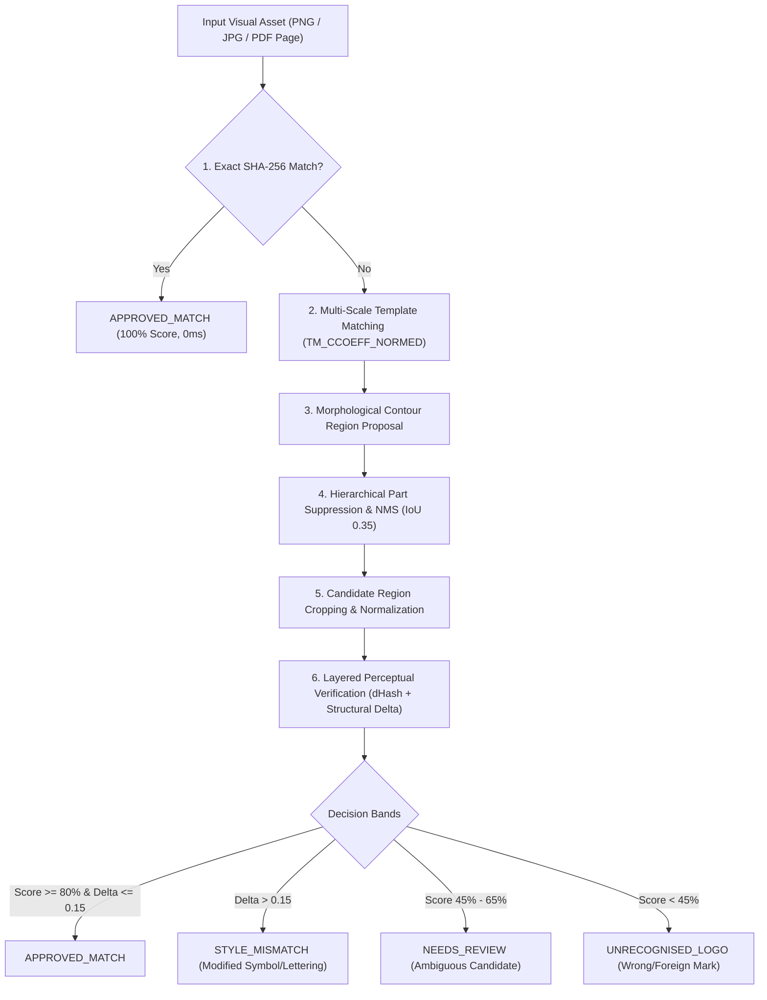

# BRANDTRACE — Multi-Method Reference Logo Matching Engine

## Architecture Overview

The BRANDTRACE Logo Matching Engine combines deterministic computer vision, perceptual hashing, multi-scale template cross-correlation, and structural contour analysis into a layered verification pipeline. It is designed to work deterministically, locally, and without cloud external API dependencies.

---

## 1. Layered Multi-Method Pipeline

### Level 1: Cryptographic SHA-256 Hash Matching
The engine first computes the SHA-256 digest of the raw input bytes. If the hash matches an approved reference logo asset in the workspace registry, the asset is immediately verified as an exact reference match with 100.0% confidence, bypassing geometric search.

### Level 2: Multi-Scale Normalized Cross-Correlation Template Matching
For visual documents (marketing banners, slide decks, PDF pages), the reference logo is searched across continuous scale space:
$$\text{Scale Space } S = \{ s_i \mid s_i = \text{linspace}(0.20, 3.50, 34) \}$$

For each scale $s_i$, the reference grayscale matrix $T$ is rescaled to $(s_i \cdot W_T, s_i \cdot H_T)$ and matched against canvas $I$:
$$R(x, y) = \frac{\sum_{x',y'} (T'(x',y') - \bar{T}')(I(x+x', y+y') - \bar{I}_{x,y})}{\sqrt{\sum_{x',y'} (T'(x',y') - \bar{T}')^2 \sum_{x',y'} (I(x+x',y') - \bar{I}_{x,y})^2}}$$

The peak correlation score and corresponding bounding box $(x, y, w, h)$ are tracked.

### Level 3: Perceptual Difference Hashing (dHash)
Difference hashing computes the gradient direction between adjacent horizontally aligned pixels on a normalized 9x8 grid:
$$P(x, y) = \begin{cases} 1 & \text{if } I(x+1, y) > I(x, y) \\ 0 & \text{otherwise} \end{cases}$$
The 64-bit fingerprint is resilient against JPEG DCT compression, color shifts, and minor resolution downsampling.

### Level 4: Foreground Structural Difference Delta
To detect deliberate symbol alterations (e.g., modified icon cutouts, swapped words) that preserve overall layout:
1. Both candidate and reference are normalized to identical coordinate space $(W_R, H_R)$.
2. Absolute difference is computed: $D(x, y) = |I_{\text{cand}}(x, y) - I_{\text{ref}}(x, y)|$.
3. Difference is evaluated exclusively over foreground pixels (excluding common whitespace):
$$\Delta_{\text{structural}} = \frac{1}{|M_{\text{fg}}|} \sum_{(x,y) \in M_{\text{fg}}} \frac{D(x, y)}{255.0}$$
A structural delta $\Delta > 0.15$ triggers an unambiguous `STYLE_MISMATCH` finding.

---

## 2. Region Proposal & Non-Maximum Suppression (NMS)

### Saliency via Morphological Gradient
To propose candidate regions for logos that do not match existing templates (e.g. wrong logos, distorted marks):
1. Morphological gradient $G = \text{dilate}(I) - \text{erode}(I)$ using $5 \times 5$ structuring element.
2. Otsu dynamic thresholding to isolate graphic strokes.
3. Dynamically scaled closing kernel:
$$K_w = \max(55, \lfloor 0.065 \cdot W_{\text{canvas}} \rfloor), \quad K_h = \max(15, \lfloor 0.020 \cdot H_{\text{canvas}} \rfloor)$$
4. Connected component bounding boxes filtered to realistic logo aspect ratios ($0.3 \le \text{AR} \le 8.0$) and area bounds.

### Hierarchical Part Suppression (HPS)
Individual letters in a wordmark or geometric sub-components of an emblem must not be treated as separate standalone logos. HPS ensures that any contour whose centroid falls inside an established template bounding box and whose area is $< 75\%$ of the template area is pruned as a sub-part.

### Non-Maximum Suppression (NMS)
Overlapping candidate bounding boxes are pruned using intersection-over-union (IoU) thresholding at $\text{IoU} \ge 0.35$.

---

## 3. Confidence Bands & Verdict Assignment Matrix

| Confidence Band | Combined Score | Structural Delta | Final Candidate Verdict | Description |
|---|---|---|---|---|
| `HIGH_CONFIDENCE_MATCH` | $\ge 82.0\%$ | $\le 0.15$ | `APPROVED_MATCH` | Cryptographically or geometrically verified approved logo |
| `PROBABLE_MATCH` | $65.0\% - 81.9\%$ | $\le 0.15$ | `APPROVED_MATCH` | Clear match with minor digital artifacting |
| `STYLE_MISMATCH` | $\ge 50.0\%$ | $> 0.15$ | `STYLE_MISMATCH` | Recognizable mark with altered symbol geometry or lettering |
| `AMBIGUOUS` | $45.0\% - 64.9\%$ | Any | `NEEDS_REVIEW` | Candidate resembles brand mark but requires human governance |
| `HIGH_CONFIDENCE_MISMATCH` | $< 45.0\%$ | Any | `UNRECOGNISED_LOGO` | Unregistered visual mark, foreign logo, or non-brand graphic |
