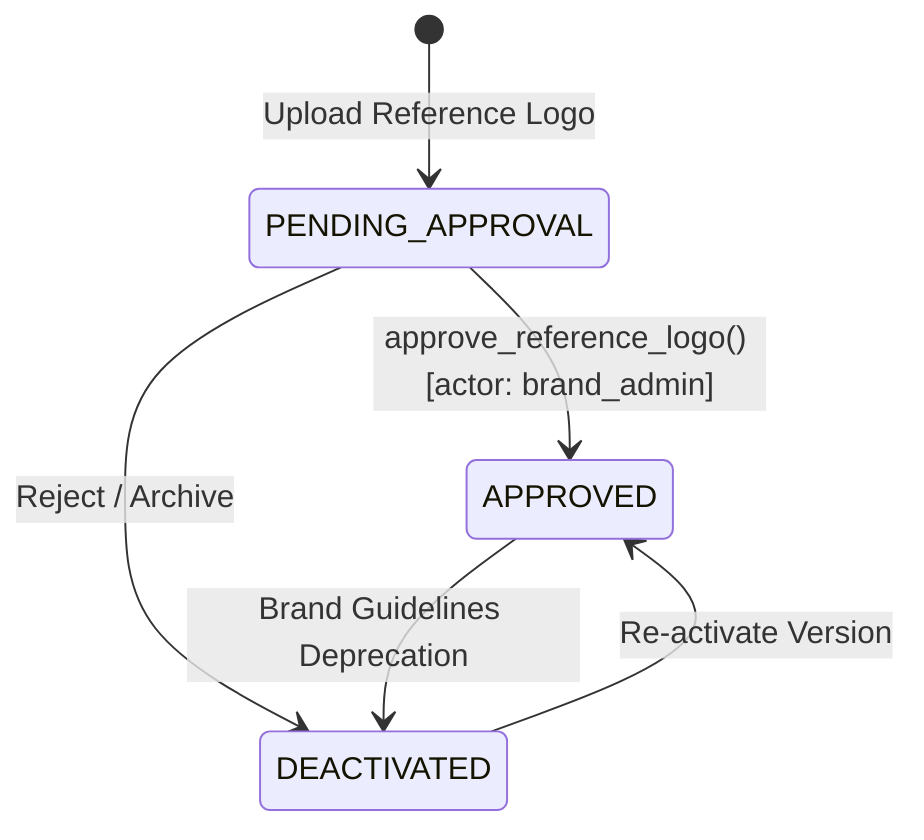

# BRANDTRACE — Official Logo Reference Library Architecture & Specification

## Executive Overview

The **Official Logo Reference Library** is the authoritative source-of-truth subsystem inside BRANDTRACE for storing, categorizing, approving, and querying cryptographic and visual representations of an organization's approved brand marks.

The core principle of BRANDTRACE is:
> **"Store the approved logo once. Compare every submitted visual asset against the stored approved reference library. Detect deviations, explain numerical and visual evidence, and create actionable BRANDTRACE findings."**

---

## 1. Reference Asset Data Model & Schema

Every reference logo is persisted in the `logo_references` database table with its raw high-resolution binary stored in isolated workspace filesystem storage (`storage/logo_references/{workspace_id}/{ref_id}.{ext}`).

### Database Schema

```sql
CREATE TABLE IF NOT EXISTS logo_references (
    id TEXT PRIMARY KEY,
    workspace_id TEXT NOT NULL DEFAULT 'ws_default',
    name TEXT NOT NULL,
    category TEXT NOT NULL DEFAULT 'primary',     -- 'primary', 'subbrand', 'partner', 'endorsement'
    variant TEXT NOT NULL DEFAULT 'horizontal',   -- 'horizontal', 'vertical', 'symbol', 'monochrome', 'reversed', 'partner_lockup'
    storage_path TEXT NOT NULL,
    original_filename TEXT NOT NULL,
    original_hash TEXT NOT NULL,                  -- SHA-256 hex digest
    file_size INTEGER NOT NULL,
    mime_type TEXT NOT NULL,
    width INTEGER NOT NULL,
    height INTEGER NOT NULL,
    aspect_ratio REAL NOT NULL,                   -- Normalized width / height (e.g. 3.000)
    has_transparency INTEGER NOT NULL DEFAULT 1,  -- 1 if alpha channel contains transparent pixels
    primary_color_hex TEXT,                       -- Dominant primary brand color
    secondary_color_hex TEXT,                     -- Dominant secondary brand color
    dominant_colors_json TEXT NOT NULL DEFAULT '[]', -- Array of hex color strings
    approval_status TEXT NOT NULL DEFAULT 'PENDING_APPROVAL', -- 'PENDING_APPROVAL', 'APPROVED', 'DEACTIVATED'
    version TEXT NOT NULL DEFAULT '1.0',
    owner_id TEXT NOT NULL DEFAULT 'demo.brand_admin',
    description TEXT,
    usage_notes TEXT,
    created_at TEXT NOT NULL,
    approved_at TEXT,
    approved_by TEXT
);
```

---

## 2. Multi-Variant Classification Matrix

Organizations rarely have a single logo mark. Modern brand systems require specialized lockups for different contexts, backgrounds, and aspect ratios:

| Variant Key | Intended Usage | Aspect Ratio Profile | Permitted Canvas Backgrounds |
|---|---|---|---|
| `horizontal` / `primary` | Master desktop website header, horizontal letterheads, billboard footers | Standard wide (2.5 to 4.5) | Light backgrounds (luminance > 0.8) |
| `vertical` / `stacked` | Mobile navbars, vertical signage, square app cards | Compact (0.8 to 1.3) | Light backgrounds |
| `symbol` / `icon` | Favicons, social avatars, watermarks, app icons | Square (1.000) | Any high-contrast background |
| `monochrome` | Single-color black/slate documents, thermal printing, faxes | Matches parent geometry | High-contrast light backgrounds |
| `reversed` | Dark-mode interfaces, dark presentation slides, black merchandise | Matches parent geometry | Dark backgrounds (luminance < 0.2) |
| `partner_lockup` | Joint press releases, co-branded sponsorship banners | Ultra-wide (4.5 to 7.0) | Neutral backgrounds |

---

## 3. Approval Lifecycle & Governance State Machine

To enforce strict governance, newly uploaded logos do not automatically become active verification references unless explicitly approved by an authorized `brand_admin` or `compliance_officer`.



### Lifecycle Rules:
1. **Verification Exclusion:** Assets in `PENDING_APPROVAL` or `DEACTIVATED` states are excluded from active visual compliance verification runs.
2. **Version Awareness:** When a new guideline update is registered (e.g. rebrand from v1.0 to v2.0), the older reference is deactivated, preventing false non-compliance flags on archived documents while ensuring all new documents adhere to v2.0.
3. **Audit Trail:** Every approval transition emits a durable audit event in `audit_events` with timestamp, actor ID, and cryptographic SHA-256 proof.

---

## 4. Multi-Tenant Workspace Storage Isolation

Storage directories are strictly partitioned by `workspace_id`:
```
storage/logo_references/
├── ws_default/
│   ├── lref_primary_01.png
│   ├── lref_mono_02.png
│   └── lref_reversed_03.png
└── ws_tenant_enterprise_beta/
    └── lref_custom_01.png
```

Cross-workspace queries are prohibited at the database query layer (`WHERE workspace_id = ?`). Tests verify that registering a logo in `ws_alpha` cannot be accessed, matched, or modified from `ws_beta`.

---

## 5. REST API Specifications

### `GET /api/logo-intelligence/references`
List all reference logos for the authenticated workspace.
- **Headers:** `x-workspace-id: ws_default`
- **Query Params:** `status_filter=APPROVED` (optional)
- **Response:** `200 OK` with JSON array of `LogoReferenceItem`.

### `POST /api/logo-intelligence/references`
Upload and register a new reference logo.
- **Form Data:**
  - `file`: Raw binary image (PNG, SVG, JPG, WebP)
  - `name`: Reference title (e.g. "Nexus Master Horizontal")
  - `variant`: `horizontal` | `vertical` | `symbol` | `monochrome` | `reversed`
  - `category`: `primary` | `subbrand` | `partner`
  - `auto_approve`: `true` | `false`
- **Response:** `201 Created` with initialized record and default standards.

### `POST /api/logo-intelligence/references/{id}/approve`
Activate reference for compliance matching.
- **Response:** `200 OK` with updated `approval_status: "APPROVED"`.

### `POST /api/logo-intelligence/references/{id}/deactivate`
Retire reference from active compliance verification.
- **Response:** `200 OK` with updated `approval_status: "DEACTIVATED"`.
