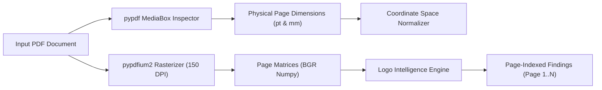

# BRANDTRACE — Multi-Page PDF Document Logo Analysis Engine

## Overview

BRANDTRACE features a native, deterministic multi-page PDF processing pipeline that extracts pages, analyzes visual marks, measures real physical print dimensions, and attributes compliance findings to exact page numbers.

---

## 1. Multi-Page PDF Extraction Pipeline



### High-Fidelity In-Memory Rasterization
1. **Engine:** `pypdfium2` native bindings.
2. **Resolution:** Rendered at 150 DPI (2.0x scale factor relative to standard 72 pt/inch desktop display).
3. **Zero Disk I/O:** Pages are rendered directly into in-memory BGRA/BGR NumPy arrays, preventing temporary file accumulation and disk performance bottlenecks.

---

## 2. Dual Coordinate Space & Physical Dimensions

Digital raster matrices alone cannot verify whether a logo satisfies print guidelines (e.g. "Logo must be at least 18 mm wide on formal letterheads").

BRANDTRACE inspects the PDF MediaBox using `pypdf` to obtain exact user-space dimensions in typographic points ($\text{pt}$), where $1\text{ pt} = \frac{1}{72}\text{ inch}$:

### Coordinate Mapping Formulations

$$\text{Scale}_X = \frac{\text{Page Width}_{\text{pt}}}{W_{\text{render\_px}}}, \quad \text{Scale}_Y = \frac{\text{Page Height}_{\text{pt}}}{H_{\text{render\_px}}}$$

$$\text{Position: } X_{\text{pt}} = X_{\text{px}} \cdot \text{Scale}_X, \quad Y_{\text{pt}} = Y_{\text{px}} \cdot \text{Scale}_Y$$

$$\text{Dimensions: } W_{\text{pt}} = W_{\text{px}} \cdot \text{Scale}_X, \quad H_{\text{pt}} = H_{\text{px}} \cdot \text{Scale}_Y$$

$$\text{Millimeters: } W_{\text{mm}} = W_{\text{pt}} \times 0.352778, \quad H_{\text{mm}} = H_{\text{pt}} \times 0.352778$$

### Stored Candidate Coordinate Structure
```json
{
  "x_pt": 36.0,
  "y_pt": 36.0,
  "width_pt": 144.0,
  "height_pt": 48.0,
  "width_mm": 50.8,
  "height_mm": 16.93,
  "page_width_pt": 612.0,
  "page_height_pt": 792.0
}
```

---

## 3. Page-Indexed Finding Attribution

Findings are never lumped into an undifferentiated document score. Every finding specifies:
- `page_number`: 1-based index corresponding to the PDF document layout.
- `visual_overlay_region_json`: Pixel bounding box on the rendered page canvas.
- `page_space_coords_json`: Physical print coordinates in points and millimeters.

### Multi-Page Enforcement Policy (`enforce_on_every_page`)
When mandated by brand standards, the engine validates that every page in a multi-page document features an authorized logo:
- Pages omitting the required mark receive a `MISSING_REQUIRED_LOGO` finding.
- Pages featuring distorted or unapproved marks receive targeted page-specific violations.
