# BRANDTRACE — ULTIMATE FULL-STACK PRODUCT AUDIT

**Audit Date:** 2026-10-31  
**Auditor:** Principal Software Architect, Senior Full-Stack Engineer & QA Director  
**Evaluation Standard:** Zero-Assumption Full-Stack Verification & Real User Journey Audit  
**Workspace:** `C:\Projects\BRANDTRACE\BRANDTRACE`  
**Repository:** `https://github.com/bindudharad/BRANDTRACE`  

---

## 1. Executive Architecture Summary

BRANDTRACE is an evidence-linked brand governance platform that combines deterministic policy evaluation, time-aware corporate claim validation, multimodal visual inspection, and human-in-the-loop decision-making.

```mermaid
flowchart TD
    subgraph Client["Frontend (React 19 / Vite / Tailwind / Lucide)"]
        Hero["BrandtraceHero (3D & Product Showcase)"]
        Workspace["BrandtraceWorkspacePremium"]
        subgraph Views["Workspace Views"]
            V_Overview["Overview Dashboard"]
            V_Const["Brand Constitution & Vault"]
            V_Review["Content Review Studio"]
            V_Queue["Approval Queue"]
            V_Audit["Audit History & Versions"]
            V_Insights["Governance Insights & Impact Map"]
            V_Help["Help, Demo & Judge Tour"]
        end
        APIClient["src/services/api.ts (Central API Gateway)"]
    end

    subgraph Server["Backend (Python 3.10 / FastAPI / Uvicorn)"]
        MainRouter["FastAPI Application (backend/app/main.py)"]
        subgraph Services["Core Specialized Engine Services"]
            GovEngine["governance.py (Deterministic Matching & Findings)"]
            DocParser["pdf_parser.py & fileExtractor.ts (Multi-format Ingestion)"]
            OCRService["ocr_service.py & groq_vision_ocr.py (Pure-Python / Hybrid OCR)"]
            ColorScience["color_science.py & visual_intelligence.py (CIELAB Delta-E, WCAG 2.1)"]
            LogoDetector["logo_detector.py (Aspect Ratio & Clearspace Detection)"]
            TypoAnalyzer["typography_analyzer.py (Font Family & Hierarchy Compliance)"]
            ConflictDetector["rule_conflict_detector.py (Dual-Rule Conflict Scanner)"]
            ImporterService["guideline_importer.py (PDF Candidate Extraction)"]
            ExpiryWorker["expiry_monitor.py & expiry_worker.py (30-day Proactive Monitor & Background Worker)"]
            ExporterService["compliance_exporter.py (Court-Ready Evidence PDF/JSON Packets)"]
            ImpactEngine["impact_map.py (Directed Dependency Graph Engine)"]
            AIAdapter["ai_adapter.py & groq_content_analyzer.py (Advisory-Only AI Fallback)"]
        end
    end

    subgraph Storage["Database & Persistence"]
        DB[(PostgreSQL / SQLite: 21 Canonical Tables)]
        Models["backend/app/models.py (Schema & Raw SQL Layer)"]
    end

    Hero --> Workspace
    Workspace --> Views
    Views --> APIClient
    APIClient --> MainRouter
    MainRouter --> Services
    Services --> Models
    Models --> DB
```

---

## 2. Frontend Pages, Navigation & Components

The application is structured around a top-level React router/state coordinator in [`src/App.tsx`](../src/App.tsx) and two primary presentation containers:

1. **`BrandtraceHero`** ([`src/components/BrandtraceHero/`](../src/components/BrandtraceHero/)):
   - Interactive 3D presentation (`FrogHero3D.tsx`)
   - Interactive Architecture Map node inspection
   - Live System Status health pill (`SystemStatus.tsx`)
   - Role simulation triggers (`JudgeAccessModal.tsx`)
   - Primary Call to Action buttons: "Open Workspace", "Enter the Workspace", "Take Judge Tour"
   - Hash-based deep links: `#overview`, `#constitution`, `#review`, `#queue`, `#audit`, `#insights`, `#tour`.

2. **`BrandtraceWorkspacePremium`** ([`src/components/BrandtraceWorkspacePremium.tsx`](../src/components/BrandtraceWorkspacePremium.tsx)):
   - Unified workspace shell with enterprise header, persistent left navigation, active role badge, and role switcher.
   - Manages 7 primary views:
     - **Overview:** Executive KPI cards, governance score gauge, high-risk draft table, source health overview, quick actions.
     - **Brand Constitution:** Tabbed repository covering Rules, Claim Ledger (Facts), Evidence Source Vault, Brand Asset Registry, and Visual Brand Standards Profile.
     - **Content Review:** Dual-mode studio for fresh document review (direct text paste or PDF/Image upload) and detailed evidence finding inspection, inline manual remediation, replacement acceptance, dismissal with reasons, reviewer assignment, and collaboration comments.
     - **Approval Queue:** Human-gated release queue filtering reviews in `IN_REVIEW` or `CHANGES_REQUESTED`. High-risk blockers prevent client-side bypass; backend validates server-side gates.
     - **Audit History:** Append-only timeline of review actions, version snapshots, and historical draft rollback.
     - **Governance Insights:** Analytics, recurring violation patterns, rule disagreement telemetry, interactive SVG impact dependency map, targeted re-review execution, and human-gated rule clarification proposals.
     - **Help & Demo:** Step-by-step judge tour, sample test data loader, deterministic rule explanations, fail-closed demo reset button with production guards.

---

## 3. Registered Backend Routes (69 Endpoints)

FastAPI application in [`backend/app/main.py`](../backend/app/main.py) registers 69 functional API endpoints across 11 functional domains:

| Category | Route Count | Key Endpoints | Primary Responsibility |
| :--- | :---: | :--- | :--- |
| **System & Health** | 5 | `/api/health`, `/api/ready`, `/api/overview`, `/api/insights`, `/api/bootstrap` | Liveness, database connectivity probe, overview aggregation |
| **Demo Setup / Guard** | 2 | `/api/demo/setup`, `/api/demo/reset` | Initial pristine seed data; fail-closed reset secret in production |
| **Brand Constitution (Rules)** | 5 | `/api/rules`, `/api/rules/{id}`, `/api/rules/{id}/versions`, `/api/rules/check-conflicts` | Rule CRUD, optimistic concurrency versioning, pre-flight conflict check |
| **Claim Ledger (Facts)** | 4 | `/api/facts`, `/api/facts/{id}`, `/api/facts/{id}/versions` | Factual assertions, validity date windows, evidence excerpts, version history |
| **Content Review Pipeline** | 10 | `/api/reviews`, `/api/reviews/upload`, `/api/reviews/{id}`, `/api/reviews/{id}/findings/...`, `/api/reviews/{id}/approval`, `/api/reviews/{id}/restore/...`, `/api/reviews/{id}/audit`, `/api/reviews/{id}/versions`, `/api/reviews/{id}/assignment`, `/api/reviews/{id}/comments` | Text & file review submission, finding actions, approval gate, revision rollback, reviewer assignment, threaded comments |
| **Visual Brand Assets** | 6 | `/api/brand-assets`, `/api/brand-assets/{id}`, `/api/brand-assets/{id}/similarity`, `/api/brand-assets/placement-check`, `/api/brand-profile` | SHA-256 asset registry, perceptual similarity, logo placement detection, brand colors & contrast |
| **Document Intelligence & OCR**| 2 | `/api/documents/ocr`, `/api/documents/typography-check` | Standalone bounded OCR pipeline, font family & heading hierarchy validator |
| **Evidence Source Vault** | 5 | `/api/evidence-sources`, `/api/evidence-sources/{id}` | Independent evidence records, verification status, document hashes, URL references |
| **Guideline Importer** | 6 | `/api/constitution/import-guidelines`, `/api/constitution/imports`, `/api/constitution/imports/{id}/candidates`, `/api/constitution/candidates/{id}`, `/api/constitution/candidates/{id}/approve`, `/api/constitution/candidates/{id}/reject` | PDF guideline extraction, candidate review workflow, human-gated activation |
| **Governance Intelligence & Expiry** | 10 | `/api/governance/impact-map`, `/api/governance/re-review-impact`, `/api/governance/guideline-health`, `/api/governance/rule-suggestions`, `/api/governance/rule-suggestions/{id}`, `/api/governance/rule-suggestions/{id}/activate`, `/api/governance/rule-conflicts`, `/api/governance/expiry-alerts`, `/api/governance/expiry-alerts/{id}/acknowledge`, `/api/governance/expiry-scan` | Impact graph, surgical re-review, reviewer disagreement telemetry, 30-day proactive expiry alerts, alert acknowledgment |
| **Expiry Background Worker** | 4 | `/api/governance/expiry-worker/trigger`, `/api/governance/expiry-worker/status`, `/api/governance/expiry-worker/start-scheduler`, `/api/governance/expiry-worker/stop-scheduler`, `/api/governance/expiry-jobs` | Recurring background scan worker, scheduler start/stop controls, execution job history |
| **Compliance Evidence Export** | 1 | `/api/reviews/{id}/export-evidence` | Cryptographic court-ready PDF and JSON evidence packet export |
| **Multi-Workspace Members** | 4 | `/api/workspaces`, `/api/workspaces/{id}/members`, `/api/workspaces/{id}/members/{actor_id}` | Multi-tenant workspace scoping and member administration |

---

## 4. Database Models & Schema Layer (21 Tables)

All schema definitions in [`backend/app/models.py`](../backend/app/models.py) support both PostgreSQL and SQLite dialect translation with parameterized query generation:

1. `workspaces`: Tenant workspace identifier and display name.
2. `workspace_members`: Actor-to-workspace mapping with role (`brand_admin`, `reviewer`, `creator`, `auditor`).
3. `system_state`: System-wide bootstrap metadata and background scheduler configuration.
4. `rules`: Brand governance rules (pattern, requirement, severity, status, version, owner).
5. `rule_versions`: Historical snapshots of modified rules with author, reason, and timestamp.
6. `facts`: Corporate claims ledger (claim, value, validity window, verification status, owner).
7. `fact_versions`: Historical versions of changed corporate facts.
8. `evidence_sources`: Independent evidence vault records with SHA-256 hashes, URLs, verification status, and page citations.
9. `evidence_dependencies`: Bi-directional tracking linking specific rule/fact versions to content reviews.
10. `reviews`: Document reviews with scores, status (`IN_REVIEW`, `CHANGES_REQUESTED`, `APPROVED`, `WAIVED`), assigned reviewer, priority, and due date.
11. `review_versions`: Historical working copy drafts of document reviews.
12. `findings`: Line-item compliance findings with passages, explanations, suggested corrections, dispositions, and status (`SUPPORTED`, `CONTRADICTED`, `OUTDATED`, `UNSUPPORTED_BY_APPROVED_EVIDENCE`, `NEEDS_REVIEW`).
13. `review_comments`: Reviewer collaboration comments linked to specific reviews and findings.
14. `audit`: Append-only audit trail logging every action, actor, role, review ID, reason, and timestamp.
15. `brand_profiles`: Visual brand guidelines (primary, secondary, accent colors, contrast ratio, logo aspect).
16. `brand_assets`: Cryptographic binary asset registry with SHA-256 hash, license status, and approval status.
17. `constitution_imports`: Session log for uploaded guideline documents.
18. `imported_rule_candidates`: Extracted candidate rules/facts awaiting human administrative approval.
19. `rule_suggestions`: Telemetry-driven rule clarification suggestions citing reviewer disagreement patterns.
20. `governance_alerts`: Proactive 30-day expiry notifications and rule conflict warnings.
21. `governance_jobs`: Audit log of recurring background expiry scan executions.

---

## 5. Audit of Gaps, Hidden Features & Integration Status

Our static and dynamic code analysis uncovered **11 backend capabilities that lacked frontend API bindings** and **several advanced capabilities that had API bindings but lacked discoverable user interfaces**:

### A. Missing Frontend API Mappings (11 Endpoints in `src/services/api.ts`):
1. `POST /api/documents/ocr`: Not exposed in `api.ts`.
2. `POST /api/documents/typography-check`: Not exposed in `api.ts`.
3. `POST /api/brand-assets/placement-check`: Not exposed in `api.ts`.
4. `GET /api/governance/expiry-worker/status`: Not exposed in `api.ts`.
5. `POST /api/governance/expiry-worker/start-scheduler`: Not exposed in `api.ts`.
6. `POST /api/governance/expiry-worker/stop-scheduler`: Not exposed in `api.ts`.
7. `POST /api/workspaces`: Not exposed in `api.ts`.
8. `GET /api/workspaces/{workspace_id}/members`: Not exposed in `api.ts`.
9. `POST /api/workspaces/{workspace_id}/members`: Not exposed in `api.ts`.
10. `DELETE /api/workspaces/{workspace_id}/members/{actor_id}`: Not exposed in `api.ts`.
11. `POST /api/bootstrap`: Not exposed in `api.ts` (Appropriate as internal system endpoint).

### B. Mapped in `api.ts` but Unconnected in UI:
1. `api.checkAssetSimilarity` (`GET /api/brand-assets/{id}/similarity`): Brand asset registry listed assets and supported deletion, but offered no UI trigger to compare perceptual similarity between two assets.
2. `api.triggerExpiryWorker` (`POST /api/governance/expiry-worker/trigger`) & `api.expiryJobs` (`GET /api/governance/expiry-jobs`): Background automated worker execution and job history had no UI monitoring dashboard.
3. `api.checkRuleConflicts` (`POST /api/rules/check-conflicts`): Real-time pre-flight conflict detection existed in backend, but rule creation modal only checked conflicts after saving.
4. `api.updateEvidenceSource` & `api.deleteEvidenceSource` (`PUT / DELETE /api/evidence-sources/{id}`): Evidence vault supported creation and viewing, but lacked inline Edit and Delete action controls.
5. `api.updateAsset` (`PUT /api/brand-assets/{id}`): Asset metadata (license, approval status, notes) had no edit dialog.

### C. UI/UX Workflow Deficiencies:
1. **Typography & Font Compliance:** Users uploading brand guidelines or documents could not trigger an explicit typography audit against approved brand fonts.
2. **Logo Placement & Clearspace:** Logo boundary and aspect ratio compliance was only executed implicitly during generic image review; no standalone placement tool existed.
3. **Standalone OCR Extraction Tool:** Scanned documents were handled via review upload, but users wanting to inspect extracted text and OCR confidence had no dedicated preview canvas.
4. **Automated Expiry Scheduler Controls:** Administrators had no visibility into scheduler status, interval configuration, or job execution history.

---

## 6. Codebase Hygiene & Search Results

A rigorous codebase-wide scan for technical debt keywords yielded the following results:
* `TODO`: **0 occurrences**
* `FIXME`: **0 occurrences**
* `NotImplementedError`: **0 occurrences**
* `dummy`: **0 occurrences**
* `coming soon`: **0 occurrences**
* `not connected`: **0 occurrences**
* `console.log`: **0 occurrences** in production frontend code
* `placeholder`: **73 occurrences**, all verified as valid HTML form input placeholders.
* `mock`: **7 occurrences**, verified as test mocks and configuration fallback strings.
* `disabled`: **70 occurrences**, verified as security safeguards (`ALLOW_DEMO_RESET=false` in production) and standard HTML button state bindings (`disabled={busy}`).

---

## 7. Deployment & Persistence Risks

1. **Deployment Divergence:** The live Render cloud backend and Vercel cloud frontend currently run a previous release. Manual redeployment from `origin/main` is required to activate newly implemented routes on the live cloud URLs.
2. **Database Integrity:** Local SQLite database `brandtrace.db` has 221,184 bytes and was verified 100% untouched. All integration tests strictly execute on isolated disposable databases.
3. **Data Safety Standard:** No production records or seed reviews are ever mutated or reset during testing.
