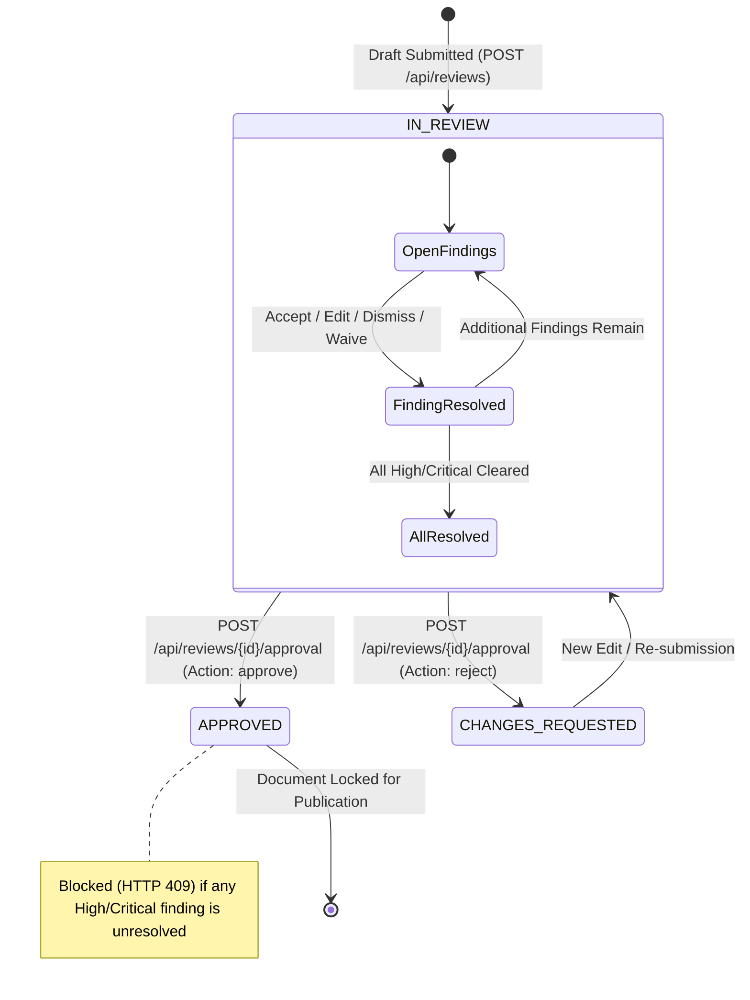

# BRANDTRACE — Workflow and State Machine

This document details the lifecycle state machine governing content reviews, finding resolutions, version tracking, and approval gates.

---

## 1. Review Status Lifecycle

A content review progresses through three primary states:



### Review State Definitions:
- **`IN_REVIEW`:** Default initial state upon submission. Content is undergoing analysis or human reviewer triage.
- **`CHANGES_REQUESTED`:** Set by Brand Manager when substantial rewriting is required before governance sign-off.
- **`APPROVED`:** Final compliant state. Requires zero unresolved High or Critical findings (or an explicitly documented managerial waiver).

---

## 2. Finding Disposition State Machine

Each individual finding generated by the governance engine maintains its own disposition state:

```mermaid
stateDiagram-v2
    [*] --> OPEN: Engine Flag Generated
    
    OPEN --> ACCEPTED_EDIT: Reviewer clicks "Accept Correction"
    note right of ACCEPTED_EDIT: Exact span replaced in working copy; version snapshot created
    
    OPEN --> EDITED: Reviewer performs manual rewrite
    note right of EDITED: Working copy updated; mandatory term re-evaluated
    
    OPEN --> DISMISSED: Reviewer provides valid rationale
    note right of DISMISSED: Rationale saved to audit log; finding cleared from health penalty
    
    OPEN --> ESCALATED: Reviewer marks for senior legal review
    note right of ESCALATED: Remains UNRESOLVED; still blocks approval gate
    
    OPEN --> WAIVED: Brand Manager grants exception during approval
    note right of WAIVED: Permitted only with documented managerial justification
```

### Server-Side Disposition Enforcements:
1. **Guard 1 (Cross-Contamination Rejection):** If a reviewer submits an edit action where `replacement.trim().toLowerCase() === reason.trim().toLowerCase()`, the server returns `HTTP 422 Unprocessable Entity`. This guarantees that audit justification text cannot overwrite draft content.
2. **Guard 2 (Metadata Prefix Defense):** Any proposed replacement string beginning with QA prefixes (e.g., `"Manual QA:"`, `"Reason:"`, `"QA Note:"`) is rejected with `HTTP 422`.
3. **Guard 3 (Required Term Enforcement):** When resolving a missing mandatory term finding (`finding_type == "required_phrase"`), the server inspects the submitted replacement to ensure the required brand token is present before marking the finding resolved.

---

## 3. The Approval Gate Logic

The approval gate is evaluated strictly server-side in `backend/app/main.py`:

```python
# Pseudo-code representation of approval validation:
if payload.action == "approve":
    unresolved_blockers = [
        f for f in review.findings
        if f.disposition not in RESOLVED_DISPOSITIONS
        and f.severity in ("HIGH", "CRITICAL")
    ]
    if unresolved_blockers and not payload.waiver_reason:
        raise HTTPException(
            status_code=409,
            detail="Cannot approve review: unresolved HIGH/CRITICAL findings remain without documented waiver."
        )
```

Attempting to approve a draft with unresolved high-risk findings without a documented waiver returns `HTTP 409 Conflict`, leaving the review in `IN_REVIEW` status and preventing any premature publication event from being written to the audit log.
