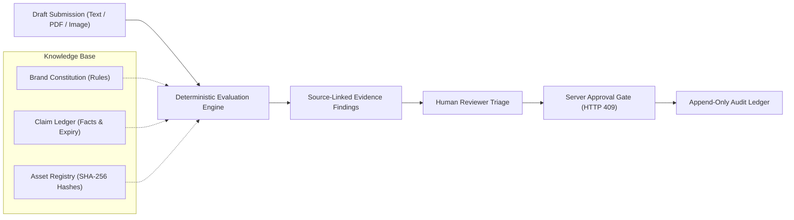

# 01 — Project Overview

## Purpose

This document provides a comprehensive, high-level introduction to **BRANDTRACE** (Evidence-Aware AI-Assisted Brand Governance Platform). It outlines the core mission, target audience, foundational principles, delivered Round 3 commitments, technology stack, and verified operational state.

---

## Overview

Modern organizations produce brand and marketing communications across distributed teams: internal marketing departments, freelance copywriters, creative agencies, and generative AI content engines. When multiple parties generate copy and visual media without continuous governance, brand risk escalates:
- Prohibited superlatives and unauthorized guarantees reach customers.
- Marketing claims cite expired pricing, obsolete statistics, or unverified claims.
- Color palettes and visual assets drift from normative brand standards.
- Content approvals exist in fragmented emails or messaging threads without permanent provenance.

**BRANDTRACE** resolves this governance failure. Operating as an evidence-aware governance gateway, it inspects digital copy, PDF document text layers, and image assets *prior to publication*. Every finding is pinned to a verifiable source citation, and every decision is permanently recorded in an append-only audit trail.

> **Product Tagline:**
> *Every finding has a source. Every decision has an owner.*

---

## Core Product Capabilities

### 1. Deterministic Rule Matching
Scans submitted copy using exact-span pattern matching and regular expressions without black-box model drift. Violations are flagged with exact character offsets, severity ratings (`LOW`, `MEDIUM`, `HIGH`, `CRITICAL`), and neutral suggested corrections.

### 2. Time-Aware Claim Ledger
Stores corporate facts, statistical claims, and regulatory statements with explicit validity windows (`effective_at` to `expires_at`). Claims nearing expiration trigger `EXPIRING_SOON` states within 30 days; expired claims trigger `OUTDATED` and invalidation alerts.

### 3. Rule-Change Impact Map
Tracks dependencies between historical reviews and normative facts. When a fact expires or is amended, the Impact Map isolates affected historical drafts and enables targeted re-review, moving affected drafts to `CHANGES_REQUESTED`.

### 4. Multimodal Visual Brand Compliance
Validates brand imagery using binary SHA-256 hash matching against a tenant-isolated Brand Asset Registry (`brand_assets`). Analyzes dominant color palettes using CIELAB Delta-E (CIE76) color distance against approved brand profile hexes and assesses WCAG 2.1 relative luminance on known token pairs.

### 5. Server-Enforced Approval Gate
Blocks publication approvals via strict server-side logic (HTTP 409 Conflict) whenever unresolved `HIGH` or `CRITICAL` findings remain. Approvals require authorized human resolution: accepting an exact-span edit, manually editing the draft, or recording a justified dismissal reason.

### 6. Guideline-Health Intelligence
Aggregates reviewer friction and disposition divergence across reviews. Detects patterns where reviewers frequently dismiss or accept specific rules, calculates statistical confidence (`SUFFICIENT` vs `INSUFFICIENT`), and logs human-reviewed clarification suggestions without mutating live rules autonomously.

---

## Hackathon Round 3 Deliverables

BRANDTRACE successfully fulfilled all three core commitments established for Round 3:

| Commitment | Scope & Technical Deliverable | Implementation Verification |
| :--- | :--- | :--- |
| **Commitment 1** | **Time-Aware Claim Ledger & Impact Map** Fact `notes` field, ISO date validity bounds, 30-day `EXPIRING_SOON` window, and targeted re-review moving affected drafts to `CHANGES_REQUESTED`. | `backend/app/impact_map.py` `backend/tests/test_round3_claim_ledger.py` |
| **Commitment 2** | **Multimodal Visual Compliance & Asset Registry** SHA-256 exact binary matching on `brand_assets`, CIELAB Delta-E color distance, and WCAG 2.1 contrast math. | `backend/app/image_analyzer.py` `backend/tests/test_round3_visual.py` |
| **Commitment 3** | **Guideline-Health Intelligence & Suggestions** Reviewer disposition divergence tracking, confidence classification, and human-in-the-loop suggestion activation. | `backend/app/guideline_health.py` `backend/tests/test_round3_guideline_health.py` |

---

## Technology Stack Summary

- **Frontend:** React 19, TypeScript 5.8, Vite 6.2, Three.js 0.186 (3D Evidence Core), Tailwind CSS v4, Lucide Icons.
- **Backend:** Python 3.10+, FastAPI 0.115, Pydantic v2, Uvicorn ASGI.
- **Data Persistence:** SQLAlchemy 2.0 dual-dialect persistence: SQLite 3 for local development and tests; PostgreSQL (Neon serverless) for hosted staging.
- **Document & Media Processing:** `pypdf` for digital PDF text-layer extraction, Pillow (`PIL`) for image decoding and color analysis.
- **Testing & Verification:** Pytest (144 backend tests), Playwright (32 automated browser QA scenarios), isolated ephemeral test databases.

---

## Known Scope Boundaries & Limitations

To maintain uncompromising truth in technical documentation, BRANDTRACE clearly defines its non-implemented capabilities:
1. **Raster OCR:** Scanned PDF OCR and bitmap text extraction are **Not implemented / Deferred**. Text extraction is supported exclusively on digital PDFs containing a valid text layer.
2. **Logo Placement Detection:** Bounding-box object positioning and perceptual logo recognition are **Not implemented / Deferred**. Visual asset verification uses exact SHA-256 binary hash matching.
3. **Font Identification:** Rendered-text typeface classification is **Not implemented / Deferred**.
4. **Autonomous AI Governance:** BRANDTRACE never allows external AI models to alter brand policies autonomously. Suggestion triage and rule version activations require authenticated brand administrator sign-off.

---

## Related Documentation

- [02 — Problem Statement and Objectives](./02_PROBLEM_STATEMENT_AND_OBJECTIVES.md)
- [03 — Product Scope and Requirements](./03_PRODUCT_SCOPE_AND_REQUIREMENTS.md)
- [04 — System Architecture](./04_SYSTEM_ARCHITECTURE.md)
- [42 — Feature Limitations and Deferred Roadmap](./42_FEATURE_LIMITATIONS_AND_DEFERRED_ROADMAP.md)
