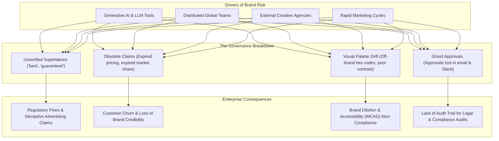

# 02 — Problem Statement and Objectives

## Purpose

This document details the real-world operational challenges in enterprise brand governance that **BRANDTRACE** is designed to solve, the systemic risks associated with unanchored content creation, and the measurable engineering objectives achieved by the system.

---

## The Enterprise Brand Governance Crisis

In multi-channel marketing, modern enterprises face an asymmetrical risk environment. Content output volume has increased exponentially through distributed authoring tools and generative AI, while governance mechanisms remain manual, fragmented, and vulnerable to errors:

### Specific Problem Vectors

1. **Inconsistent and Subjective Guidelines:**  
   Brand guidelines are typically distributed as dense, 80-page static PDFs. Reviewers interpret subjective phrases ("professional tone", "modern aesthetic") inconsistently, leading to arbitrary feedback and reviewer friction.
2. **Unanchored Factual Claims:**  
   Marketing copy often makes empirical assertions: *"Supported by 99.9% of global banks"* or *"Available across 50 countries"*. Reviewers lack a single source of truth to verify whether a claim is active, expired, or geographically limited.
3. **The 'Ghost Approval' Problem:**  
   When high-risk violations are overlooked or casually dismissed in chat channels, no audit record links the specific published draft to the reviewer who authorized the exception.
4. **Impact Invisibility on Policy Changes:**  
   When legal teams retire a claim or update a corporate fact, no mechanism exists to identify which published or pending assets rely on that obsolete statement.
5. **AI Hallucinations in Compliance Tools:**  
   Using generative LLMs directly as compliance judges introduces non-deterministic grading: the same draft evaluated twice may receive conflicting scores and hallucinatory policy citations.

---

## Core Product Objectives

BRANDTRACE was architected with six foundational engineering objectives:

### 1. Deterministic Exact-Span Evaluation
- **Objective:** Eliminate model drift and non-deterministic scoring from the core policy evaluation loop.
- **Solution:** Execute normative rules via regular expressions and substring pattern matchers. The engine locates exact passage character spans (`offset_start`, `offset_end`) and returns deterministic severity ratings (`LOW`, `MEDIUM`, `HIGH`, `CRITICAL`).

### 2. Time-Aware Evidence Traceability
- **Objective:** Prevent stale facts from lingering in active publications.
- **Solution:** Maintain an immutable Claim Ledger where every corporate assertion carries `effective_at` and `expires_at` ISO timestamps. Claims approaching their expiration date transition to `EXPIRING_SOON` within 30 days, alerting reviewers before violations reach print.

### 3. Server-Enforced Approval Gates
- **Objective:** Guarantee that drafts cannot be approved while severe compliance or factual violations remain unresolved.
- **Solution:** Implement a hard HTTP 409 Conflict barrier at the FastAPI service layer. The backend rejects approval requests unless every `HIGH` and `CRITICAL` finding has been formally resolved via an exact-span edit or an authorized, documented dismissal reason.

### 4. Continuous Dependency Mapping
- **Objective:** Provide immediate situational awareness when brand facts change.
- **Solution:** Construct a dynamic Claim Impact Map that cross-references `evidence_dependencies` across all stored reviews. Updating or retiring a fact immediately flags affected historical drafts and enables targeted re-review workflows.

### 5. Multimodal Brand Asset Registry
- **Objective:** Enforce visual asset integrity without complex perceptual ambiguity.
- **Solution:** Use exact binary SHA-256 hash matching against a tenant-isolated registry (`brand_assets`), pairing it with CIELAB Delta-E color distance calculations and WCAG 2.1 contrast math.

### 6. Reviewer-Guided Policy Evolution
- **Objective:** Prevent brand guidelines from remaining rigid and disconnected from real editorial usage.
- **Solution:** Telemetry engine aggregates reviewer friction, identifies rules with high dismissal or divergence rates, and generates human-reviewed clarification proposals without autonomous rule modification.

---

## Related Documentation

- [01 — Project Overview](./01_PROJECT_OVERVIEW.md)
- [03 — Product Scope and Requirements](./03_PRODUCT_SCOPE_AND_REQUIREMENTS.md)
- [15 — Deterministic Rule Engine](./15_DETERMINISTIC_RULE_ENGINE.md)
- [28 — Approval Gate and Governance Workflow](./28_APPROVAL_GATE_AND_GOVERNANCE_WORKFLOW.md)
