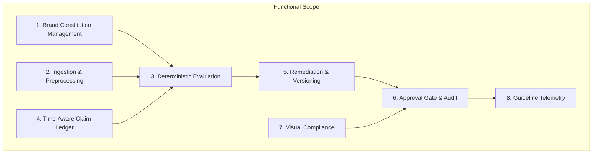

# 03 — Product Scope and Requirements

## Purpose

This document provides the definitive specification of functional and non-functional requirements implemented in **BRANDTRACE**, clearly delineating in-scope capabilities, out-of-scope capabilities, and delivered Round 3 commitments.

---

## Functional Requirements Matrix

| ID | Capability | Description | Status | Source Location |
| :--- | :--- | :--- | :---: | :--- |
| **FR-01** | Rule Repository | Create, edit, and version prohibited phrases, superlatives, and required terminology. | **Implemented** | `backend/app/main.py` `rules` table |
| **FR-02** | Text Ingestion | Direct marketing copy and Markdown input with length limits. | **Implemented** | `backend/app/main.py` `POST /api/reviews` |
| **FR-03** | PDF Ingestion | Digital PDF upload with text-layer extraction via `pypdf`. | **Implemented** | `backend/app/pdf_parser.py` `test_pdf_parser.py` |
| **FR-04** | Pattern Matching | Regular expression evaluation identifying exact character passage spans. | **Implemented** | `backend/app/governance.py` |
| **FR-05** | Claim Expiry | Fact validity tracking with `effective_at`, `expires_at`, and 30-day `EXPIRING_SOON` state. | **Implemented** | `backend/app/governance.py` `facts` table |
| **FR-06** | Exact-Span Edits | One-click replacement of flagged phrases preserving surrounding grammar. | **Implemented** | `src/components/BrandtraceWorkspace.tsx` |
| **FR-07** | Disposition Logging | Accepting edits or dismissing with mandatory justification string. | **Implemented** | `backend/app/main.py` `test_disposition_integrity.py` |
| **FR-08** | Revision Versioning | Full draft snapshots captured on every acceptance, edit, or rollback. | **Implemented** | `review_versions` table |
| **FR-09** | Approval Gate | Server-side block (HTTP 409) preventing sign-off when high-risk findings exist. | **Implemented** | `backend/app/main.py` `POST /api/reviews/{id}/approval` |
| **FR-10** | Immutable Audit Trail | Append-only event ledger logging actor, role, action, reason, and timestamp. | **Implemented** | `audit` table |
| **FR-11** | Asset Registry | SHA-256 binary hash matching for approved and restricted brand graphics. | **Implemented** | `backend/app/image_analyzer.py` `brand_assets` table |
| **FR-12** | Color Science | Pillow-based dominant color extraction and CIELAB Delta-E (CIE76) calculations. | **Implemented** | `backend/app/color_science.py` |
| **FR-13** | WCAG 2.1 Math | Relative luminance and contrast ratio calculations on supplied token pairs. | **Implemented** | `backend/app/color_science.py` |
| **FR-14** | Claim Impact Map | Cross-draft dependency tracking identifying drafts affected by expired facts. | **Implemented** | `backend/app/impact_map.py` |
| **FR-15** | Targeted Re-Review | User-triggered re-evaluation moving affected drafts to `CHANGES_REQUESTED`. | **Implemented** | `backend/app/main.py` `POST /api/governance/re-review-impact` |
| **FR-16** | Disagreement Telemetry| Statistical aggregation of reviewer acceptances, dismissals, and overrides. | **Implemented** | `backend/app/guideline_health.py` |
| **FR-17** | Suggestion Activation | Review and authorized activation of guideline clarification proposals. | **Implemented** | `backend/app/guideline_health.py` `rule_suggestions` table |
| **FR-18** | Workspace Multi-Tenancy| Scoping of all queries and asset registrations by `workspace_id`. | **Implemented** | `backend/app/models.py` `test_phase1_security_access_control.py` |

---

## Non-Functional Requirements (NFR)

1. **Deterministic Latency:** Deterministic rule scanning must complete in $< 100\text{ ms}$ for standard marketing text submissions ($< 50,000$ characters).
2. **Persistence Independence:** The platform must execute identically on local lightweight SQLite and cloud-hosted PostgreSQL without code alterations.
3. **Fail-Closed Security:** In production mode (`AUTH_MODE=strict`), unauthenticated or unassigned workspace requests must immediately fail with HTTP 401 or 403.
4. **Zero Hallucination Guarantee:** The core rule matching pipeline must never inject unverified AI text or hallucinate non-existent rule citations.
5. **Memory & Upload Bounds:** Uploaded image and PDF files are constrained to a strict 10 MB maximum limit (`MAX_UPLOAD_BYTES = 10485760`).
6. **Accessible UI:** Contrast badges and interactive controls must adhere to WCAG 2.1 Level AA color contrast standards ($4.5:1$ for normal text).

---

## Explicit Scope Exclusions & Deferred Roadmap

The following capabilities are explicitly documented as **Deferred / Not Implemented** in the current release:

- **Raster Image OCR:** Extracting text from flat JPEG/PNG images or scanned physical documents is deferred. Text extraction requires digital PDF files with native text layers.
- **Logo Placement & Bounding-Box Detection:** Automatic computer vision detection of logo coordinates, clear space, or minimum sizing is deferred. Visual asset integrity is enforced via SHA-256 byte matching.
- **Font Identification:** Identifying typeface names or font metrics from rendered raster imagery is deferred.
- **Automated Background Cron Worker:** Re-reviewing drafts on fact expiration occurs via user-triggered re-review requests, not continuous background polling daemons.
- **Autonomous Policy Mutation:** External AI models are strictly prohibited from writing directly to active brand rules.

---

## Related Documentation

- [01 — Project Overview](./01_PROJECT_OVERVIEW.md)
- [04 — System Architecture](./04_SYSTEM_ARCHITECTURE.md)
- [08 — API Reference](./08_API_REFERENCE.md)
- [42 — Feature Limitations and Deferred Roadmap](./42_FEATURE_LIMITATIONS_AND_DEFERRED_ROADMAP.md)
