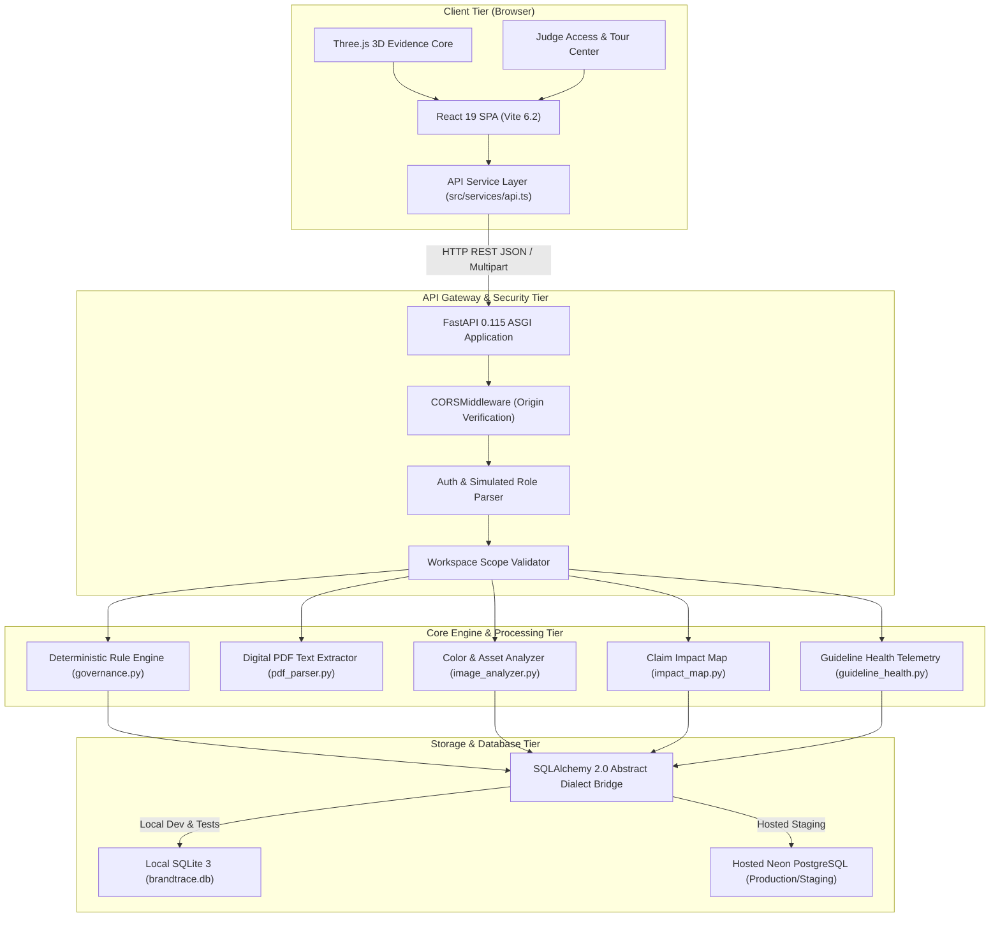
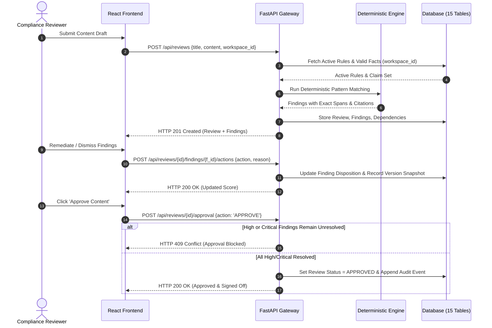

# 04 — System Architecture

## Purpose

This document details the high-level system architecture of **BRANDTRACE**, illustrating component boundaries, API communication protocols, processing pipelines, dual-database abstractions, and deployment topology.

---

## High-Level System Architecture

BRANDTRACE follows a decoupled client-server architecture. The frontend is a single-page application built on React 19, TypeScript, and Three.js, communicating over a structured REST API to a Python 3.10+ FastAPI backend.

---

## Component Responsibilities

### 1. Client Tier
- **Single Page Application:** Rendered via React 19 with Tailwind CSS v4 styling. Manages client-side navigation between the public landing page (`BrandtraceHero.tsx`) and the operational governance command center (`BrandtraceWorkspacePremium.tsx`).
- **Interactive 3D Evidence Core:** Built using Three.js (`EvidenceCore3D.tsx`). Implements an interactive 3D faceted Glass Icosahedron with 6 orbiting module satellites, raycasting selection, and an SVG fallback for environments lacking WebGL support.
- **Unified API Client:** Implemented in `src/services/api.ts`. Enforces header injection (`X-Demo-Role`, `X-Demo-Actor`, `X-Workspace-Id`), handles multipart file streams, and translates HTTP error statuses.

### 2. API Gateway & Security Tier
- **FastAPI Framework:** Handles asynchronous HTTP requests via Pydantic v2 data models.
- **Authentication & Role Context:** Evaluates caller identity. In production mode (`AUTH_MODE=strict`), verifies Bearer tokens and API keys against `workspace_members`. In local demonstration mode (`AUTH_MODE=demo`), parses simulated demo headers (`X-Demo-Role`) while preserving server-side access controls.
- **Tenant Scope Enforcement:** Injects `workspace_id` into all service layer calls. Prevents cross-workspace asset leakage, review access, or rule modification.

### 3. Service Layer
- **`governance.py`:** Central deterministic evaluation pipeline. Normalizes input text, executes regular expressions, measures character offsets, and cross-references active claims in the Claim Ledger.
- **`image_analyzer.py`:** Computes SHA-256 byte hashes, queries the `brand_assets` registry, extracts dominant colors via Pillow, and calculates CIELAB Delta-E (CIE76) distances against approved hex values.
- **`pdf_parser.py`:** Ingests digital PDF streams using `pypdf`, extracts UTF-8 text layers, rejects corrupted or encrypted payloads, and logs extraction warnings.
- **`impact_map.py`:** Traverses `evidence_dependencies` to identify which reviews depend on expired or modified facts.
- **`guideline_health.py`:** Aggregates reviewer friction (acceptances, dismissals, manual edits) across rules to surface statistical divergence and human-reviewable clarification suggestions.

### 4. Persistence Layer
- **Dual-Dialect SQLAlchemy Bridge:** Database access is abstracted through `backend/app/models.py`. The connection pool automatically normalizes `postgres://` connection strings to `postgresql://`, detects dialect capabilities, and compiles dialect-safe SQL syntax (e.g., SQLite `INSERT OR REPLACE` vs. PostgreSQL `ON CONFLICT DO UPDATE`).

---

## Data Flow: Content Review & Approval Gate

---

## Deployment & Hosting Topology

- **Frontend:** Hosted on **Vercel** via automated GitHub Git Integration on the `main` branch. Static assets are prerendered and served via Vercel's global Edge Network.
- **Backend:** Python FastAPI application executed via Uvicorn ASGI runner.
- **Database:** Hosted serverless **Neon PostgreSQL** database connected over secure TLS with connection pooling.

---

## Related Documentation

- [05 — Technology Stack](./05_TECHNOLOGY_STACK.md)
- [06 — Frontend Architecture](./06_FRONTEND_ARCHITECTURE.md)
- [07 — Backend Architecture](./07_BACKEND_ARCHITECTURE.md)
- [10 — Database Schema](./10_DATABASE_SCHEMA.md)
- [28 — Approval Gate and Governance Workflow](./28_APPROVAL_GATE_AND_GOVERNANCE_WORKFLOW.md)
