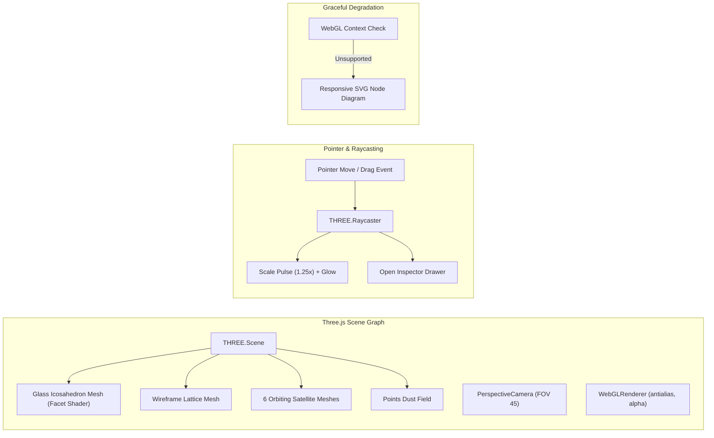

# 06 — Frontend Architecture

## Purpose

This document details the frontend architecture of **BRANDTRACE**, covering React component decomposition, TypeScript interfaces, state management patterns, 3D visualization systems, modal dialogs, and responsive design strategies.

---

## Component Hierarchy & Directory Organization

The frontend codebase is organized cleanly under `src/`:

```text
src/
├── components/
│   ├── 3d/
│   │   ├── EvidenceCore3D.tsx       # Three.js 3D Evidence Intelligence Core
│   │   └── EvidenceNetwork3D.tsx    # 8-stage interactive evidence chain
│   ├── analytics/
│   │   ├── GuidelineHealthMeters.tsx# Telemetry meters & disagreement rates
│   │   ├── InteractiveImpactGraph.tsx# Visual rule/fact dependency tree
│   │   ├── SeverityBarChart.tsx     # Finding severity distributions
│   │   └── WorkflowStepper.tsx      # Lifecycle progress indicator
│   ├── BrandtraceHero/
│   │   └── BrandtraceHero.tsx       # Dark obsidian landing page & architecture
│   ├── judge/
│   │   ├── JudgeAccessModal.tsx     # One-click persona switching & copyable headers
│   │   └── JudgeTourModal.tsx       # 8-step guided product tour
│   ├── navigation/
│   │   └── PremiumNavbar.tsx        # Glass-morphism sticky navbar
│   ├── BrandtraceWorkspacePremium.tsx # Dark command center workspace
│   └── BrandtraceWorkspace.tsx      # Core governance workspace implementation
├── services/
│   ├── api.ts                       # Typed REST client with header injection
│   ├── environment.ts               # Truthful environment classification service
│   ├── geminiSemanticEngine.ts      # Optional client-side Gemini fallback
│   └── webExtractor.ts              # URL content scraper utility
├── App.tsx                          # Root application component & view routing
├── main.tsx                         # React 19 entry point
└── index.css                        # Tailwind CSS v4 styling & dark theme tokens
```

---

## Primary Application Views

### 1. The Landing Experience (`BrandtraceHero.tsx`)
Rendered when users visit the root domain. Styled in an obsidian dark palette (`#070B12`, `#0C1420`, `#111D2A`) with emerald (`#00E6A0`) and cyan (`#00C8F0`) highlights:
- **Top System Strip:** Displays verified live backend status (`FastAPI Online · PostgreSQL Connected`), runtime environment label, and active database dialect.
- **Hero & 3D Core:** Integrates `EvidenceCore3D` alongside hero typography, direct CTAs (`Enter the Workspace`, `Take Judge Tour`, `Judge Access`), and live trust metrics.
- **Prominent Judge Access Banner:** Prompts evaluators with one-click credential configurations.
- **6-Stage Governance Lifecycle:** Explains Define $\to$ Ingest $\to$ Analyse $\to$ Inspect $\to$ Resolve $\to$ Approve.
- **Interactive System Architecture Map:** Responsive SVG diagram featuring 7 connected functional nodes with an interactive inspection drawer.
- **3D Evidence Network:** Step-by-step 8-stage provenance chain.
- **Round 3 Commitments Strip:** Summary of delivered capabilities with zero placeholder claims.

### 2. The Operational Command Center (`BrandtraceWorkspacePremium.tsx`)
The primary governance interface used by brand administrators, compliance reviewers, and content authors:
- **Collapsible Sidebar Navigation:** Provides access to all 9 operational panels:
  1. *Overview:* Executive telemetry, clearance scores, and active review cards.
  2. *Brand Constitution:* Normative rules repository with category filters.
  3. *Claim Ledger:* Timestamped factual claims with validity badges (`ACTIVE`, `EXPIRING_SOON`, `OUTDATED`).
  4. *Asset Registry:* Registered brand media with SHA-256 binary hash validation.
  5. *Content Review:* Ingestion form (Text / File / Image), review card list, and findings triage.
  6. *Visual Identity:* Brand profile color management and contrast ratings.
  7. *Governance Insights:* Guideline health telemetry, disagreement rates, and clarification proposals.
  8. *Impact Map:* Fact dependency graph highlighting historical drafts affected by policy updates.
  9. *Audit History:* Chronological, immutable event stream logging all actions.
- **Role Simulation Selector:** Enables evaluators to switch between `brand_admin`, `reviewer`, `creator`, and `auditor` with immediate permission boundary enforcement.

---

## 3D Graphics Architecture (`EvidenceCore3D.tsx`)



### Three.js Scene Implementation
1. **Geometric Core:** Renders a central `THREE.IcosahedronGeometry` with a semi-transparent dark glass material (`roughness: 0.15`, `metalness: 0.8`, `transmission: 0.6`). A matching wireframe lattice rotates at an inverse frequency.
2. **Orbiting Module Satellites:** Six spherical satellite meshes orbit the central core on distinct orbital planes:
   - Satellite 0: Brand Constitution (`#00E6A0`)
   - Satellite 1: Claim Ledger (`#00C8F0`)
   - Satellite 2: Deterministic Engine (`#8467FF`)
   - Satellite 3: Visual Compliance (`#00E6A0`)
   - Satellite 4: Approval Gate (`#FF657A`)
   - Satellite 5: Impact Map (`#FFB84D`)
3. **Controls & Animation Loop:** Supports mouse drag rotation, play/pause toggling, camera reset, and automatic raycasting hover highlighting.
4. **SVG Fallback:** If `gl.getExtension('WEBGL_depth_texture')` or the WebGL context fails, `EvidenceCore3D` renders a clean SVG fallback diagram with zero runtime console exceptions.

---

## State Management & API Communication

BRANDTRACE intentionally avoids heavy external state libraries (e.g., Redux) in favor of React 19's native hooks (`useState`, `useEffect`, `useCallback`) paired with a centralized API service (`src/services/api.ts`):
- **Simulated Role Context:** Persisted in `sessionStorage` (`bt_demo_role`, `bt_demo_actor`, `bt_active_ws`).
- **Automatic Header Injection:** `api.call()` automatically injects `X-Demo-Role`, `X-Demo-Actor`, and `X-Workspace-Id` on all outbound fetch requests.
- **Polling & Caching:** The environment status service (`src/services/environment.ts`) uses an observer subscriber pattern (`subscribeSystemStatus`) to broadcast backend readiness probes without redundant network calls.

---

## Accessibility & Responsive Design

- **WCAG AA Compliance:** Text contrast ratios on all card bodies and headings exceed $4.5:1$.
- **Reduced Motion Support:** Respects `prefers-reduced-motion: reduce` media queries by dampening orbital velocities in 3D scenes.
- **Viewport Adaptability:** Fully tested across 1920px (Desktop), 1366px (Laptop), 1024px (Tablet), and 390px/360px (Mobile) with zero horizontal scrollbar overflow.

---

## Related Documentation

- [04 — System Architecture](./04_SYSTEM_ARCHITECTURE.md)
- [05 — Technology Stack](./05_TECHNOLOGY_STACK.md)
- [37 — Frontend User Guide](./37_FRONTEND_USER_GUIDE.md)
- [38 — Judge Demonstration Guide](./38_JUDGE_DEMONSTRATION_GUIDE.md)
