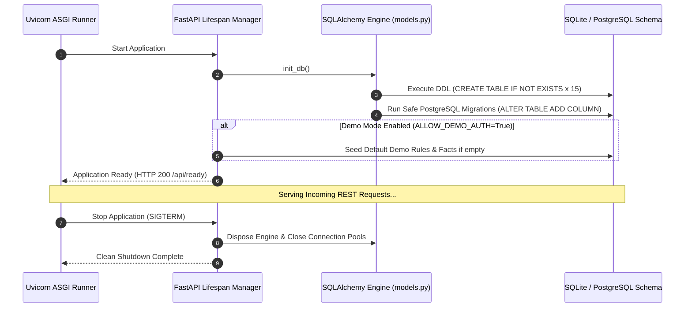

# 07 — Backend Architecture

## Purpose

This document provides a detailed breakdown of the **BRANDTRACE** backend architecture, covering the FastAPI application lifecycle, route modularity, service-tier implementation, request authentication, error handling, and database connection pooling.

---

## Directory Organization & Module Responsibilities

The backend source code resides under `backend/app/`:

```text
backend/app/
├── __init__.py
├── color_science.py       # CIELAB Delta-E (CIE76), WCAG luminance, RGB/Hex conversions
├── config.py              # Environment configuration & fail-closed defaults
├── governance.py          # Deterministic regular expression matching & scoring engine
├── guideline_health.py    # Disagreement detection & rule clarification suggestion logic
├── image_analyzer.py      # SHA-256 hash matching, palette extraction & asset registry
├── impact_map.py          # Claim dependency traversal & re-review state transitions
├── main.py                # FastAPI app initialization, routes, lifecycle & exception handlers
├── models.py              # SQLAlchemy 2.0 dual-dialect database bridge & SQL helpers
└── pdf_parser.py          # Digital PDF text-layer extraction via pypdf
```

---

## Application Lifespan & Initialization (`main.py`)

FastAPI uses an asynchronous `lifespan` context manager to manage application startup and shutdown:



1. **Schema Verification:** Calls `init_db()` on boot. Creates all 15 relational tables idempotently using `CREATE TABLE IF NOT EXISTS`.
2. **PostgreSQL Compatibility Migrations:** Automatically executes non-destructive column additions (e.g., adding `notes` to `facts` or `license_notes` to `brand_assets`) if upgrading from earlier schema versions.
3. **Dialect Normalization:** Automatically converts legacy `postgres://` URLs to `postgresql://` to satisfy SQLAlchemy 2.0 connection driver requirements.

---

## Service-Tier Module Breakdown

### 1. `governance.py` — Deterministic Policy Evaluation
- **No External LLM Dependency:** Executes normative rules purely through Python's `re` module and substring matching.
- **Span Extraction:** Uses `re.finditer` to locate start and end character offsets (`passage`), allowing the frontend to highlight exact text phrases.
- **Fact Matching:** Performs case-insensitive matching against active facts in the Claim Ledger. If a statement matches a fact whose `expires_at` timestamp is in the past, the finding is assigned status `OUTDATED`. If an empirical statement lacks verified citations, it is flagged as `NEEDS_REVIEW`.
- **Score Calculation:** Computes a clearance score from $0$ to $100$ using deterministic deductions:
  - `CRITICAL` risk: $-30\text{ points}$
  - `HIGH` severity: $-18\text{ points}$
  - `MEDIUM` risk: $-10\text{ points}$
  - `LOW` warning: $-4\text{ points}$

### 2. `image_analyzer.py` — Multimodal Visual Compliance
- **SHA-256 Hash Matching:** Computes the cryptographic binary SHA-256 hash of uploaded image bytes. Looks up the hash in the `brand_assets` table strictly filtered by `workspace_id`.
  - Registered & `APPROVED` $\to$ Returns finding `registered_asset_approved` (`LOW` severity, `SUPPORTED` status).
  - Registered & `RESTRICTED` $\to$ Returns finding `registered_asset_restricted` (`HIGH` severity, `CONTRADICTED` status).
  - Unregistered $\to$ Returns finding `unregistered_asset` (`MEDIUM` severity, `NEEDS_REVIEW` status).
- **Pillow Palette Extraction:** Identifies dominant colors via k-means clustering. Computes perceptual distance against approved brand colors using CIELAB Delta-E (CIE76).
- **Limitation Disclosure:** Explicitly reports that arbitrary raster OCR and perceptual logo recognition are unsupported.

### 3. `impact_map.py` — Claim Dependency Mapping
- Traverses the `evidence_dependencies` table to identify which reviews cite specific fact IDs.
- Calculates fact validity based on ISO UTC timestamps:
  - `EXPIRED`: $t_{\text{now}} > t_{\text{expires}}$
  - `EXPIRING_SOON`: $t_{\text{now}} \le t_{\text{expires}} \le t_{\text{now}} + 30\text{ days}$
  - `ACTIVE`: $t_{\text{now}} < t_{\text{expires}} - 30\text{ days}$
- Supports user-triggered re-review (`POST /api/governance/re-review-impact`), moving affected previously approved drafts to `CHANGES_REQUESTED`.

### 4. `guideline_health.py` — Guideline-Health Intelligence
- Aggregates reviewer actions per rule: total findings, acceptances, dismissals, manual edits, and overrides.
- Detects reviewer disagreement: flags rules where distinct reviewers take conflicting actions on the same policy.
- Assigns data confidence: rules with $\ge 5$ evaluation events are labeled `SUFFICIENT`; otherwise `INSUFFICIENT`.
- Generates structured clarification suggestions in `rule_suggestions` for brand administrator review.

---

## Authentication & Authorization Model

FastAPI dependency injection (`Depends`) enforces security policies across routes:

```python
# Authorization Dependency Chain in main.py
def get_current_user_context(
    demo_role: Optional[str] = Header(None, alias="X-Demo-Role"),
    demo_actor: Optional[str] = Header(None, alias="X-Demo-Actor"),
    auth_header: Optional[str] = Header(None, alias="Authorization"),
    workspace_id: str = Header("ws_default", alias="X-Workspace-Id"),
) -> UserContext:
    if config.AUTH_MODE == "strict":
        # Verifies cryptographic Bearer token against workspace_members
        ...
    else:
        # Evaluates simulated demo role within workspace scope
        ...
```

1. **Role Enforcement:** Routes performing administrative updates (e.g., creating rules, activating suggestions, updating brand profiles) require role `brand_admin`.
2. **Approval Gate Guard:** Approving reviews (`POST /api/reviews/{id}/approval`) is restricted to `reviewer` and `brand_admin`. The `creator` and `auditor` roles are strictly blocked with HTTP 403.
3. **Workspace Multi-Tenancy:** Every query to `rules`, `facts`, `reviews`, `brand_assets`, and `audit` includes an explicit `workspace_id = ?` clause. Cross-workspace operations fail with HTTP 403.

---

## Exception Handling & Error Formats

All backend errors return standard RFC-compliant JSON schemas:

```json
{
  "detail": "High-risk compliance findings must be resolved before approval."
}
```

Key HTTP Status Codes:
- **`200 OK` / `201 Created`**: Successful read or mutation.
- **`400 Bad Request`**: Malformed payload or invalid action type.
- **`401 Unauthorized`**: Missing or invalid credentials in strict mode.
- **`403 Forbidden`**: Role lacks authority or workspace access denied.
- **`404 Not Found`**: Target review, rule, fact, or asset does not exist.
- **`409 Conflict`**: Approval gate blocked due to unresolved `HIGH` or `CRITICAL` findings.
- **`422 Unprocessable Entity`**: Validation guard violation (e.g., attempt to inject QA metadata as draft content).
- **`503 Service Unavailable`**: Database probe failure during readiness health check.

---

## Related Documentation

- [04 — System Architecture](./04_SYSTEM_ARCHITECTURE.md)
- [08 — API Reference](./08_API_REFERENCE.md)
- [10 — Database Schema](./10_DATABASE_SCHEMA.md)
- [11 — Workspace Isolation](./11_WORKSPACE_ISOLATION.md)
