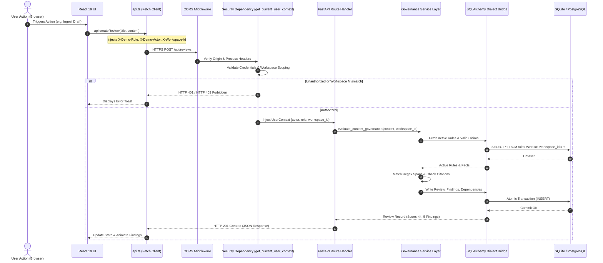

# 09 — API Request and Response Flow

## Purpose

This document details the lifecycle of HTTP requests as they travel from client actions in the React single-page application, through the FastAPI gateway and security middleware, into the service engines, and down to the persistent database layer.

---

## The Request Lifecycle Architecture

---

## Detailed Request Processing Stages

### Stage 1: Client Request Dispatch (`src/services/api.ts`)
1. **Payload Serialization:** JSON payloads are serialized; file uploads are structured as standard `multipart/form-data`.
2. **Context Header Injection:** The client automatically retrieves session state and injects:
   - `X-Demo-Role`: Active simulated persona (`brand_admin`, `reviewer`, `creator`, `auditor`).
   - `X-Demo-Actor`: Attribution identifier (e.g., `admin@brandtrace.internal`).
   - `X-Workspace-Id`: Target workspace partition (defaults to `ws_default`).
   - `Authorization`: Bearer token if executing in strict production mode.
3. **URL Normalization:** Checks `VITE_API_BASE_URL`. Strips trailing slashes or duplicate `/api` path segments to ensure requests target `${base}/api/...` cleanly.

### Stage 2: Gateway & Security Validation (`backend/app/main.py`)
1. **CORS Verification:** `CORSMiddleware` checks the incoming `Origin` against configured `CORS_ORIGINS` (defaults to `http://localhost:3000`, `http://localhost:3001`, and production Vercel domains).
2. **Authentication Parsing:** Dependency `get_current_user_context` inspects headers:
   - In `strict` mode: Verifies the cryptographic token against `workspace_members`. Fails closed with `HTTP 401 Unauthorized` if invalid.
   - In `demo` mode: Binds the simulated role while strictly enforcing role permission boundaries.
3. **Workspace Access Guard:** Verifies that the requested actor belongs to the specified `workspace_id`. Cross-workspace attempts immediately abort with `HTTP 403 Forbidden`.

### Stage 3: Service-Tier Execution
1. **Data Isolation:** All database reads for rules, facts, and past reviews explicitly filter by `workspace_id`.
2. **Deterministic Processing:** The engine scans input copy without network calls to external LLM endpoints. Findings are generated with immutable source IDs.
3. **Contamination Guards:** Remediation requests (`POST /api/reviews/{id}/findings/{f_id}/actions`) are validated against editorial contamination:
   - Reject attempts to replace draft text with reviewer reason strings (`HTTP 422`).
   - Reject attempts to insert manual QA metadata tags (e.g., `"Manual QA: Approved by John"`) into publishable content (`HTTP 422`).

### Stage 4: Database Persistence & Transaction Commit
1. **Atomic Transactions:** Review creation, version snapshots, finding records, and audit events execute within atomic SQLAlchemy sessions.
2. **Idempotent Upserts:** Data mutations compile dialect-safe SQL:
   - SQLite: Uses `INSERT OR REPLACE INTO`.
   - PostgreSQL: Compiles `ON CONFLICT (...) DO UPDATE SET`.
3. **Optimistic Concurrency:** Rule and fact updates check `expected_version` to prevent concurrent write collisions (`HTTP 409 Conflict`).

### Stage 5: Response Serialization & Client Hydration
1. **Pydantic Serialization:** Response models convert Python dictionaries and SQLAlchemy rows into type-safe JSON.
2. **Client State Update:** The React UI consumes the response, updates the view, recalibrates health score meters, and displays notifications.

---

## Common Request Scenarios & HTTP Status Codes

| Scenario | Route Invoked | Expected Status | Response Characteristic |
| :--- | :--- | :---: | :--- |
| **Clean Ingestion** | `POST /api/reviews` | `201 Created` | Returns review object with calculated clearance score and findings array. |
| **Contaminated Edit**| `POST .../findings/{id}/actions` | `422 Unprocessable` | Rejected by server guard; draft content remains untouched. |
| **Blocked Approval** | `POST .../approval` | `409 Conflict` | Server gate blocks approval due to unresolved `HIGH` findings. |
| **Valid Sign-Off** | `POST .../approval` | `200 OK` | Review status transitions to `APPROVED`; audit event logged. |
| **Cross-Tenant Read**| `GET /api/rules` | `403 Forbidden` | Denied; tenant A cannot view tenant B policies. |
| **Readiness Failure**| `GET /api/ready` | `503 Unavailable`| Database connection probe fails. |

---

## Related Documentation

- [07 — Backend Architecture](./07_BACKEND_ARCHITECTURE.md)
- [08 — API Reference](./08_API_REFERENCE.md)
- [11 — Workspace Isolation](./11_WORKSPACE_ISOLATION.md)
- [28 — Approval Gate and Governance Workflow](./28_APPROVAL_GATE_AND_GOVERNANCE_WORKFLOW.md)
