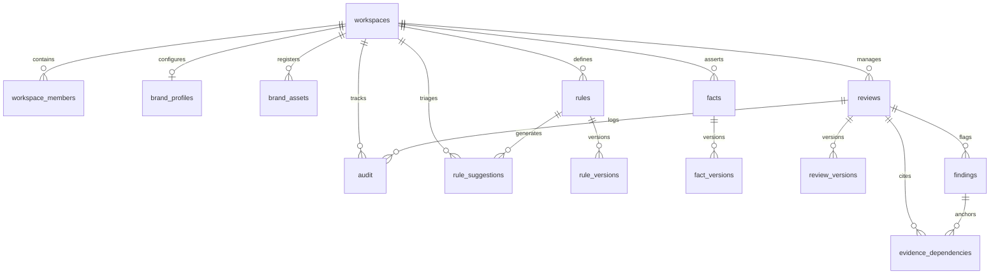

# 10 — Database Schema

## Purpose

This document provides the definitive architectural reference for all **15 relational database tables** implemented in BRANDTRACE. It specifies column definitions, data types, primary and foreign keys, indexing strategies, multi-tenant partitioning, and data retention lifecycles across both SQLite and PostgreSQL.

---

## Entity Relationship Overview

---

## Table Specifications (15 Tables)

### 1. `workspaces`
Tenant partition root. Isolates organizational governance boundaries.
- `id` (`TEXT`, PK): Unique workspace identifier (e.g., `ws_default`, `ws_alpha`).
- `name` (`TEXT`): Human-readable workspace name.
- `created_at` (`TEXT`): ISO 8601 creation timestamp.

### 2. `workspace_members`
User actors assigned to workspaces with discrete governance roles.
- `workspace_id` (`TEXT`, PK, FK $\to$ `workspaces.id`): Target workspace.
- `actor` (`TEXT`, PK): Email or username of the actor.
- `role` (`TEXT`): Assigned role (`brand_admin`, `reviewer`, `creator`, `auditor`).
- `created_at` (`TEXT`): Membership timestamp.

### 3. `brand_profiles`
Visual identity standards and contrast compliance parameters per workspace.
- `id` (`TEXT`, PK): Profile identifier.
- `workspace_id` (`TEXT`, UNIQUE, FK $\to$ `workspaces.id`): Parent workspace.
- `brand_name` (`TEXT`): Official brand display name.
- `primary_color` (`TEXT`): Primary brand hex code (e.g., `#0f766e`).
- `secondary_color` (`TEXT`): Secondary brand hex code (e.g., `#2dd4bf`).
- `accent_colors` (`TEXT`): JSON array of approved accent hex strings.
- `min_contrast_ratio` (`REAL`): Minimum required WCAG contrast ratio (default `4.5`).
- `approved_logo_aspect` (`REAL`): Reference logo aspect ratio (width/height).
- `updated_at` (`TEXT`): Timestamp of last visual profile amendment.

### 4. `brand_assets`
Registered brand media assets with cryptographic binary SHA-256 hashes.
- `id` (`TEXT`, PK): Asset identifier.
- `name` (`TEXT`): Descriptive asset name.
- `asset_type` (`TEXT`): File type classification (`image`, `logo`, `badge`).
- `content_hash` (`TEXT`): Binary SHA-256 hash string (64 characters).
- `source` (`TEXT`): Asset file source path or URL.
- `license_status` (`TEXT`): Licensing category (`COMMERCIAL_UNLIMITED`, `RESTRICTED`, `EXPIRED_LICENSE`).
- `license_notes` (`TEXT`): Mandatory conditions or usage constraints.
- `approval_status` (`TEXT`): Governance clearance (`APPROVED`, `RESTRICTED`, `REVIEW_REQUIRED`).
- `workspace_id` (`TEXT`, FK $\to$ `workspaces.id`): Tenant partition.
- `created_at` (`TEXT`): Creation timestamp.
- `updated_at` (`TEXT`): Last modification timestamp.

### 5. `rules`
Active normative guidelines, prohibited phrases, and required disclaimers.
- `id` (`TEXT`, PK): Structured rule identifier (e.g., `R-VOICE-01`, `R-TERM-02`).
- `workspace_id` (`TEXT`, FK $\to$ `workspaces.id`): Tenant partition.
- `title` (`TEXT`): Concise rule summary.
- `category` (`TEXT`): Rule grouping (`voice`, `terminology`, `compliance`, `visual`).
- `kind` (`TEXT`): Enforcement behavior (`prohibited_phrase`, `required_term`, `superlative`).
- `pattern` (`TEXT`): Regular expression string used for exact-span matching.
- `requirement` (`TEXT`): Prescriptive guidance for remediation.
- `severity` (`TEXT`): Risk classification (`LOW`, `MEDIUM`, `HIGH`, `CRITICAL`).
- `version` (`TEXT`): Semantic rule version string (e.g., `1.0`).
- `status` (`TEXT`): Policy lifecycle status (`ACTIVE`, `RETIRED`, `DRAFT`).
- `owner` (`TEXT`): Responsible organizational team.
- `source_id` (`TEXT`): Internal guideline citation ID.
- `source_title` (`TEXT`): Official document name cited.
- `source_excerpt` (`TEXT`): Verbatim excerpt justifying the rule.
- `effective_at` (`TEXT`): Policy commencement timestamp.
- `expires_at` (`TEXT`): Policy sunset timestamp.
- `created_at` (`TEXT`): Rule creation timestamp.

### 6. `rule_versions`
Immutable historical snapshots captured on rule amendments or suggestion activations.
- `id` (`TEXT`, PK): Snapshot identifier.
- `rule_id` (`TEXT`, FK $\to$ `rules.id`): Target rule.
- `workspace_id` (`TEXT`, FK $\to$ `workspaces.id`): Tenant partition.
- `version` (`TEXT`): Snapshot version.
- `title` (`TEXT`): Rule title at this snapshot.
- `category` (`TEXT`): Category at this snapshot.
- `kind` (`TEXT`): Rule kind at this snapshot.
- `pattern` (`TEXT`): Evaluation pattern at this snapshot.
- `requirement` (`TEXT`): Prescriptive text at this snapshot.
- `severity` (`TEXT`): Severity at this snapshot.
- `source_title` (`TEXT`): Document cited.
- `source_excerpt` (`TEXT`): Excerpt cited.
- `originating_suggestion_id` (`TEXT`): Linked suggestion ID if created via telemetry.
- `activated_by` (`TEXT`): Administrator actor who authorized this version.
- `activation_reason` (`TEXT`): Justification for policy amendment.
- `created_at` (`TEXT`): Snapshot timestamp.

### 7. `facts`
Empirical corporate assertions with time-aware validity windows.
- `id` (`TEXT`, PK): Fact identifier (e.g., `F-001`).
- `workspace_id` (`TEXT`, FK $\to$ `workspaces.id`): Tenant partition.
- `claim` (`TEXT`): Assertion topic or category.
- `value` (`TEXT`): Verified statistical or empirical value.
- `owner` (`TEXT`): Department responsible for fact veracity.
- `status` (`TEXT`): Validity status (`ACTIVE`, `EXPIRING_SOON`, `EXPIRED`, `INVALIDATED`).
- `version` (`TEXT`): Semantic fact version string.
- `source_id` (`TEXT`): Primary evidence document citation.
- `source_title` (`TEXT`): Official source document title.
- `source_excerpt` (`TEXT`): Verbatim factual quotation.
- `review_at` (`TEXT`): Scheduled audit review timestamp.
- `effective_at` (`TEXT`): Assertion valid-from timestamp.
- `expires_at` (`TEXT`): Assertion expiration timestamp.
- `notes` (`TEXT`): Operational context or verification notes.
- `created_at` (`TEXT`): Creation timestamp.
- `updated_at` (`TEXT`): Last modification timestamp.

### 8. `fact_versions`
Immutable version snapshots tracking fact amendments over time.
- `id` (`TEXT`, PK): Snapshot identifier.
- `fact_id` (`TEXT`, FK $\to$ `facts.id`): Parent fact.
- `version` (`TEXT`): Version at snapshot.
- `claim` (`TEXT`): Claim text at snapshot.
- `value` (`TEXT`): Value string at snapshot.
- `source_id` (`TEXT`): Evidence citation.
- `source_title` (`TEXT`): Source title.
- `source_excerpt` (`TEXT`): Excerpt.
- `effective_at` (`TEXT`): Effective date.
- `expires_at` (`TEXT`): Expiration date.
- `status` (`TEXT`): Status at snapshot.
- `change_reason` (`TEXT`): Rationale for updating fact.
- `changed_by` (`TEXT`): Administrator actor who modified fact.
- `created_at` (`TEXT`): Snapshot timestamp.

### 9. `reviews`
Primary content submission records holding clearance scores and review statuses.
- `id` (`TEXT`, PK): Review identifier (e.g., `rev_launch_q4`).
- `workspace_id` (`TEXT`, FK $\to$ `workspaces.id`): Tenant partition.
- `title` (`TEXT`): Review submission title.
- `content` (`TEXT`): Current text content draft.
- `content_type` (`TEXT`): MIME or content classification (`text/plain`, `application/pdf`, `image/png`).
- `status` (`TEXT`): Review lifecycle state (`IN_REVIEW`, `CHANGES_REQUESTED`, `APPROVED`, `WAIVED`).
- `score` (`INTEGER`): Deterministic clearance score ($0$ to $100$).
- `author` (`TEXT`): Creator actor.
- `reviewer` (`TEXT`): Assigned or approving compliance reviewer.
- `file_name` (`TEXT`): Original uploaded filename if ingested via file.
- `file_mime` (`TEXT`): MIME type string.
- `file_size` (`INTEGER`): Byte length of uploaded payload.
- `analysis_method` (`TEXT`): Evaluation engine utilized (`DETERMINISTIC_REGEX`, `VISUAL_MULTIMODAL`).
- `rule_versions` (`TEXT`): JSON string recording rule version IDs active during evaluation.
- `created_at` (`TEXT`): Submission timestamp.
- `updated_at` (`TEXT`): Last update timestamp.

### 10. `review_versions`
Historical content snapshots captured on every accepted edit, manual revision, or rollback.
- `id` (`TEXT`, PK): Version identifier.
- `review_id` (`TEXT`, FK $\to$ `reviews.id`): Parent review draft.
- `content` (`TEXT`): Full draft text at this snapshot.
- `created_at` (`TEXT`): Snapshot timestamp.
- `created_by` (`TEXT`): Actor who triggered the edit.
- `reason` (`TEXT`): Rationale (e.g., `Remediated R-VOICE-01 with neutral correction`).

### 11. `findings`
Structured compliance and factual violations flagged on a review draft.
- `id` (`TEXT`, PK): Unique finding identifier.
- `review_id` (`TEXT`, FK $\to$ `reviews.id`): Target review draft.
- `category` (`TEXT`): Violation category (`voice`, `terminology`, `compliance`, `visual_asset`, `visual_palette`).
- `type` (`TEXT`): Specific finding type (e.g., `prohibited_claim`, `unapproved_color`).
- `severity` (`TEXT`): Risk classification (`LOW`, `MEDIUM`, `HIGH`, `CRITICAL`).
- `status` (`TEXT`): Evidence disposition (`SUPPORTED`, `CONTRADICTED`, `OUTDATED`, `UNSUPPORTED_BY_APPROVED_EVIDENCE`, `NEEDS_REVIEW`).
- `passage` (`TEXT`): Exact text span matched in draft content.
- `explanation` (`TEXT`): Rationale explaining the violation.
- `suggested_correction` (`TEXT`): Neutral replacement phrase.
- `source_id` (`TEXT`): Cited rule or fact ID.
- `source_title` (`TEXT`): Official document title cited.
- `source_excerpt` (`TEXT`): Verbatim excerpt justifying the violation.
- `source_version` (`TEXT`): Version of rule or fact active during evaluation.
- `analysis_method` (`TEXT`): Method used (`EXACT_SPAN_REGEX`, `ASSET_REGISTRY_LOOKUP`, `COLOR_SCIENCE_DELTA_E`).
- `uncertainty` (`TEXT`): Explicit technical boundary or confidence limitation note.
- `disposition` (`TEXT`): Human resolution (`ACCEPTED_EDIT`, `EDITED`, `DISMISSED`, `ESCALATED`, `WAIVED`).
- `disposition_reason` (`TEXT`): Mandatory reviewer justification string if dismissed.
- `disposition_by` (`TEXT`): Actor who triaged the finding.
- `disposition_at` (`TEXT`): Triage timestamp.

### 12. `evidence_dependencies`
Granular mapping connecting specific review findings to cited corporate facts.
- `id` (`TEXT`, PK): Dependency identifier.
- `workspace_id` (`TEXT`, FK $\to$ `workspaces.id`): Tenant partition.
- `review_id` (`TEXT`, FK $\to$ `reviews.id`): Dependent review.
- `finding_id` (`TEXT`, FK $\to$ `findings.id`): Related finding.
- `source_type` (`TEXT`): Source entity (`fact`, `rule`, `asset`).
- `source_id` (`TEXT`): Cited entity identifier (e.g., `F-001`).
- `source_version` (`TEXT`): Version string cited.
- `created_at` (`TEXT`): Linkage creation timestamp.

### 13. `audit`
Immutable, append-only chronological stream of all system actions.
- `id` (`TEXT`, PK): Event identifier (e.g., `aud_001`).
- `workspace_id` (`TEXT`, FK $\to$ `workspaces.id`): Tenant partition.
- `review_id` (`TEXT`): Target review ID (or `NULL` if system-level event).
- `action` (`TEXT`): Operation type (`REVIEW_CREATED`, `FINDING_ACTION_ACCEPTED`, `VERSION_RESTORED`, `APPROVED`, `FACT_UPDATED`).
- `actor` (`TEXT`): Acting user or simulated persona.
- `actor_role` (`TEXT`): Role held at event time.
- `reason` (`TEXT`): Human rationale provided.
- `details` (`TEXT`): Structured JSON or textual metadata describing the state change.
- `created_at` (`TEXT`): Immutable ISO 8601 event timestamp.

### 14. `rule_suggestions`
Reviewer-guided clarification proposals generated by guideline-health telemetry.
- `id` (`TEXT`, PK): Suggestion identifier.
- `rule_id` (`TEXT`, FK $\to$ `rules.id`): Target rule.
- `observed_issue` (`TEXT`): Summary of reviewer friction detected.
- `proposed_clarification` (`TEXT`): Concrete wording amendment.
- `ambiguity_addressed` (`TEXT`): Specific ambiguity causing dismissals.
- `status` (`TEXT`): Triage state (`PENDING_REVIEW`, `ACCEPTED`, `DEFERRED`, `REJECTED`, `ACTIVATED`).
- `reviewed_by` (`TEXT`): Administrator actor who reviewed proposal.
- `reviewed_at` (`TEXT`): Triage review timestamp.
- `created_at` (`TEXT`): Proposal generation timestamp.
- `workspace_id` (`TEXT`, FK $\to$ `workspaces.id`): Tenant partition.
- `rule_version` (`TEXT`): Rule version active during proposal.
- `finding_ids` (`TEXT`): Comma-separated list of supporting finding IDs.
- `review_ids` (`TEXT`): Comma-separated list of supporting review IDs.
- `decision_evidence` (`TEXT`): Statistical telemetry summary.
- `sample_count` (`INTEGER`): Count of evaluation events backing the proposal.
- `data_confidence` (`TEXT`): Reliability rating (`SUFFICIENT` vs `INSUFFICIENT`).
- `activated_at` (`TEXT`): Activation timestamp if promoted to live rule.
- `activated_by` (`TEXT`): Administrator who authorized activation.

### 15. `system_state`
Internal key-value store for operational flags and version pointers.
- `key` (`TEXT`, PK): Configuration key name.
- `value` (`TEXT`): Serialized configuration value.
- `created_at` (`TEXT`): Key initialization timestamp.

---

## Dialect Compilation & Indexing

1. **Foreign Key Integrity:** Enforced via `PRAGMA foreign_keys = ON;` in SQLite and native foreign key constraints in PostgreSQL.
2. **Indexing:** Primary indexes exist on `(workspace_id, id)` across all tenant tables. Dedicated lookup indexes cover:
   - `brand_assets.content_hash` + `brand_assets.workspace_id`
   - `evidence_dependencies.source_id` + `evidence_dependencies.source_type`
   - `findings.review_id`
   - `audit.workspace_id` + `audit.created_at`

---

## Related Documentation

- [04 — System Architecture](./04_SYSTEM_ARCHITECTURE.md)
- [07 — Backend Architecture](./07_BACKEND_ARCHITECTURE.md)
- [11 — Workspace Isolation](./11_WORKSPACE_ISOLATION.md)
- [32 — Database Migrations and Persistence](./32_DATABASE_MIGRATIONS_AND_PERSISTENCE.md)
