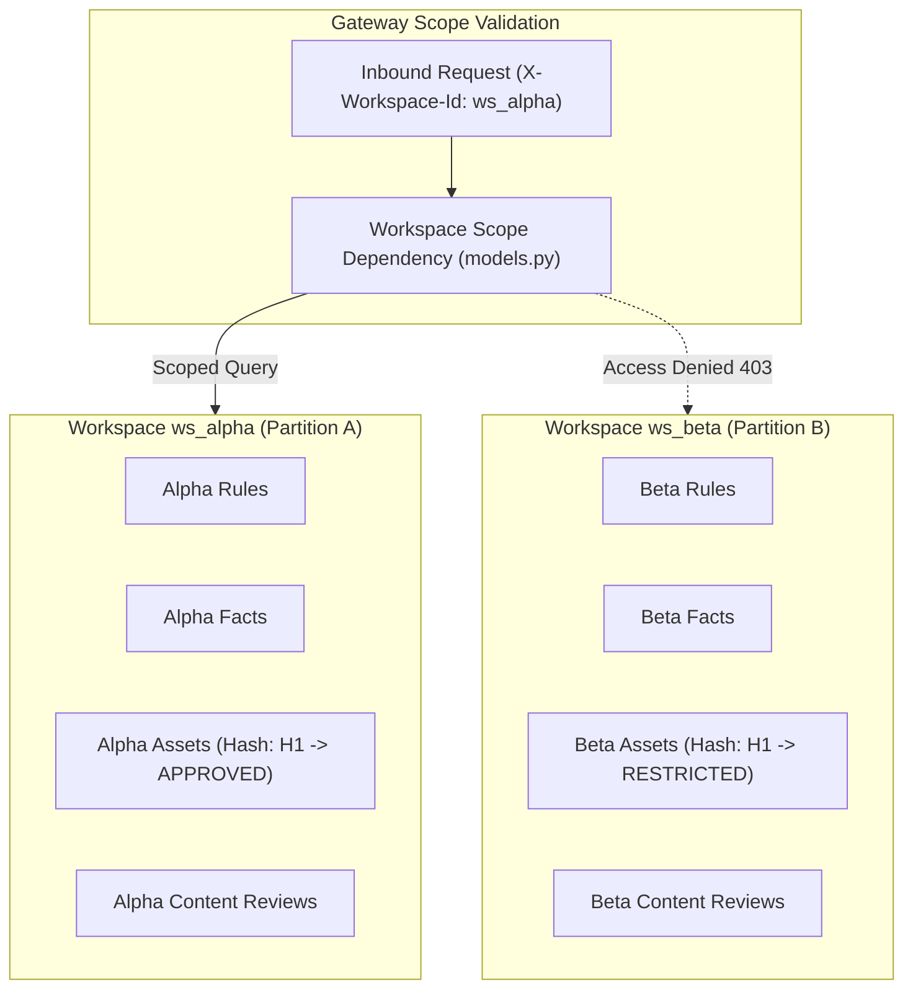

# 11 — Workspace Isolation

## Purpose

This document explains the multi-tenant workspace isolation architecture of **BRANDTRACE**, specifying how tenant data is strictly partitioned across queries, asset registries, review evaluations, and administrative mutations to prevent cross-workspace data leakage.

---

## Multi-Tenancy Architecture

BRANDTRACE enforces logical multi-tenancy using partition identifiers (`workspace_id`). Every tenant partition operates as an isolated virtual brand organization:

---

## Core Isolation Invariants

1. **Mandatory Query Scoping:**
   Every database query accessing `rules`, `facts`, `reviews`, `brand_assets`, `evidence_dependencies`, `audit`, or `rule_suggestions` contains an explicit `WHERE workspace_id = ?` clause.
2. **Identical Bytes, Independent Metadata:**
   The Brand Asset Registry (`brand_assets`) strictly scopes lookups by `(content_hash, workspace_id)`. If Tenant A and Tenant B upload the exact same image bytes (producing identical SHA-256 hash `H1`), Tenant A can mark the asset `APPROVED` with global licensing while Tenant B marks it `RESTRICTED` with expired licensing. Neither tenant can see or modify the other's private asset metadata.
3. **No Cross-Tenant Rule Mutation:**
   Creating or updating rules requires that the authenticated user actor belong to the target workspace in `workspace_members`. Submitting rule triage actions or activating clarification suggestions for a rule outside the caller's workspace fails with `HTTP 403 Forbidden`.
4. **Isolated Evaluation Context:**
   When a review is evaluated (`POST /api/reviews`), the deterministic engine fetches active rules and valid facts strictly matching the review's parent `workspace_id`. Policies from other workspaces never influence findings or clearance scores.

---

## Security Verification & Test Evidence

The workspace isolation model is comprehensively verified across dedicated automated test suites:

### 1. `test_round3_comprehensive_security.py`
- `test_section3_asset_isolation_same_bytes_different_workspaces`: Verifies that identical image bytes uploaded to `ws_alpha` and `ws_beta` retain completely isolated approval statuses and license notes.
- `test_section3_asset_exists_only_in_workspace_b`: Proves that querying an asset hash that exists only in Workspace B returns `None` (`unregistered_asset`) when requested from Workspace A.
- `test_section3_asset_unknown_and_cross_workspace_tampering`: Verifies that an administrator in Workspace A cannot update or delete an asset belonging to Workspace B (`HTTP 404/403`).

### 2. `test_phase1_security_access_control.py`
- `test_cross_workspace_guideline_health_isolation`: Verifies that reviewer disposition telemetry is strictly partitioned per workspace.
- `test_cross_workspace_rule_suggestion_denial_and_zero_writes`: Confirms that attempts to triage suggestions in a foreign workspace fail with `HTTP 403` and execute zero database writes.
- `test_cross_workspace_suggestion_activation_defensive_validation`: Verifies defensive checks ensuring source rules and suggestions belong to the same authorized workspace during activation.

---

## Related Documentation

- [04 — System Architecture](./04_SYSTEM_ARCHITECTURE.md)
- [10 — Database Schema](./10_DATABASE_SCHEMA.md)
- [12 — Authentication and Authorization](./12_AUTHENTICATION_AND_AUTHORIZATION.md)
- [21 — Brand Asset Registry](./21_BRAND_ASSET_REGISTRY.md)
- [30 — Security Threat Model](./30_SECURITY_THREAT_MODEL.md)
