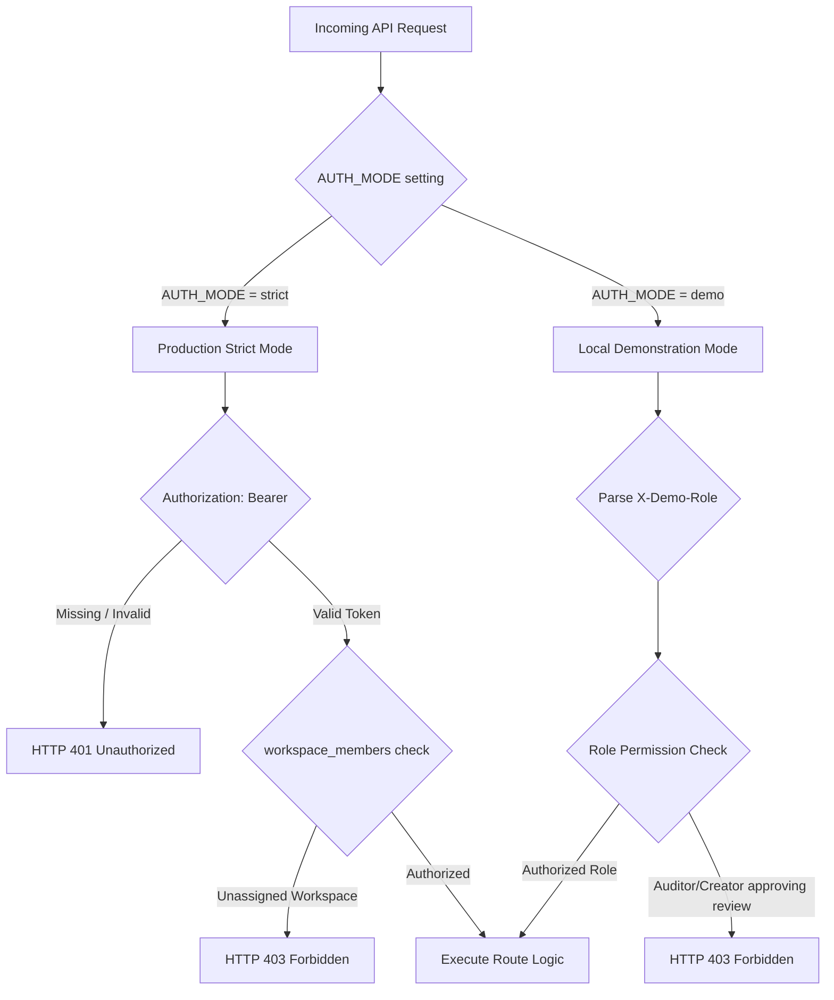

# 12 — Authentication and Authorization

## Purpose

This document details the authentication and authorization model implemented in **BRANDTRACE**, distinguishing between strict production token authentication, API-key privilege separation, least-privilege role hierarchies, and simulated demo personas.

---

## Dual Authentication Modes

BRANDTRACE supports two distinct operational security modes governed by the `AUTH_MODE` environment variable (`backend/app/config.py`):

---

## 1. Strict Production Mode (`AUTH_MODE=strict`)
Used in production enterprise deployments:
- **Token Verification:** Requires an `Authorization: Bearer <API_KEY>` header.
- **Fail-Closed Policy:** If credentials are missing, malformed, or unassigned to the target workspace in `workspace_members`, requests fail immediately with `HTTP 401 Unauthorized` or `HTTP 403 Forbidden`.
- **Privilege Separation:** Distinguishes between reviewer keys (`BRANDTRACE_API_KEY`) and administrator keys (`BRANDTRACE_ADMIN_API_KEY`).
  - Reviewer keys are strictly prohibited from mutating brand rules, registering assets, or resetting databases.
  - If the administrator key is unconfigured, the system fails closed rather than falling back to reviewer privileges.
  - Reusing identical keys for both reviewer and administrator roles is blocked in secure production configurations.

---

## 2. Local Demonstration Mode (`AUTH_MODE=demo`)
Designed for hackathon evaluators and offline demonstration without requiring real OAuth servers or database user creation:
- **Header Parsing:** Reads caller persona from `X-Demo-Role` (`brand_admin`, `reviewer`, `creator`, `auditor`) and `X-Demo-Actor` (e.g., `admin@brandtrace.internal`).
- **Clear Disclosure:** The UI prominently informs evaluators that role switching simulates operational workflows and does not represent independent authentication.
- **Server Enforcement Preserved:** Even in demo mode, role permission boundaries are strictly enforced server-side. For example, selecting `auditor` or `creator` and attempting to approve a review draft via `POST /api/reviews/{id}/approval` triggers a hard `HTTP 403 Forbidden` from FastAPI.

---

## Role-Based Access Control (RBAC) Matrix

| Endpoint Group | `brand_admin` | `reviewer` | `creator` | `auditor` |
| :--- | :---: | :---: | :---: | :---: |
| **View Reviews & Findings** (`GET /api/reviews`) | Allowed | Allowed | Allowed | Allowed |
| **Ingest Content Drafts** (`POST /api/reviews`) | Allowed | Allowed | Allowed | **Blocked (403)** |
| **Upload Files & PDFs** (`POST /api/reviews/upload`) | Allowed | Allowed | Allowed | **Blocked (403)** |
| **Remediate Findings** (`POST .../findings/.../actions`) | Allowed | Allowed | **Blocked (403)** | **Blocked (403)** |
| **Approve Content Reviews** (`POST .../approval`) | Allowed | Allowed | **Blocked (403)** | **Blocked (403)** |
| **Create / Edit Rules** (`POST/PUT /api/rules`) | Allowed | **Blocked (403)** | **Blocked (403)** | **Blocked (403)** |
| **Register Brand Assets** (`POST /api/brand-assets`) | Allowed | **Blocked (403)** | **Blocked (403)** | **Blocked (403)** |
| **Activate Rule Suggestions** (`POST .../activate`) | Allowed | **Blocked (403)** | **Blocked (403)** | **Blocked (403)** |
| **Inspect Immutable Audit** (`GET .../audit`) | Allowed | Allowed | Allowed | Allowed |

---

## Security Test Verification

Privilege separation is verified in `backend/tests/test_round3_comprehensive_security.py`:
- `test_section5_api_key_privilege_separation_matrix`: Verifies that reviewer API keys cannot invoke administrative endpoints, missing credentials fail closed, and duplicate keys are blocked.
- `test_auth_boundary_and_production_security` (in `test_defect_repairs_round3.py`): Validates strict-mode token challenge flows.

---

## Related Documentation

- [08 — API Reference](./08_API_REFERENCE.md)
- [11 — Workspace Isolation](./11_WORKSPACE_ISOLATION.md)
- [13 — Demo Mode and Judge Access](./13_DEMO_MODE_AND_JUDGE_ACCESS.md)
- [30 — Security Threat Model](./30_SECURITY_THREAT_MODEL.md)
