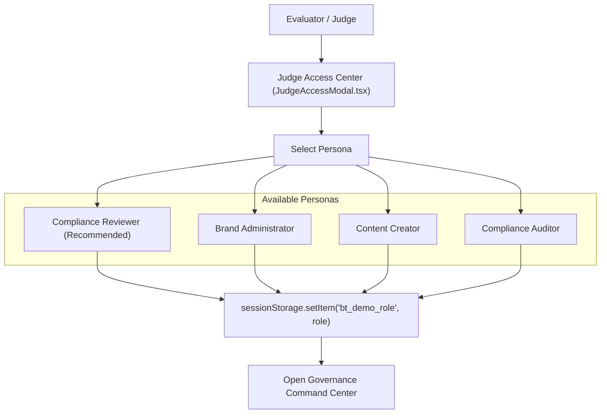

# 13 — Demo Mode and Judge Access

## Purpose

This document explains the **Judge Access Center**, demo role simulation architecture, and safety constraints enforced on the public production website (`https://brandtrace-woad.vercel.app`) to enable seamless hackathon evaluation while preventing security regressions.

---

## The Hackathon Evaluation Architecture

Hackathon evaluators require instant, frictionless access to inspect enterprise features without navigating complex multi-factor authentication sign-up flows. Simultaneously, compliance platforms must never falsely display invented usernames/passwords or pretend that demo buttons represent genuine cryptographic authentication.

BRANDTRACE adheres strictly to the organizer's demo guideline:
1. **No Fake Logins:** Because local and hosted demo environments use role simulation headers rather than a full OAuth user registration system, the UI presents an honest *"No login required — Enter Judge Demo"* interface.
2. **Copyable Context Headers:** Evaluators can copy exact request headers (`X-Demo-Role`, `X-Demo-Actor`, `X-Workspace-Id`) for independent CLI or Postman verification.
3. **Server-Enforced Boundaries:** Persona selection changes the request context; the backend independently enforces RBAC rules on every endpoint.

---

## Available Simulated Personas

### 1. Compliance Reviewer (`reviewer`) — *Recommended*
- **Actor:** `reviewer@brandtrace.internal`
- **Scope:** Ingests marketing drafts, reviews deterministic findings, accepts exact-span neutral corrections, dismisses items with documented reasons, and tests the approval gate (HTTP 409).
- **Restrictions:** Prohibited from altering brand constitution rules or registering brand assets.

### 2. Brand Administrator (`brand_admin`)
- **Actor:** `admin@brandtrace.internal`
- **Scope:** Full administrative authority. Creates and edits brand rules, manages valid claim facts, reviews guideline telemetry, activates clarification suggestions, and manages the Brand Asset Registry.

### 3. Content Creator (`creator`)
- **Actor:** `creator@brandtrace.internal`
- **Scope:** Authors marketing text, uploads digital PDFs, and views calculated clearance scores.
- **Restrictions:** Strictly blocked from approving content drafts (`HTTP 403`) or triaging violations.

### 4. Compliance Auditor (`auditor`)
- **Actor:** `auditor@brandtrace.internal`
- **Scope:** Read-only inspection of the append-only audit trail, historical rule snapshots, and fact version timelines.
- **Restrictions:** Blocked from modifying drafts, creating reviews, or issuing approvals (`HTTP 403`).

---

## Public Demo Safety & Protection Controls

To protect the shared hosted demonstration database (PostgreSQL on Neon), strict guardrails are enforced in hosted environments (`ENVIRONMENT=staging`):

1. **Destructive Reset Disabled:**
   `POST /api/demo/reset` is disabled by default. Calling this endpoint without a valid server-side `DEMO_RESET_SECRET` immediately returns `HTTP 403 Forbidden`. Evaluators cannot accidentally or maliciously purge shared demo reviews.
2. **Simulated Headers Cannot Authorize Resets:**
   Passing `X-Demo-Role: brand_admin` alone is insufficient to trigger database truncation. Reset operations require strict backend secrets.
3. **Ephemeral Test Isolation:**
   All automated browser QA tests and destructive unit test suites run exclusively against temporary SQLite databases (`tempfile.NamedTemporaryFile`) on dedicated local ports. No test suite touches the live hosted database.

---

## How Evaluators Access the Application

1. **Through the Landing Page:**
   Click the **"Judge Access"** button in the hero section or the **"Judge Mode"** button in the top navigation bar.
2. **In the Workspace:**
   Use the **"Simulated Role"** dropdown located in the left sidebar to switch personas dynamically. A toast notification confirms role transition and summarizes permission boundaries.
3. **Guided Walkthrough:**
   Click **"Take Judge Tour"** to launch the 8-step interactive tour explaining verified technical invariants across the system.

---

## Related Documentation

- [12 — Authentication and Authorization](./12_AUTHENTICATION_AND_AUTHORIZATION.md)
- [30 — Security Threat Model](./30_SECURITY_THREAT_MODEL.md)
- [38 — Judge Demonstration Guide](./38_JUDGE_DEMONSTRATION_GUIDE.md)
