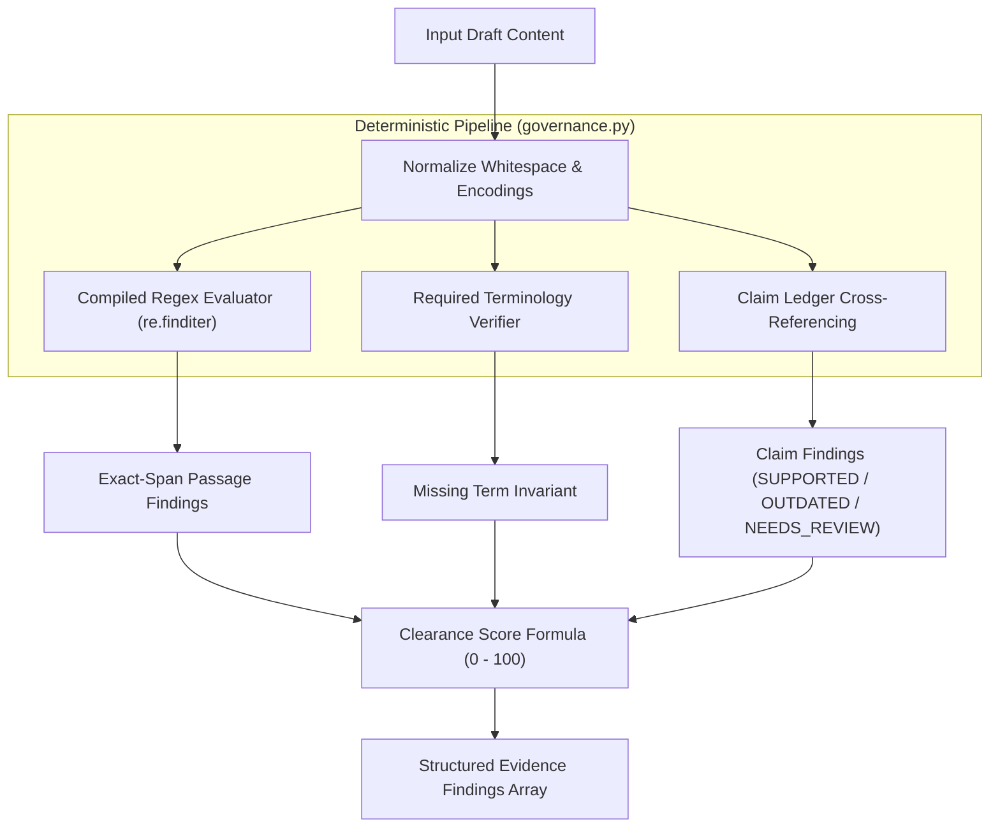

# 15 — Deterministic Rule Engine

## Purpose

This document provides a technical explanation of the **Deterministic Rule Engine** (`backend/app/governance.py`), explaining how regular expression matching, exact-span passage isolation, clearance score calculations, and neutral remediation proposals operate without non-deterministic AI drift.

---

## Architectural Principles of Deterministic Governance

In high-stakes compliance and legal review, non-deterministic AI models present substantial risks:
- Identical copy evaluated on consecutive runs can yield conflicting scores.
- Models may hallucinate non-existent guideline citations.
- Explanations lack verifiable mathematical or regular-expression anchors.

BRANDTRACE solves this by executing its core policy evaluation loop deterministically in pure Python:



---

## Evaluation Workflow

### 1. Regex Pattern Execution & Span Isolation
The engine compiles the `pattern` attribute of active rules and evaluates them using `re.finditer`:
```python
for match in re.finditer(rule["pattern"], content, re.IGNORECASE):
    passage = match.group(0)
    start_offset = match.start()
    end_offset = match.end()
    # Generates finding anchored to exact character boundaries
```
This guarantees that findings pinpoint the precise phrase violating brand standards, enabling the React client to render contextual highlights directly in the editorial preview.

### 2. Required Terminology Enforcement
For rules categorized as `required_term`, the engine verifies the presence of mandatory brand keywords. If absent:
- A finding of type `missing_required_term` is generated.
- The suggested correction does **not** perform arbitrary editorial injection. Instead, it provides clear prescriptive guidance indicating where the trademark or disclosure must appear.

### 3. Claim Ledger Cross-Referencing
The engine identifies factual assertions (e.g., geographic availability, customer metrics, pricing claims) and cross-references them against active rows in `facts`:
- **Matching & Active:** If the assertion matches a fact with an `expires_at` date in the future, it is marked `SUPPORTED`.
- **Matching & Expired:** If `t_now > expires_at`, the finding is marked `OUTDATED` (`HIGH` severity).
- **Unverified Assertions:** Broad empirical claims lacking supporting facts in the ledger are assigned `NEEDS_REVIEW` (honestly disclosing the absence of evidence rather than generating false certitude).

---

## Clearance Score Mathematical Formula

The clearance score ($S$) is calculated deterministically on a scale of $0$ to $100$:

$$S = \max\left(0, 100 - \sum_{i=1}^{N} W(\text{severity}_i)\right)$$

Where the penalty weight function $W(\cdot)$ is defined as:

$$W(\text{severity}) = \begin{cases}
30 & \text{if } \text{severity} = \text{CRITICAL} \\
18 & \text{if } \text{severity} = \text{HIGH} \\
10 & \text{if } \text{severity} = \text{MEDIUM} \\
4  & \text{if } \text{severity} = \text{LOW}
\end{cases}$$

Only **unresolved findings** (where `disposition` is `NULL` or unaccepted) apply score penalties. When a reviewer remediates a finding by accepting a suggestion, editing the text, or recording an authorized dismissal reason, its penalty is cleared from the score.

---

## Neutral Suggested Corrections

To prevent broken grammar and avoid subjective editorial bias:
1. **Direct Replacements:** For specific prohibited superlatives, pre-mapped neutral replacements are supplied:
   - *"cheap"* $\to$ *"cost-effective"*
   - *"best"* $\to$ *"effective"* or *"leading"*
2. **Grammar Preservation:** Replacements match the exact token span, preventing duplicate words (e.g., preventing *"our effective our"*).
3. **Null Corrections for Promissory Guarantees:** Absolute promotional promises like *"guaranteed"* do not receive naive automated word replacements; they require human editorial restructuring.

---

## Performance & Test Verification

- **Evaluation Speed:** Deterministic regex evaluation executes in $< 15\text{ ms}$ for typical marketing copy ($1,000$ to $5,000$ words).
- **Test Evidence:**
  - `test_qa_phase2_regression.py::test_suggested_corrections_are_neutral`
  - `test_qa_phase2_regression.py::test_best_choice_correction_is_neutral`
  - `test_qa_phase2_regression.py::test_missing_required_terminology_semantics_and_no_editorial_replacement`

---

## Related Documentation

- [03 — Product Scope and Requirements](./03_PRODUCT_SCOPE_AND_REQUIREMENTS.md)
- [14 — Brand Constitution](./14_BRAND_CONSTITUTION.md)
- [16 — Content Review Pipeline](./16_CONTENT_REVIEW_PIPELINE.md)
- [17 — Findings and Evidence Model](./17_FINDINGS_AND_EVIDENCE_MODEL.md)
