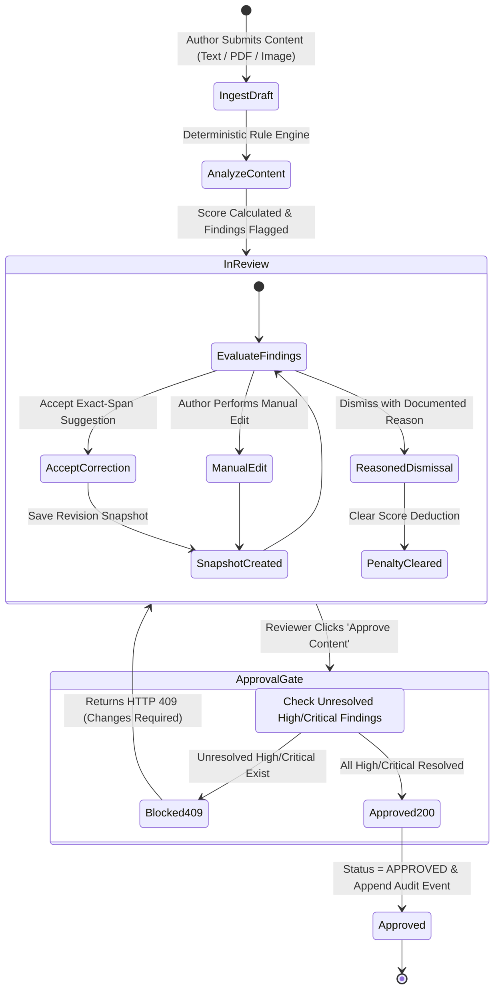

# 16 — Content Review Pipeline

## Purpose

This document details the end-to-end lifecycle of a content review submission in **BRANDTRACE**, covering ingestion, preprocessing, deterministic evaluation, remediation workflows, revision snapshots, and final approval sign-off.

---

## The End-to-End Governance Lifecycle

---

## Detailed Step-by-Step Lifecycle

### Step 1: Draft Ingestion & Validation
Authors submit content via the workspace interface:
- **Direct Text / Markdown:** Ingested via `POST /api/reviews`. Content size is bounded to prevent buffer-exhaustion attacks (`MAX_CONTENT_CHARS = 50000`).
- **Digital PDF Ingestion:** Uploaded via `POST /api/reviews/upload`. Ingested via `pypdf`, extracting clean UTF-8 text layers while validating file headers.
- **Graphic Assets:** Ingested as PNG/JPEG payloads, computing cryptographic SHA-256 hashes and extracting palette distributions.

### Step 2: Deterministic Evaluation & Finding Generation
The backend evaluates the draft against active guidelines in the caller's workspace:
1. Normalizes whitespace and character encodings.
2. Scans against all active rules in `rules` using compiled regular expressions.
3. Cross-references empirical assertions against `facts`.
4. Checks asset hashes against `brand_assets`.
5. Calculates the initial clearance score ($0$ to $100$) and records active rule versions in `reviews.rule_versions`.

### Step 3: Reviewer Inspection & Triage
The review draft appears in the reviewer workspace with an initial status of `IN_REVIEW`. Reviewers inspect structured finding cards:
- **Exact Passage Highlight:** Visual indicator showing the matched text span.
- **Source Citation:** Displays rule title, cited policy handbook, and verbatim excerpt.
- **Suggested Remediation:** Displays neutral suggested replacement phrases.

### Step 4: Remediation Actions & Revision Snapshots
Reviewers resolve findings using three authorized operations (`POST /api/reviews/{id}/findings/{f_id}/actions`):
1. **Accept Suggestion (`action: "ACCEPT"`):**
   The engine replaces the flagged text span with the suggested phrase, updates `reviews.content`, clears the finding penalty, and captures a full revision snapshot in `review_versions`.
2. **Manual Revision (`action: "EDIT"`):**
   The reviewer edits the text. Guardrails reject contamination strings or QA metadata tags (`HTTP 422`). An audit event and version snapshot are recorded.
3. **Reasoned Dismissal (`action: "DISMISS"`):**
   The reviewer waives the finding. A non-empty justification string (`reason`) is mandatory. The finding disposition is recorded in `findings.disposition` and the score penalty is cleared.

### Step 5: Version History & Rollback
Every remediation action increments the review's version timeline. Reviewers can inspect historical version diffs and roll back to any previous snapshot (`POST /api/reviews/{id}/restore/{version_id}`). A `VERSION_RESTORED` audit event logs who initiated the restoration.

### Step 6: Approval Gate Verification
When a reviewer or administrator submits an approval request (`POST /api/reviews/{id}/approval`):
1. The server checks for unresolved `HIGH` or `CRITICAL` findings.
2. **Violation Present:** The server returns **`HTTP 409 Conflict`**, and the review status remains `IN_REVIEW` or transitions to `CHANGES_REQUESTED`.
3. **Clean Clearance:** If all high-risk items are remediated or reasoned, the server transitions status to `APPROVED`, records the reviewer's actor identifier, and appends a permanent sign-off event in the `audit` ledger.

---

## Related Documentation

- [08 — API Reference](./08_API_REFERENCE.md)
- [15 — Deterministic Rule Engine](./15_DETERMINISTIC_RULE_ENGINE.md)
- [17 — Findings and Evidence Model](./17_FINDINGS_AND_EVIDENCE_MODEL.md)
- [28 — Approval Gate and Governance Workflow](./28_APPROVAL_GATE_AND_GOVERNANCE_WORKFLOW.md)
