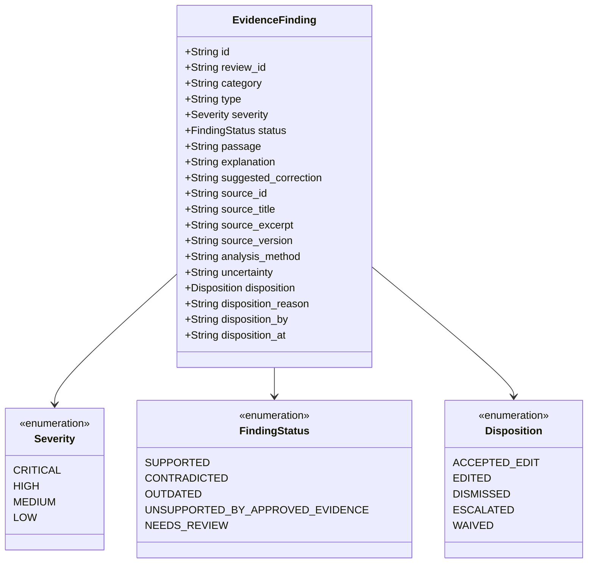

# 17 — Findings and Evidence Model

## Purpose

This document specifies the data model, evidence anchorage, severity taxonomy, and disposition tracking implemented for **Evidence Findings** in BRANDTRACE.

---

## Anatomy of an Evidence Finding

Every finding flagged during content evaluation is persisted in the `findings` table as a structured, defensible entity:



---

## Field Specifications

1. **`passage`**: The exact verbatim substring flagged in the draft content.
2. **`category`**: Functional governance group:
   - `voice`: Tone, superlatives, comparative marketing.
   - `terminology`: Trademark usage, naming standards, mandatory phrasing.
   - `compliance`: Legal disclaimers, factual veracity, regulatory rules.
   - `visual_asset`: Binary SHA-256 asset registration status.
   - `visual_palette`: Delta-E color compliance and contrast ratings.
3. **`severity`**: Risk weight applied to clearance score ($0$ to $100$):
   - `CRITICAL`: $-30\text{ pts}$ (Blocks approval).
   - `HIGH`: $-18\text{ pts}$ (Blocks approval).
   - `MEDIUM`: $-10\text{ pts}$ (Advisory deduction).
   - `LOW`: $-4\text{ pts}$ (Formatting warning).
4. **`status`**: Evidence state:
   - `SUPPORTED`: Assertion is backed by an active, valid corporate fact or approved asset.
   - `CONTRADICTED`: Content directly conflicts with an active normative rule or fact.
   - `OUTDATED`: Cited fact exists in the Claim Ledger but has passed its `expires_at` date.
   - `UNSUPPORTED_BY_APPROVED_EVIDENCE`: Fact citation is missing from corporate ledgers.
   - `NEEDS_REVIEW`: Ambiguous assertion or broad geographic claim requiring human assessment.
5. **`source_id`, `source_title`, `source_excerpt`**: Verifiable citations grounding the finding in authoritative policy.
6. **`source_version`**: Exact rule or fact version active when the evaluation ran.
7. **`uncertainty`**: Explicit disclosure of analysis boundaries (e.g., *"Exact binary SHA-256 match; does not perform perceptual logo recognition"*).
8. **`disposition` & `disposition_reason`**: Human resolution status and mandatory justification string if dismissed.

---

## Disposition Resolution Lifecycle

```text
Finding Flagged (disposition = NULL)
       │
       ├── Accept Suggestion  ──> disposition = "ACCEPTED_EDIT" (replaces passage span)
       ├── Manual Revision    ──> disposition = "EDITED"        (reviewer manual edit)
       ├── Reasoned Dismissal ──> disposition = "DISMISSED"     (mandatory reason string)
       └── Escalation         ──> disposition = "ESCALATED"     (referred to brand admin)
```

### Contamination Guard Invariant
When a reviewer records a dismissal justification, the backend strictly verifies that the reason string is stored in `findings.disposition_reason` and **never** overwrites the publishable draft content (`reviews.content`). This server guard is tested in `test_disposition_integrity.py`.

---

## Related Documentation

- [10 — Database Schema](./10_DATABASE_SCHEMA.md)
- [15 — Deterministic Rule Engine](./15_DETERMINISTIC_RULE_ENGINE.md)
- [16 — Content Review Pipeline](./16_CONTENT_REVIEW_PIPELINE.md)
- [26 — Reviewer Feedback and Disagreement](./26_REVIEWER_FEEDBACK_AND_DISAGREEMENT.md)
