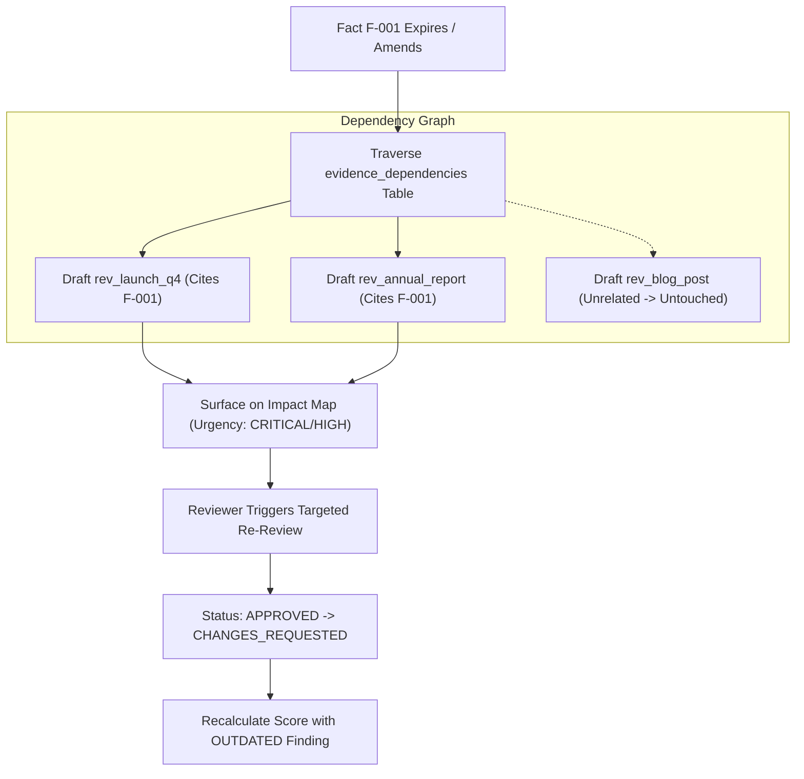

# 19 — Claim Impact Map

## Purpose

This document details the **Claim Impact Map** module (`backend/app/impact_map.py`), explaining dependency graph generation, historical content invalidation, and user-triggered targeted re-review execution.

---

## The Dependency Tracking Problem

In corporate marketing, legal and regulatory statements change continuously:
- A licensing agreement expires, requiring the withdrawal of partner badges.
- A market research study is superseded, invalidating a *"#1 Market Leader"* claim.
- A geographic expansion renders a *"Available exclusively in UK"* statement inaccurate.

In conventional organizations, identifying which active marketing assets cite an altered fact requires manual searches across hundreds of documents. If an asset is overlooked, outdated and legally risky assertions remain live in market.

The Claim Impact Map resolves this vulnerability through continuous relational dependency tracking:



---

## Architecture & Implementation

### 1. Granular Linkage Storage
Whenever a review is evaluated, every finding citing a fact records a row in `evidence_dependencies`:
```sql
INSERT INTO evidence_dependencies (
    id, workspace_id, review_id, finding_id, source_type, source_id, source_version, created_at
) VALUES (?, ?, ?, ?, 'fact', 'F-001', '1.0', ?);
```

### 2. Impact Query Traversal (`GET /api/governance/impact-map`)
When requested, the service performs an inner join between `facts`, `evidence_dependencies`, and `reviews`, scoped to the caller's workspace:
- Identifies all reviews linked to `EXPIRED` or `EXPIRING_SOON` facts.
- Categorizes urgency based on time remaining to expiration.
- Excludes unrelated reviews: drafts that do not cite the altered fact are completely untouched.

### 3. Targeted Re-Review Workflow (`POST /api/governance/re-review-impact`)
Reviewers can initiate targeted re-reviews directly from the Impact Map:
1. Re-evaluates each impacted review draft against current active rules and fact validities.
2. If a cited fact is now expired, the associated finding is updated to `status: OUTDATED` (`HIGH` severity, $-18\text{ pts}$).
3. **Approval Invalidation:** If the review had previously achieved `APPROVED` status, the server automatically revokes approval, transitioning the draft to **`CHANGES_REQUESTED`**.
4. An immutable audit record (`RE_REVIEW_EXECUTED`) is appended to the audit ledger.

---

## Distinction: User-Triggered vs. Background Worker

To maintain strict truthfulness in technical documentation:
- **Implemented:** Targeted, user-triggered re-review execution via `POST /api/governance/re-review-impact`.
- **Not Implemented / Deferred:** Automated background daemon/cron workers continuously re-scoring reviews on clock ticks without user initiation.

---

## Test Verification

Verified in `backend/tests/test_round3_claim_ledger.py`:
- `test_impact_map_three_drafts_and_isolation`: Proves that modifying Fact A flags Drafts 1 & 2 while leaving Draft 3 (citing Fact B) completely unaffected.
- `test_re_review_trigger_workflow`: Verifies that targeted re-review execution moves previously approved drafts to `CHANGES_REQUESTED` and recalculates scores deterministically.

---

## Related Documentation

- [10 — Database Schema](./10_DATABASE_SCHEMA.md)
- [16 — Content Review Pipeline](./16_CONTENT_REVIEW_PIPELINE.md)
- [18 — Time-Aware Claim Ledger](./18_TIME_AWARE_CLAIM_LEDGER.md)
- [28 — Approval Gate and Governance Workflow](./28_APPROVAL_GATE_AND_GOVERNANCE_WORKFLOW.md)
