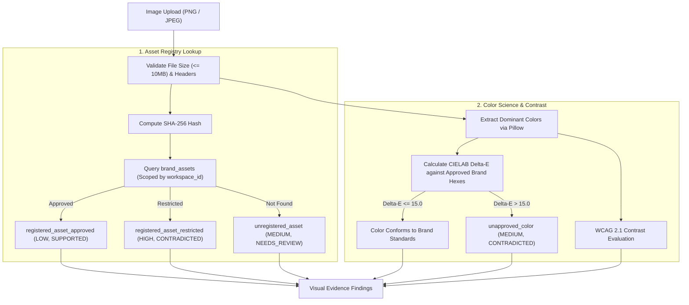

# 20 — Visual Compliance Overview

## Purpose

This document provides a comprehensive overview of the **Visual Compliance** engine in BRANDTRACE (`backend/app/image_analyzer.py` and `backend/app/color_science.py`), defining implemented multimodal capabilities, color science mathematics, asset registry checks, and explicit unsupported boundaries.

---

## Capabilities & Support Matrix

BRANDTRACE provides robust visual brand governance focused on deterministic mathematics and cryptographic hashing rather than black-box computer vision:

| Visual Governance Capability | Implementation Method | Status | Technical Details |
| :--- | :--- | :---: | :--- |
| **Asset Authenticity** | SHA-256 Binary Hash | **Implemented** | Matches against tenant-scoped `brand_assets` table. |
| **Asset Licensing Check** | Registry Lookup | **Implemented** | Identifies `APPROVED` vs `RESTRICTED` vs unknown media. |
| **Palette Extraction** | Pillow Color Quantization | **Implemented** | Extracts top dominant color tokens from uploaded raster files. |
| **Color Distance** | CIELAB Delta-E (CIE76) | **Implemented** | Computes mathematical perceptual distance to approved brand hexes. |
| **WCAG 2.1 Contrast Ratio** | Relative Luminance Math | **Implemented** | Evaluates known foreground/background color token pairs. |
| **Digital PDF Extraction** | Native `pypdf` Parser | **Implemented** | Extracts searchable text layers and embedded character spans. |
| **Raster Image OCR** | Bitmap Text Extraction | **Not Implemented (Deferred)**| Flat image and scanned-PDF OCR are unsupported. |
| **Perceptual Logo Detection** | Computer Vision / Bounding Box | **Not Implemented (Deferred)**| Does not detect logo coordinates, clear space, or rotation. |
| **Font Identification** | Typeface Classification | **Not Implemented (Deferred)**| Does not classify font names from raster imagery. |

---

## Multimodal Analysis Pipeline



---

## 1. Asset Registry SHA-256 Matching
When an image is uploaded, the server computes its cryptographic SHA-256 digest:
```python
content_hash = hashlib.sha256(data).hexdigest()
```
The hash is compared against the workspace's registered assets in `brand_assets`:
- **`APPROVED`**: Confirms the file is an authorized corporate visual asset with valid licensing (`SUPPORTED`).
- **`RESTRICTED`**: Flags unauthorized, internal-only, or expired assets (`CONTRADICTED`, `HIGH` severity).
- **Unknown Hash**: Assets missing from the registry are assigned `NEEDS_REVIEW` (`MEDIUM` severity), prompting human verification.

---

## 2. Dominant Color Extraction & Delta-E CIE76
- **Extraction:** Pillow quantizes the image to identify the most frequent RGB color clusters.
- **Color Space Transform:** RGB values are converted to CIELAB ($L^*, a^*, b^*$) coordinates via an intermediate $XYZ$ transform using the D65 standard illuminant.
- **CIE76 Delta-E Formula:** Perceptual distance ($\Delta E^*$) between extracted dominant color $C_1$ and approved brand standard $C_2$ is calculated as:
  $$\Delta E^* = \sqrt{(L_2^* - L_1^*)^2 + (a_2^* - a_1^*)^2 + (b_2^* - b_1^*)^2}$$
- **Threshold:** If the closest approved brand color has $\Delta E^* > 15.0$, the image is flagged with an `unapproved_color` violation.

---

## 3. WCAG 2.1 Contrast Ratio Assessment
Calculates relative luminance ($L$) according to WCAG 2.1 definitions:
$$L = 0.2126 \times R + 0.7152 \times G + 0.0722 \times B$$
Where color channels are linearized:
$$C = \begin{cases}
\frac{c_{\text{srgb}}}{12.92} & \text{if } c_{\text{srgb}} \le 0.04045 \\
\left(\frac{c_{\text{srgb}} + 0.055}{1.055}\right)^{2.4} & \text{if } c_{\text{srgb}} > 0.04045
\end{cases}$$

Contrast ratio between lighter color $L_1$ and darker color $L_2$ is:
$$\text{Ratio} = \frac{L_1 + 0.05}{L_2 + 0.05}$$
- Normal Text AA threshold: $\ge 4.5:1$.
- Bold/Large Text AA threshold: $\ge 3.0:1$.

---

## Related Documentation

- [14 — Brand Constitution](./14_BRAND_CONSTITUTION.md)
- [21 — Brand Asset Registry](./21_BRAND_ASSET_REGISTRY.md)
- [23 — Image Analysis and Colour Science](./23_IMAGE_ANALYSIS_AND_COLOUR_SCIENCE.md)
- [24 — WCAG Contrast and Limitations](./24_WCAG_CONTRAST_AND_LIMITATIONS.md)
- [42 — Feature Limitations and Deferred Roadmap](./42_FEATURE_LIMITATIONS_AND_DEFERRED_ROADMAP.md)
