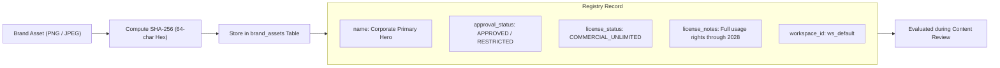

# 21 — Brand Asset Registry

## Purpose

This document specifies the technical implementation of the **Brand Asset Registry** (`brand_assets` table and `backend/app/image_analyzer.py`), explaining cryptographic SHA-256 binary hash matching, asset lifecycle statuses, licensing metadata, and tenant isolation guarantees.

---

## What is the Brand Asset Registry?

In enterprise marketing operations, unauthorized or outdated visual assets introduce acute legal and brand risks:
- Using a promotional banner whose photography licensing expired.
- Publishing deprecated corporate logo marks or unapproved partner badges.
- Utilizing internal-only visual mockups in customer-facing collateral.

The Brand Asset Registry enables brand administrators to register authorized visual assets into an immutable corporate ledger:



---

## Cryptographic Hash Matching vs. Perceptual Matching

BRANDTRACE intentionally uses **exact binary SHA-256 hash matching**:
1. **Zero False Positives:** Every single byte must match the authorized file. Modifications, unauthorized watermarks, or altered resolutions produce a completely different hash, immediately prompting human review.
2. **Defensible Legal Evidence:** Pinned cryptographic hashes provide immutable proof of whether the exact published byte sequence was cleared by legal.
3. **Explicit Boundary Disclosure:** The registry does **not** perform fuzzy, perceptual, or bounding-box logo recognition. If an authorized logo is embedded inside a complex, unflattened composite graphic, the composite will have a distinct hash and be classified as `unregistered_asset` (`NEEDS_REVIEW`).

---

## Data Schema (`brand_assets`)

- **`id`** (`TEXT`, PK): Unique identifier (e.g., `asset_corp_hero`).
- **`name`** (`TEXT`): Human-readable asset name.
- **`asset_type`** (`TEXT`): File classification (`image`, `logo`, `badge`).
- **`content_hash`** (`TEXT`, Indexed): Cryptographic binary SHA-256 digest string.
- **`source`** (`TEXT`): Origin path, CDN URL, or digital asset management (DAM) link.
- **`license_status`** (`TEXT`): Licensing category (`COMMERCIAL_UNLIMITED`, `EDITORIAL_ONLY`, `RESTRICTED`, `EXPIRED_LICENSE`).
- **`license_notes`** (`TEXT`): Mandatory restrictions or photographer attribution guidelines.
- **`approval_status`** (`TEXT`): Clearance tier:
  - `APPROVED`: Authorized for general commercial publication (`LOW` severity, `SUPPORTED` finding).
  - `RESTRICTED`: Prohibited or deprecated asset (`HIGH` severity, `CONTRADICTED` finding).
  - `REVIEW_REQUIRED`: Conditional asset requiring secondary review.
- **`workspace_id`** (`TEXT`, Indexed): Tenant partition ID.

---

## Tenant Data Isolation Invariant

Asset lookups are strictly scoped by `(content_hash, workspace_id)`:
```python
def check_asset_registry(content_hash: str, workspace_id: Optional[str] = None) -> Optional[Dict[str, Any]]:
    if workspace_id:
        return row(
            "SELECT * FROM brand_assets WHERE content_hash=? AND workspace_id=?",
            (content_hash, workspace_id),
        )
    return None
```
If two separate workspaces register the identical file bytes, each workspace maintains completely independent approval statuses, licensing conditions, and operational notes. Neither tenant can view, query, or mutate the other's asset records.

---

## Test Verification

Verified in `backend/tests/test_round3_visual.py` and `backend/tests/test_round3_comprehensive_security.py`:
- `test_brand_asset_registry_crud`: Tests creation, reading, updating metadata, and deleting assets.
- `test_image_hash_matching_registered_approved`: Proves approved assets generate `SUPPORTED` findings.
- `test_image_hash_matching_unregistered_and_restricted`: Verifies restricted assets generate `CONTRADICTED` findings and unknown assets generate `NEEDS_REVIEW`.
- `test_section3_asset_isolation_same_bytes_different_workspaces`: Proves complete multi-tenant partition isolation for identical file bytes.

---

## Related Documentation

- [10 — Database Schema](./10_DATABASE_SCHEMA.md)
- [11 — Workspace Isolation](./11_WORKSPACE_ISOLATION.md)
- [20 — Visual Compliance Overview](./20_VISUAL_COMPLIANCE_OVERVIEW.md)
- [23 — Image Analysis and Colour Science](./23_IMAGE_ANALYSIS_AND_COLOUR_SCIENCE.md)
