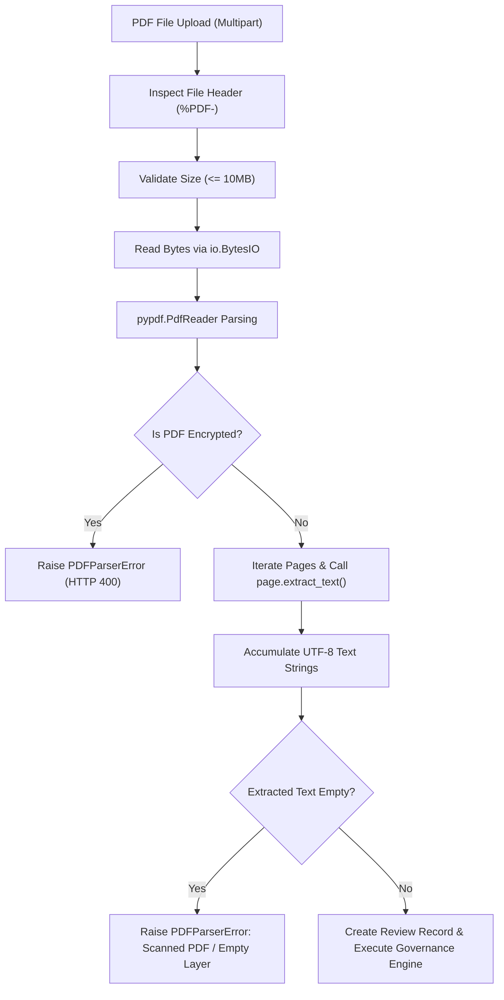

# 22 — PDF Ingestion and Text Extraction

## Purpose

This document details the **PDF Ingestion & Text Extraction** pipeline (`backend/app/pdf_parser.py`), explaining digital text-layer extraction, error handling, file-size guards, and the boundary between digital PDF extraction and unsupported scanned-document OCR.

---

## Architectural Workflow

Enterprise communications frequently circulate as formatted PDF drafts: press releases, product one-pagers, whitepapers, and brand manuals. BRANDTRACE ingests PDF files directly via `POST /api/reviews/upload`:

---

## Technical Implementation (`pdf_parser.py`)

1. **Native Pure-Python Parsing (`pypdf`):**  
   The parser uses `pypdf.PdfReader` directly in Python. It requires zero external OS packages, zero C-libraries, and zero system PATH dependencies (such as poppler or Ghostscript).
2. **Text-Layer Extraction:**  
   Extracts text page-by-page using `page.extract_text()`, preserving word spacing and punctuation necessary for regex pattern matching.
3. **Encrypted & Corrupted Stream Handling:**  
   - Encrypted PDFs (`reader.is_encrypted == True`) fail safely with an informative `PDFParserError` without crashing the ASGI worker.
   - Corrupted streams or invalid PDF headers fail immediately with standard HTTP 400 error responses.
4. **Blank Page Resiliency:**  
   Blank or spacer pages within a valid document are handled gracefully; text from remaining pages is extracted and normalized.

---

## Technical Limitations: Digital PDFs vs. Scanned OCR

To uphold strict documentation integrity:
- **Supported:** Digital PDFs containing a native font and character text layer (e.g., exported from Google Docs, Microsoft Word, Figma, Adobe InDesign, or LaTeX).
- **Unsupported (Deferred):** Scanned PDF documents consisting purely of rasterized flat page images (e.g., pages scanned from paper via a physical scanner). If a scanned PDF without an embedded text layer is uploaded, the parser detects an empty text stream and raises an informative error:
  > *"PDF file contains no extractable digital text layer. Scanned-document OCR is deferred in the current release."*

---

## Test Verification

Verified in `backend/tests/test_pdf_parser.py`:
- `test_empty_pdf_raises_safe_error`: Verifies that empty PDF byte streams raise safe `PDFParserError`.
- `test_corrupted_pdf_raises_safe_error`: Confirms corrupted headers trigger clean error handling.
- `test_blank_page_pdf_handling`: Validates multi-page extraction where some pages are blank.
- `test_encrypted_pdf_handling`: Proves encrypted payloads fail closed safely.

---

## Related Documentation

- [03 — Product Scope and Requirements](./03_PRODUCT_SCOPE_AND_REQUIREMENTS.md)
- [08 — API Reference](./08_API_REFERENCE.md)
- [16 — Content Review Pipeline](./16_CONTENT_REVIEW_PIPELINE.md)
- [42 — Feature Limitations and Deferred Roadmap](./42_FEATURE_LIMITATIONS_AND_DEFERRED_ROADMAP.md)
