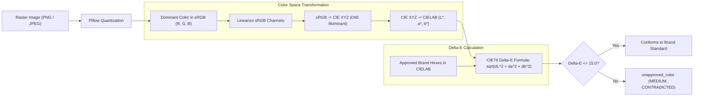

# 23 — Image Analysis and Colour Science

## Purpose

This document details the mathematical algorithms and color science implemented in **BRANDTRACE** (`backend/app/color_science.py` and `backend/app/image_analyzer.py`), covering dominant palette extraction, sRGB to CIELAB color space conversions, and CIELAB Delta-E (CIE76) perceptual distance calculations.

---

## The Color Science Pipeline



---

## 1. sRGB to CIELAB Color Space Transformation

Human vision perceives color differences non-linearly. Evaluating color compliance using raw Euclidean distance in RGB color space ($\sqrt{\Delta R^2 + \Delta G^2 + \Delta B^2}$) produces severe errors: colors that appear completely different to human observers can share small RGB distances, while visually similar shades can yield large RGB differences.

To achieve perceptually uniform evaluation, BRANDTRACE converts colors into the **CIELAB ($L^*, a^*, b^*$)** color space.

### Step 1.1: Linearize sRGB Channels
Raw sRGB channel values ($c \in [0, 255]$) are normalized to $[0, 1]$ and delinearized to remove gamma encoding:
$$c_{\text{linear}} = \begin{cases}
\frac{c}{12.92} & \text{if } c \le 0.04045 \\
\left(\frac{c + 0.055}{1.055}\right)^{2.4} & \text{if } c > 0.04045
\end{cases}$$

### Step 1.2: Transform Linear sRGB to CIE $XYZ$
Using the standard sRGB to $XYZ$ matrix under the D65 standard white point:
$$\begin{bmatrix} X \\ Y \\ Z \end{bmatrix} = \begin{bmatrix}
0.4124564 & 0.3575761 & 0.1804375 \\
0.2126729 & 0.7151522 & 0.0721750 \\
0.0193339 & 0.1191920 & 0.9503041
\end{bmatrix} \begin{bmatrix} R_{\text{linear}} \\ G_{\text{linear}} \\ B_{\text{linear}} \end{bmatrix}$$

### Step 1.3: Transform CIE $XYZ$ to CIELAB ($L^*, a^*, b^*$)
Normalized against the D65 reference white point ($X_n = 0.95047, Y_n = 1.00000, Z_n = 1.08883$):
$$L^* = 116 \cdot f\left(\frac{Y}{Y_n}\right) - 16$$
$$a^* = 500 \cdot \left[ f\left(\frac{X}{X_n}\right) - f\left(\frac{Y}{Y_n}\right) \right]$$
$$b^* = 200 \cdot \left[ f\left(\frac{Y}{Y_n}\right) - f\left(\frac{Z}{Z_n}\right) \right]$$
Where the non-linear transfer function $f(t)$ is defined as:
$$f(t) = \begin{cases}
t^{1/3} & \text{if } t > \left(\frac{6}{29}\right)^3 \\
\frac{1}{3} \left(\frac{29}{6}\right)^2 t + \frac{4}{29} & \text{otherwise}
\end{cases}$$

---

## 2. CIE76 Delta-E ($\Delta E^*$) Formula

Once both the extracted dominant color ($L_1^*, a_1^*, b_1^*$) and the approved brand color ($L_2^*, a_2^*, b_2^*$) are represented in CIELAB space, the Euclidean distance represents true perceptual difference:

$$\Delta E^* = \sqrt{(L_2^* - L_1^*)^2 + (a_2^* - a_1^*)^2 + (b_2^* - b_1^*)^2}$$

### Perceptual Distance Interpretation
- $\Delta E^* < 2.0$: Perceptually imperceptible difference to the human eye.
- $2.0 \le \Delta E^* \le 10.0$: Perceptible on close inspection, acceptable variation across different digital displays.
- $10.0 < \Delta E^* \le 15.0$: Noticeable shift, acceptable brand boundary.
- **$\Delta E^* > 15.0$:** **Off-Brand Color Drift.** Flags violation `unapproved_color` (`status: CONTRADICTED`).

---

## Dominant Palette Extraction via Pillow

```python
img = Image.open(stream)
img = img.convert("RGB")
img.thumbnail((300, 300)) # Fast downsampling for performance
quantized = img.quantize(colors=num_colors, method=Image.Quantize.MEDIANCUT)
```
1. **Downsampling:** Images are scaled down to $300\times 300$ pixels prior to quantization to maintain $< 50\text{ ms}$ processing times.
2. **Median Cut Quantization:** Clusters image pixels into the top $K$ dominant color centroids, returning both RGB coordinates and cluster frequency percentages.

---

## Test Verification

Verified in `backend/tests/test_color_and_visual.py` and `backend/tests/test_round3_visual.py`:
- `test_hex_rgb_conversions`: Validates bidirectional conversion precision.
- `test_delta_e_perceptual_distance`: Validates exact mathematical Delta-E outputs on standard CIE test color pairs.
- `test_image_palette_and_contrast_compliance`: End-to-end test verifying compliant vs off-brand image fixture evaluations.

---

## Related Documentation

- [14 — Brand Constitution](./14_BRAND_CONSTITUTION.md)
- [20 — Visual Compliance Overview](./20_VISUAL_COMPLIANCE_OVERVIEW.md)
- [24 — WCAG Contrast and Limitations](./24_WCAG_CONTRAST_AND_LIMITATIONS.md)
