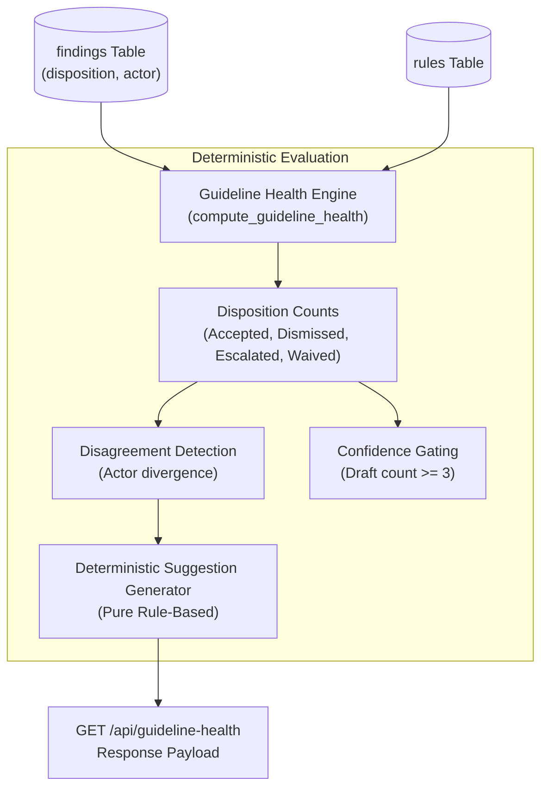

# 25 — Guideline Health Intelligence

## Purpose

This document explains the telemetry and analysis engine in **BRANDTRACE** (`backend/app/guideline_health.py`), which monitors rule performance across real reviews, quantifies human reviewer friction, identifies rule ambiguities, and computes guideline health without ungrounded AI speculation.

---

## 1. Architectural Overview

The Guideline Health engine aggregates empirical findings and human review dispositions across drafts within each workspace. It bridges automated static checks and human governance, answering questions such as:
- Which brand rules trigger excessive false positives?
- Where do human reviewers disagree on violation validity?
- Are guidelines failing due to poor rule scoping or author awareness gaps?

---

## 2. Key Metrics and Formulas

For each rule $r$ in workspace $W$, the engine tallies findings across associated reviews:

1. **Finding Count ($N_f$)**: Total findings generated by rule $r$.
2. **Affected Draft Count ($N_d$)**: Distinct reviews/drafts in which rule $r$ triggered at least once:
   $$N_d = |\bigcup_{f \in F_r} \{\text{review\_id}(f)\}|$$
3. **Disposition Rates**:
   - **Dismiss Rate**: $\frac{N_{\text{dismissed}}}{N_f}$
   - **Escalation Rate**: $\frac{N_{\text{escalated}}}{N_f}$
   - **Acceptance Rate**: $\frac{N_{\text{accepted}}}{N_f}$
   - **Waiver Rate**: $\frac{N_{\text{waived}}}{N_f}$

---

## 3. Reviewer Disagreement Detection

A primary innovation in BRANDTRACE is **multi-actor disagreement detection**. 

A rule demonstrates semantic ambiguity when one reviewer accepts a finding as a genuine violation while a different reviewer dismisses an identical finding triggered by the same rule:

$$\text{Disagreement Detected} \iff \exists a \in A_{\text{accepted}}, d \in A_{\text{dismissed}} : a \neq d \land a, d \notin \{\text{null}, \text{"unknown"}\}$$

This actor-aware calculation guarantees that a single user toggling a finding during review exploration does not trigger a false disagreement warning; divergence requires conflicting dispositions across distinct human actors.

---

## 4. Data Confidence Gating

To prevent misleading telemetry from skewing governance decisions on small sample sizes, BRANDTRACE enforces explicit data confidence thresholds:

$$\text{data\_confidence} = \begin{cases} \text{SUFFICIENT} & \text{if } N_d \ge 3 \\ \text{INSUFFICIENT} & \text{if } N_d < 3 \end{cases}$$

- **`INSUFFICIENT`**: When fewer than 3 independent drafts have encountered the rule, metrics are displayed with cautionary indicators, preventing premature rule modifications based on anecdotal drafts.
- **`SUFFICIENT`**: Statistical thresholds are considered mature enough for governance review and candidate rule suggestions.

---

## 5. Deterministic Suggestion Generation

BRANDTRACE does **not** use generative LLM guesswork to mutate policies. Instead, `backend/app/guideline_health.py` applies deterministic, auditable heuristic triggers:

| Trigger Condition | Observed Issue | Proposed Clarification Action |
| :--- | :--- | :--- |
| **Disagreement Detected** | Conflicting dispositions across distinct reviewers | Provide additional examples and contextual exception lists in rule definition. |
| **Dismiss Rate $\ge 50\%$** | High false-positive rate; rule over-triggering | Tighten regex pattern scope or exclude common legitimate phrases. |
| **Escalation Rate $\ge 30\%$** | Reviewers uncertain of policy intent | Clarify severity criteria and explicit decision guidance. |
| **Affected Drafts $\ge 5$ on Required Term** | Consistent missing required phrase across authors | Contributor awareness gap; recommend draft templates rather than policy change. |

Each suggestion includes:
- `observed_issue`: Exact metric-backed problem description.
- `proposed_clarification`: Concrete actionable remediation text.
- `ambiguity_addressed`: Specific governance risk mitigated.
