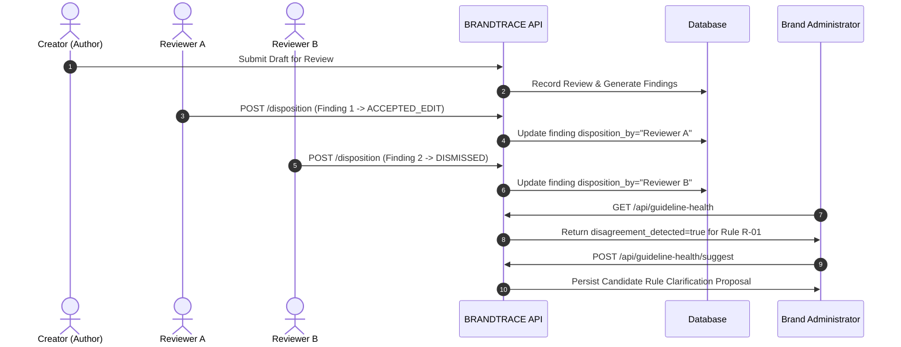

# 26 — Reviewer Feedback and Disagreement

## Purpose

This document explains the human-in-the-loop review feedback mechanisms, finding disposition overrides, and reviewer disagreement tracking implemented in **BRANDTRACE** (`backend/app/main.py`, `backend/app/guideline_health.py`, and `backend/app/governance.py`).

---

## 1. Finding Dispositions

When BRANDTRACE analyzes a draft, candidate findings are generated deterministically or through contextual analysis. Every finding has a lifecycle managed by human reviewers via the endpoint:

`POST /api/reviews/{review_id}/findings/{finding_id}/disposition`

### Allowed Disposition Taxonomy

| Disposition | Meaning | Effect on Governance Clearance Score | Audit Requirement |
| :--- | :--- | :--- | :--- |
| `UNRESOLVED` (`None` / `""`) | Finding detected; awaiting review | Penalty active (-4 to -30 based on severity) | Default initial state |
| `ACCEPTED_EDIT` / `EDITED` | Author or reviewer accepted correction | Penalty resolved (restores points) | Records editor identity and timestamp |
| `DISMISSED` | Finding marked as false positive or non-issue | Penalty resolved | Records dismisser and reason |
| `WAIVED` | Finding acknowledged as valid violation but granted an explicit administrative exception | Penalty resolved | Mandatory justification reason |
| `ESCALATED` | Reviewer flagged finding for supervisor or brand administrator adjudication | Penalty remains active | Treated as unresolved; triggers guideline health escalation counts |

---

## 2. Reviewer Disagreement Semantics

### Disposition Divergence at the Rule Level

In multi-reviewer enterprise workflows, guideline ambiguity reveals itself when different reviewers evaluate identical or similar rule violations inconsistently.

BRANDTRACE monitors this disposition divergence per rule in `compute_guideline_health()`:

```python
# Evaluates actual distinct actors across all findings for a given rule
accepted_by = {
    f.get("disposition_by")
    for f in rule_findings
    if f.get("disposition") in ("ACCEPTED_EDIT", "EDITED") and f.get("disposition_by")
}
dismissed_by = {
    f.get("disposition_by")
    for f in rule_findings
    if f.get("disposition") == "DISMISSED" and f.get("disposition_by")
}
# True disagreement: at least one known actor accepted AND a DIFFERENT known actor dismissed
disagreement_detected = any(
    a != d
    for a in accepted_by
    for d in dismissed_by
    if a and d and a != "unknown" and d != "unknown"
)
```

### Safety and Contamination Controls

1. **Self-Consistency Exclusion**: If the same reviewer marks a finding as dismissed and later modifies it, this is treated as a workflow revision, not a cross-reviewer divergence.
2. **Actor Attribution**: Dispositions are stamped with authenticated actor identities (`disposition_by`) and timestamps (`disposition_at`).
3. **Workspace Isolation**: Disagreement telemetry is strictly tenant-scoped (`WHERE r.workspace_id = ?`). Reviewer actions in Workspace A never influence health scores or suggestions in Workspace B.

---

## 3. Disagreement Lifecycle and Policy Loop



---

## 4. Audit Trail Integration

Every disposition transition generates an immutable audit record in the `audit` table:

```json
{
  "action": "FINDING_DISPOSITION_SET",
  "actor": "reviewer@brandtrace.internal",
  "actor_role": "reviewer",
  "review_id": "rev_7890",
  "details": "Finding f_1234 set to WAIVED. Reason: Approved for regional marketing campaign exception."
}
```
