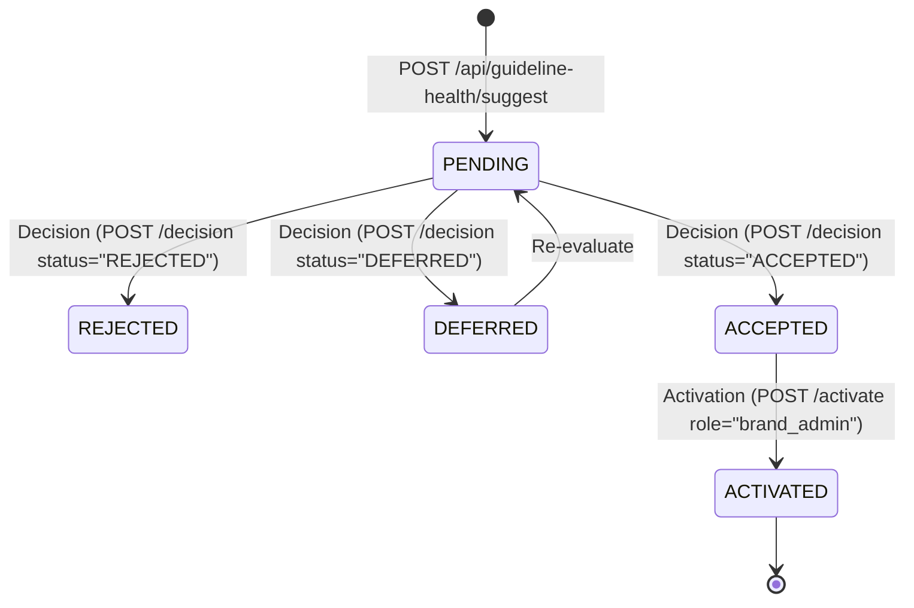

# 27 — Rule Suggestions and Versioning

## Purpose

This document explains how **BRANDTRACE** translates empirical review friction into proposed rule clarifications, and how approved proposals are safely activated through semantic versioning, immutable snapshots, and human-in-the-loop governance (`backend/app/main.py`, `backend/app/guideline_health.py`).

---

## 1. Explicit Architectural Boundary: No Autonomous AI Policy Mutation

A foundational principle of BRANDTRACE is **governance integrity**:
> **BRANDTRACE does NOT allow autonomous AI agents or background cron daemons to silently mutate enterprise brand guidelines.**

All rule changes follow a strict, auditable, human-adjudicated proposal and activation lifecycle:
1. Candidate suggestions are generated deterministically from real review telemetry or explicit API invocation.
2. Compliance administrators review the proposals in a triage queue.
3. Proposals can be **Accepted**, **Deferred**, or **Rejected**.
4. Only an authorized **Brand Admin** can explicitly trigger the **Activation** endpoint, which atomically updates the rule version and records the change in the immutable audit log.

---

## 2. Rule Suggestion Lifecycle



### Endpoints and Role Permissions

| Endpoint | HTTP Method | Required Role | Function |
| :--- | :--- | :--- | :--- |
| `/api/guideline-health/suggest` | `POST` | `reviewer`, `brand_admin` | Generate and persist a candidate rule proposal from telemetry |
| `/api/governance/rule-suggestions` | `GET` | Any authenticated role | List persisted rule suggestions for caller workspace |
| `/api/guideline-health/suggestions/{id}/decision` | `POST` | `brand_admin` | Triage proposal status (`ACCEPTED`, `DEFERRED`, `REJECTED`) |
| `/api/governance/rule-suggestions/{id}/activate` | `POST` | `brand_admin` | Promote accepted proposal into active rule; increments rule version |

---

## 3. Optimistic Locking and Concurrency Protection

To prevent concurrent race conditions or stale guideline overwrites, BRANDTRACE enforces **optimistic concurrency control** during activation:

```python
# Verification in /api/governance/rule-suggestions/{id}/activate
if rule_rec["version"] != payload.expected_rule_version or suggestion.get("rule_version") != payload.expected_rule_version:
    raise HTTPException(
        409,
        f"Version conflict: current rule version is {rule_rec['version']}, "
        f"expected {payload.expected_rule_version}"
    )
```

If another administrator modified or activated a rule change while the current proposal was pending review, the activation is rejected with `HTTP 409 Conflict`, forcing the administrator to review the latest rule state before applying changes.

---

## 4. Immutable Version Snapshots

When a rule suggestion is activated, BRANDTRACE executes an atomic transaction in `backend/app/main.py`:

1. **Calculate New Version**: Semantic patch increment (e.g. `v1.0` $\to$ `v1.1`).
2. **Snapshot Old Version**: Persist the existing rule state into the `rule_versions` table with:
   - `rule_id`: Identifier of the rule
   - `version`: Version string before mutation
   - `title`, `description`, `pattern`, `requirement`, `severity`
   - `source_title`, `source_excerpt`
   - `originating_suggestion_id`: Link to the proposal triggering the revision
   - `created_at`: Exact timestamp of snapshot creation
3. **Update Live Rule**: Mutate the active row in `rules` with the clarified description or pattern, setting `version = new_version` and `updated_at = now()`.
4. **Update Proposal Status**: Mark suggestion as `ACTIVATED` with `activated_by` and `activated_at`.
5. **Record Audit Event**: Insert `RULE_SUGGESTION_DECIDED` and `RULE_UPDATED` events into the `audit` ledger.

This immutability ensures that past reviews evaluated against version `v1.0` can always be verified against the exact historical snapshot in `rule_versions`, preserving audit trail reproducibility.
