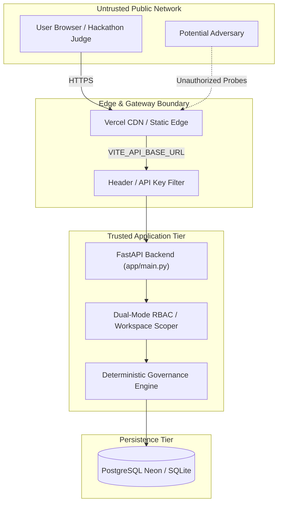

# 30 — Security Threat Model

## Purpose

This document presents the formal security threat model for **BRANDTRACE**, analyzing potential attack vectors, trust boundaries, tenant isolation guarantees, and mitigating controls according to the Microsoft STRIDE methodology.

---

## 1. System Trust Boundaries and Architecture



---

## 2. STRIDE Threat Analysis and Mitigations

| Threat Category | Potential Attack Vector | BRANDTRACE Technical Mitigation |
| :--- | :--- | :--- |
| **Spoofing** | Adversary attempts to forge `X-Demo-Role: brand_admin` in production | In strict production mode (`AUTH_MODE=strict`), demo headers are completely ignored; requests require valid bearer tokens or authenticated API keys. In demo mode, role switching is restricted to simulated sandbox environments. |
| **Tampering** | User attempts to silently modify an active rule or overwrite past review findings | Historical immutability: rules and reviews use append-only version snapshots (`rule_versions`, `review_versions`). Rule activation requires explicit `expected_rule_version` matching (optimistic locking). |
| **Repudiation** | User denies approving a non-compliant marketing campaign | Append-only `audit` ledger records immutable events with `actor`, `actor_role`, `action`, details, and ISO-8601 UTC timestamps on every state transition. |
| **Information Disclosure** | Tenant B queries findings or facts belonging to Tenant A | Strict SQL parameterized tenant scoping on every route: `WHERE workspace_id = ?`. Dual-layer validation ensures resource workspace matches caller workspace before returning data. |
| **Denial of Service** | Malicious user uploads massive corrupted PDF files or huge image bitmaps | Maximum payload size limits enforced at gateway (10MB). `pypdf` extraction runs in isolated try/catch with recursion limits. Image processing downsamples palettes using Pillow quantization. |
| **Elevation of Privilege** | `creator` or `auditor` attempts to trigger `/approval` or mutate brand profile | FastAPI role dependency checks enforce strict RBAC. Non-privileged roles attempting administrative endpoints receive immediate `HTTP 403 Forbidden`. |

---

## 3. Multi-Tenant Workspace Isolation Guarantees

BRANDTRACE guarantees cross-workspace isolation through three structural layers:

1. **Parameter Resolution**: The active workspace is resolved through authenticated session contexts or verified headers (`get_workspace_id` dependency).
2. **Database Query Scoping**: Every SQL statement touching rules, facts, reviews, findings, or assets includes an explicit tenant filter:
   ```sql
   SELECT * FROM rules WHERE status='APPROVED' AND workspace_id = ?
   ```
3. **Cross-Tenant Mutation Guards**: During resource updates (e.g. activating a rule suggestion or modifying brand guidelines), the server verifies that both the target resource and caller session share the exact same `workspace_id`:
   ```python
   if suggestion.get("workspace_id") != rule_rec.get("workspace_id"):
       raise HTTPException(403, "Suggestion and source rule must belong to the authorized caller workspace.")
   ```

---

## 4. Secret Management and Zero-Leakage Policy

- **Environment Variable Isolation**: Backend secrets (`ADMIN_RESET_SECRET`, `NEON_DATABASE_URL`, `GEMINI_API_KEY`) are exclusively stored in server environment variables and are never bundled into client Vite builds.
- **Client Configuration**: The frontend accesses only public configuration tokens prefixed with `VITE_` (`VITE_API_BASE_URL`, `VITE_APP_ENV`).
- **No Embedded Credentials in Git**: Local `.env` files and `.sqlite` databases are strictly excluded via `.gitignore`.
