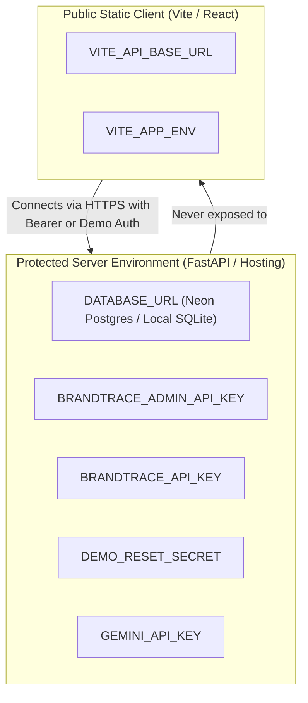

# 31 — Data Privacy and Secret Management

## Purpose

This document outlines the data privacy protocols, credential handling, secret lifecycle management, and fixture hygiene enforced across **BRANDTRACE** client and server components.

---

## 1. Secret Management Architecture

BRANDTRACE separates sensitive server credentials from client application bundles using strict environment variable boundaries:



### Critical Security Protections in Code
1. **Production Insecure Key Guard** (`backend/app/config.py`):
   ```python
   if API_KEY and ADMIN_API_KEY and API_KEY.strip() == ADMIN_API_KEY.strip():
       if ENVIRONMENT == "production":
           raise RuntimeError(
               "Insecure configuration: API_KEY and ADMIN_API_KEY must not be identical in production mode."
           )
   ```
2. **Fail-Closed Demo Reset**:
   `ALLOW_DEMO_RESET` defaults to `false` in production and staging environments, preventing unauthenticated or automated database resets over the public internet.

---

## 2. Customer Content Privacy

### Marketing Drafts and Uploaded Media
- **In-Memory and Ephemeral Processing**: Ingested PDFs and uploaded images are processed in-memory or streamed to local temporary storage during analysis. Binary buffers are parsed, hashed for asset matching, and never transmitted to third-party endpoints unless an external AI provider is explicitly configured.
- **Offline / Mock Mode by Default**: Out of the box, `AI_PROVIDER=mock`, meaning draft text is analyzed completely offline on local compute without communicating with external cloud LLMs.
- **Tenant Scope Enforcement**: Customer drafts are isolated by `workspace_id`. Cross-workspace querying of draft text, findings, or review versions is structurally blocked at the database query level.

---

## 3. Test Fixture Hygiene

To avoid accidental disclosure of proprietary enterprise data or real credentials in test runs and demonstrations:
1. **Synthetic Data Only**: All fixtures in `backend/app/main.py` (`setup_demo_data`) and test suites use fictional brand entities (e.g., *AuraTech*, *CloudScale*), synthetic marketing claims, and public ISO test vectors.
2. **Zero Hardcoded API Tokens**: Test scripts generate dynamic mock tokens or use local test flags (`ENVIRONMENT=test`). No production keys, database passwords, or private signing secrets are checked into the Git repository.
3. **Automatic SQLite Exclusion**: Local `.sqlite` databases and `brandtrace.db` are barred by `.gitignore`.
