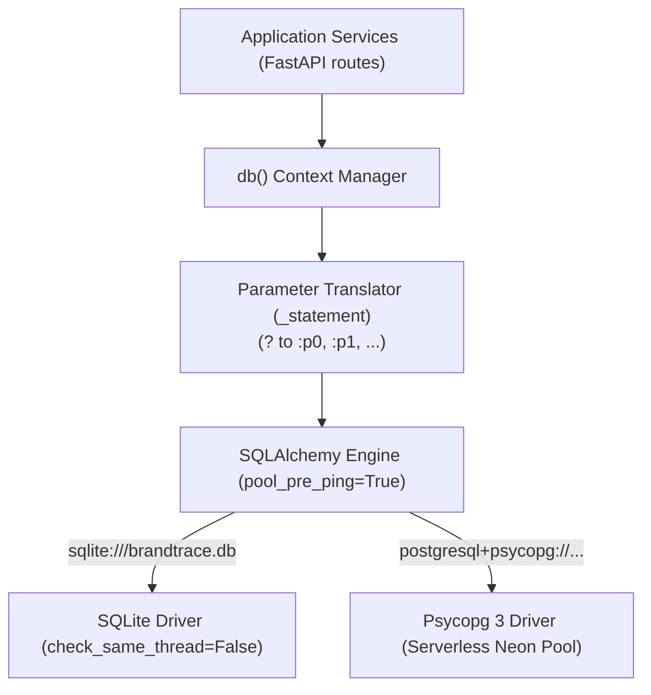

# 32 — Database Migrations and Persistence

## Purpose

This document explains the dual-engine persistence layer implemented in **BRANDTRACE** (`backend/app/models.py`), supporting zero-setup local SQLite for development and hackathon demonstrations, as well as production-ready connection-pooled PostgreSQL (Neon) for hosted deployments.

---

## 1. Dual-Engine Architecture

BRANDTRACE utilizes **SQLAlchemy 2.0** as a dialect-agnostic database abstraction layer:



### Dynamic Dialect Parameter Normalization

SQLite uses positional `?` placeholders while standard PostgreSQL drivers expect positional `%s` or named `:param` placeholders. BRANDTRACE bridges this seamlessly through an automated query translator:

```python
def _statement(query: str, params: Any = ()):
    """
    Format SQL query for SQLAlchemy 2.0 with bound parameters.
    Converts '?' positional placeholders to ':p0', ':p1', etc.
    """
    if isinstance(params, dict):
        return text(query), params
    values = tuple(params)
    if not values:
        return text(query), {}
    index = 0
    def replace(_: re.Match):
        nonlocal index
        placeholder = f"p{index}"
        index += 1
        return f":{placeholder}"
    converted = re.sub(r"\?", replace, query)
    return text(converted), {f"p{i}": val for i, val in enumerate(values)}
```

This guarantees identical SQL queries written across the codebase execute cleanly on both SQLite and PostgreSQL without code bifurcation.

---

## 2. Serverless Connection Resilience (Neon PostgreSQL)

Hosted serverless databases like Neon suspend compute instances during inactivity, which can drop idle TCP sockets. BRANDTRACE mitigates dropped connections and connection spikes with robust engine configuration:

- **`pool_pre_ping=True`**: Tests connections with a lightweight `SELECT 1` ping prior to checkout, transparently recycling dead sockets.
- **`pool_recycle=300`**: Cycles pooled connections every 5 minutes (300 seconds) to avoid upstream gateway timeouts.
- **`pool_size=5` / `max_overflow=10`**: Balances connection capacity against serverless connection limits.
- **Bounded Connect Timeouts**: Sets `connect_timeout` and `pool_timeout` to 10 seconds, ensuring health probes fail fast rather than hanging indefinitely.

---

## 3. Idempotent Schema Initialization (`init_db`)

The database schema is defined declaratively using idempotent `CREATE TABLE IF NOT EXISTS` statements covering all 15 core tables:

1. `workspaces`
2. `workspace_members`
3. `brand_profiles`
4. `brand_assets`
5. `rules`
6. `rule_versions`
7. `facts`
8. `fact_versions`
9. `reviews`
10. `review_versions`
11. `findings`
12. `evidence_dependencies`
13. `audit`
14. `rule_suggestions`
15. `system_state`

During application startup (within the FastAPI `lifespan` handler), `init_db()` runs automatically. If tables or indices already exist, the operation safely no-ops without data loss.

---

## 4. Migration Strategy

For production lifecycle management:
- Initial table provisioning is executed by `init_db()`.
- Incremental column additions (such as adding `disposition_by` or `source_version`) use guarded `ALTER TABLE ADD COLUMN` statements with existence checks or catch-and-ignore blocks, ensuring idempotence across multiple startup cycles.
- High-risk operations (such as resetting demo fixtures) are restricted to dedicated administrative routes protected by `DEMO_RESET_SECRET`.
