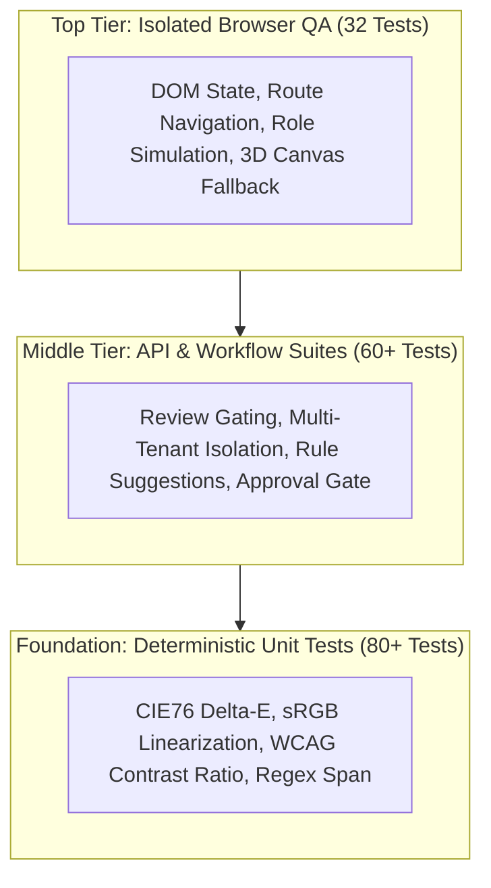

# 33 — Testing Strategy

## Purpose

This document outlines the testing philosophy, verification layers, execution frameworks, and quality gates that validate the reliability, security, and mathematical precision of **BRANDTRACE**.

---

## 1. Testing Philosophy and Pyramid

The BRANDTRACE testing strategy emphasizes **deterministic reproducibility** and **governance rigor**. Because enterprise brand compliance directly impacts customer trust and legal risk, test coverage is prioritized as follows:

1. **Deterministic Unit Math**: Color conversions, Delta-E calculations, and WCAG contrast ratios must match ISO/CIE analytical standards within $\pm 0.01$ precision.
2. **Strict Multi-Tenant Isolation**: Automated tests verify that Tenant A cannot read, mutate, or trigger reviews against Tenant B assets.
3. **Negative Security Boundaries**: Unauthorized personas (`creator`, `auditor`) must receive explicit `HTTP 403 Forbidden` on administrative endpoints.
4. **Approval Gate Integrity**: Automated integration tests confirm that `HIGH` or `CRITICAL` findings block review approval with `HTTP 409 Conflict`.

---

## 2. Verification Frameworks and Test Runners

### 1. Pytest Backend Suite (`backend/tests/`)
- **Engine**: `pytest` 8.3+ with `pytest-asyncio`.
- **Scope**: Complete unit and integration coverage across all 44 FastAPI routes, the deterministic rule engine, claim ledger expiry, and SQLite/PostgreSQL persistence.
- **Coverage**: 20 distinct test modules executing 144 passing tests (1 skipped).

### 2. Isolated Browser QA Suite (`run_isolated_browser_qa.py`)
- **Engine**: Headless Playwright / Chromium runner.
- **Scope**: End-to-end user journeys:
  - Navigation across all 9 views
  - 3D Command Core canvas rendering and SVG fallback validation
  - Role switcher UI behavior and persona simulation banner
  - Finding resolution (Accept / Dismiss / Waive)
  - Color contrast visualizer UI
- **Results**: 32/32 tests passing.

### 3. SQLite Regression Verifier (`verify_sqlite_regression.py`)
- **Engine**: Fast automated test harness for local developer environments.
- **Scope**: Validates all database queries, migrations, and model triggers without requiring an external PostgreSQL instance.
- **Results**: 126 passing tests (1 skipped).

---

## 3. Continuous Integration and Release Gates

Before any production deployment or hackathon release:
1. **Linting and Type Checking**: `npm run build` runs `tsc -b` and Vite bundling with zero type errors.
2. **Backend Test Suite**: `pytest backend/tests` must pass with zero failures.
3. **Route Reconciliation**: API route introspection ensures documented endpoints match registered FastAPI paths.
4. **Live Smoke Testing**: Deployed web endpoints are verified against `/api/health` and `/api/overview`.
