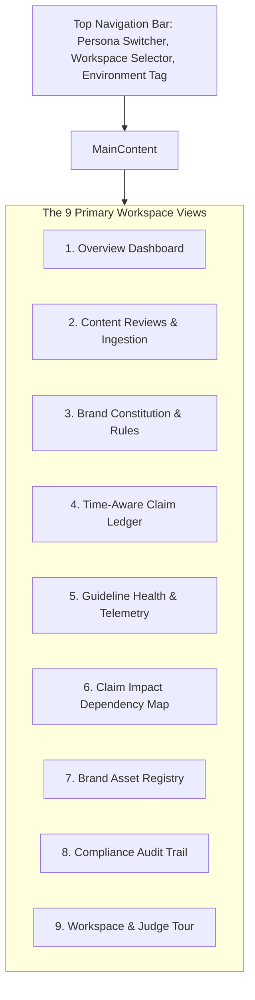

# 37 — Frontend User Guide

## Purpose

This document provides a comprehensive user manual and interface walkthrough covering all nine primary workspace views in the **BRANDTRACE** client application.

---

## 1. Interface Navigation and Layout

BRANDTRACE features a dark obsidian, Apple-inspired interface designed for high-density compliance work and executive decision-making.

---

## 2. Walkthrough of the 9 Workspace Views

### 1. Overview Dashboard
- **Executive Telemetry**: Displays total drafts reviewed, unresolved violations by severity, and average governance clearance score.
- **3D AI Command Core**: An interactive Three.js node network visualizing guideline clusters and active review dependencies. Supports raycasting and hover inspection, with automatic SVG fallback if WebGL is unavailable.
- **Recent Activity Stream**: Live feed of the latest audit events recorded in the workspace.

### 2. Content Reviews & Ingestion
- **Ingestion Modal**: Allows pasting raw marketing copy, Markdown text, or uploading digital PDFs and image assets (`.png`, `.jpg`).
- **Review Canvas**: Split-pane interface displaying the draft text alongside detailed compliance findings.
- **Interactive Finding Triage**: Click any finding to inspect its rule citation, exact-span match, and available actions:
  - **Accept Correction**: Automatically applies the suggested replacement in-place.
  - **Dismiss**: Clears the finding with a documented reason.
  - **Waive**: Grants an administrative exception.
- **Version History**: Review side-by-side diffs of previous draft revisions and perform one-click rollbacks.
- **Approval Gate**: Reviewers and Brand Admins can trigger `Approve`, `Request Changes`, or `Waive`.

### 3. Brand Constitution & Guidelines
- **Rule Library**: Browse approved guidelines categorized by prohibited superlatives, required terminology, tone, and visual standards.
- **Visual Identity Tokens**: Configure brand primary color, secondary color, accent palette, and minimum contrast thresholds.
- **Rule Version Snapshots**: Inspect semantic version histories (e.g. `v1.0` $\to$ `v1.1`) and originating proposals.

### 4. Time-Aware Claim Ledger
- **Claim Catalog**: Centralized repository of substantiated business facts (e.g. market share statistics, award claims, pricing benchmarks).
- **Time-Aware Boundaries**: Each claim includes strict `effective_from` and `expires_at` ISO-8601 UTC dates.
- **Expiration Alerts**: Claims approaching expiration within 30 days display an amber `EXPIRING_SOON` badge; expired claims show a red `OUTDATED` badge.

### 5. Guideline Health & Telemetry
- **Friction Metrics**: Tally of finding frequencies, dismiss rates, and escalation rates per rule.
- **Multi-Reviewer Disagreement**: Flags rules where different human reviewers recorded conflicting dispositions on identical violations.
- **Candidate Clarification Proposals**: Triage queue where administrators review, accept, defer, or activate rule refinements.

### 6. Claim Impact Dependency Map
- **Dependency Graph**: Interactive network mapping Claim Ledger facts to historical marketing drafts that rely on them.
- **Targeted Re-Review**: When a fact expires or is modified, administrators click **Run Targeted Re-Review** to automatically transition all affected approved drafts to `CHANGES_REQUESTED`.

### 7. Brand Asset Registry
- **Official Asset Repository**: Registry of approved logos, brand badges, and iconography.
- **Cryptographic Verification**: Verifies uploaded assets against official binary SHA-256 hashes.
- **Aspect Ratio Checks**: Flags uploaded logos that deviate from approved aspect ratio standards.

### 8. Compliance Audit Trail
- **Immutable Log**: Chronological stream of all workspace actions (rule updates, finding dispositions, approval decisions).
- **Deep Attribution**: Each entry displays the authenticated actor, role, action, and detailed payload diffs.

### 9. Workspace Management & Judge Tour
- **Tenant Management**: Switch active workspaces or invite team members with specific RBAC roles (`creator`, `reviewer`, `brand_admin`, `auditor`).
- **Interactive Judge Tour**: A 6-step guided walkthrough highlighting key product features for hackathon evaluators.
- **Persona Switcher**: Seamlessly switch simulated roles in demo mode to test permission boundaries.
