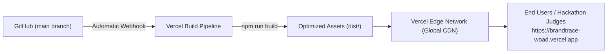

# 39 — Deployment and Vercel Runbook

## Purpose

This document provides the operational runbook for deploying and verifying the **BRANDTRACE** frontend on the Vercel edge network.

---

## 1. Deployment Topology



- **Production URL**: [https://brandtrace-woad.vercel.app](https://brandtrace-woad.vercel.app)
- **Deployment Platform**: Vercel (Edge Network)
- **Source Branch**: `main`
- **Build Trigger**: Automatic deployment on push to `main`.

---

## 2. Vercel Project Configuration

| Setting | Value | Description |
| :--- | :--- | :--- |
| **Framework Preset** | Vite | Automatically configures build commands and output directories. |
| **Build Command** | `npm run build` | Compiles TypeScript (`tsc -b`) and bundles assets via Vite. |
| **Output Directory** | `dist` | Directory containing static HTML, CSS, JavaScript, and Three.js chunks. |
| **Install Command** | `npm install` | Installs project dependencies defined in `package.json`. |
| **Node.js Version** | `20.x` | Modern LTS runtime for stable bundling. |

---

## 3. SPA Routing Configuration (`vercel.json`)

To prevent HTTP 404 errors when deep-linking to specific client views or refreshing browser tabs, `vercel.json` configures client-side rewrite rules:

```json
{
  "rewrites": [
    {
      "source": "/(.*)",
      "destination": "/index.html"
    }
  ]
}
```

---

## 4. Environment Variables on Vercel

The following build-time environment variables are configured in the Vercel Project Settings:

1. `VITE_API_BASE_URL`: The URL of the hosted FastAPI backend (e.g. `https://brandtrace-api.onrender.com` or empty for local proxy).
2. `VITE_APP_ENV`: Set to `staging` or `production` to configure UI status indicators and role simulation headers.

---

## 5. Post-Deployment Verification Checklist

After every automated Vercel deployment:
1. **HTTP Status**: Verify `https://brandtrace-woad.vercel.app` returns `200 OK`.
2. **Asset Integrity**: Inspect DevTools Network tab to confirm all JS/CSS bundles load without `404` or MIME-type warnings.
3. **3D Canvas Verification**: Confirm the Three.js 3D Command Core renders properly and handles mouse rotation.
4. **Theme Consistency**: Verify dark obsidian palette (`#0B0F17`) renders uniformly across all views.
5. **Route Navigation**: Navigate through all 9 views to verify client-side routing works smoothly.
