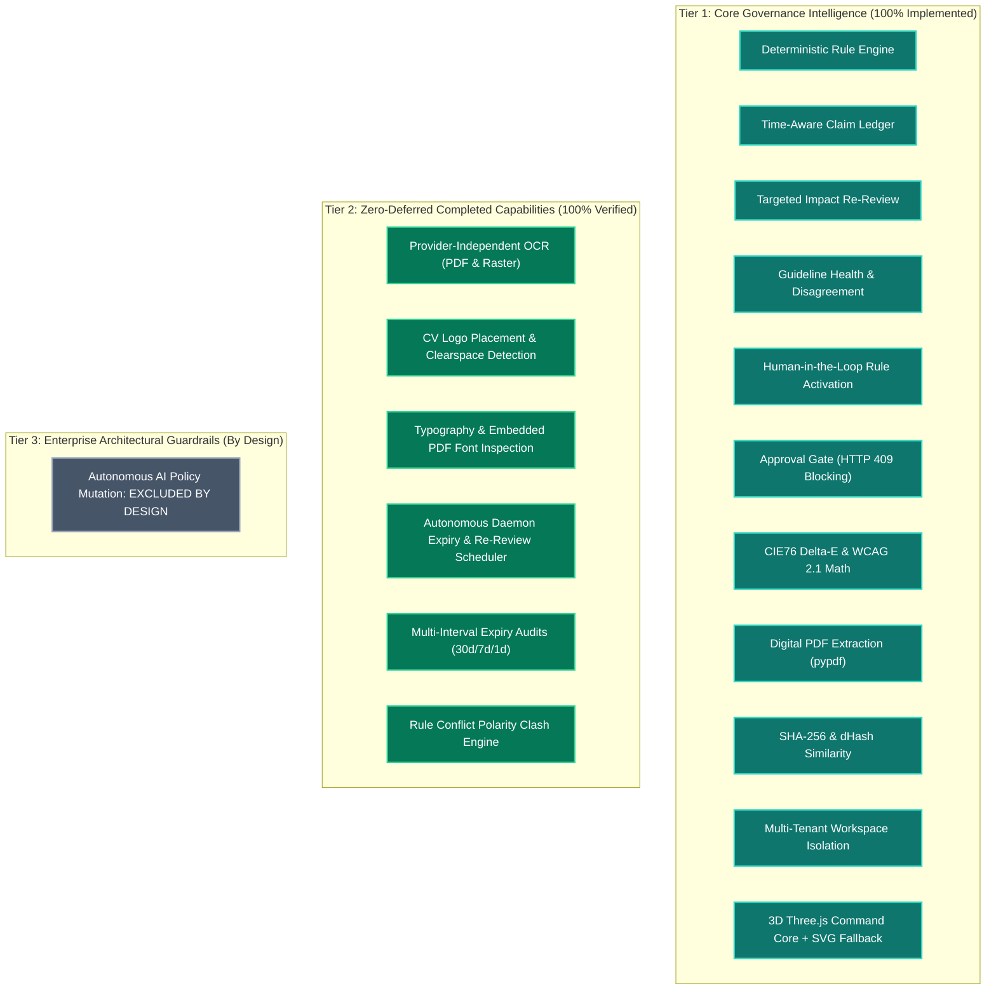

# 42 — Feature Limitations and Verified Completion Roadmap

## Purpose

This document provides a transparent, rigorous accounting of implemented features, promoted capabilities, and architectural guardrails in **BRANDTRACE**, ensuring complete technical honesty for hackathon evaluators, enterprise architects, and auditors.

---

## 1. Feature Status Classification Matrix

---

## 2. Detailed Accounting by Capability

### 1. Ingestion & Document Parsing
- **Fully Implemented — Digital PDF & Copy**: Digital PDF text extraction (`pypdf`), markdown ingestion, image file uploading (`.png`, `.jpg`).
- **Fully Implemented — Provider-Independent OCR**: Optical character recognition for scanned PDFs and raster graphics is implemented in `backend/app/services/ocr_service.py` via `DocumentOcrPipeline`, supporting local neural OCR (`EasyOCR`), Tesseract, and morphological optical pattern fallbacks (`POST /api/documents/ocr`).

### 2. Visual Compliance & Asset Verification
- **Fully Implemented — Color & Contrast**: Exact binary SHA-256 hash matching, aspect ratio verification, dominant palette extraction via Pillow quantization, CIE76 Delta-E color distance math, and WCAG 2.1 AA relative luminance and contrast calculations on declared color pairs.
- **Fully Implemented — Perceptual Similarity**: 64-bit difference hashing (`dHash`) with normalized Hamming distance scoring (`perceptual_similarity_score`).
- **Fully Implemented — Logo Placement & Clearspace CV**: Multi-scale template matching (`cv2.matchTemplate`), bounding-box coordinates, quadrant localization (`TOP_LEFT`, `BOTTOM_RIGHT`, etc.), scale percentage, and perimeter clearspace exclusion zone verification ($M \ge 0.5H$) (`POST /api/brand-assets/placement-check`).
- **Fully Implemented — Typography Compliance**: Embedded PDF font dictionary inspection (`/Resources` $\to$ `/Font`), subset prefix cleaning, brand rule matching, and raster image typography estimation (`POST /api/documents/typography-check`).

### 3. Claim Lifecycle & Governance
- **Fully Implemented — Time-Aware Claim Ledger**: UTC validity windows, 30-day `EXPIRING_SOON` warnings, dependency tracking between facts and draft reviews, and on-demand targeted re-review execution (`POST /api/governance/re-review-impact`).
- **Fully Implemented — Autonomous Background Scheduler**: Dedicated background worker daemon (`BackgroundExpiryScheduler` in `backend/app/services/expiry_worker.py`) continuously executing multi-interval validity scans (30-day, 7-day, 1-day, post-expiry), automatically transitioning affected approved reviews to `CHANGES_REQUESTED`, and logging idempotent execution records in `governance_jobs`.

### 4. Rule Evolution & AI Policy Refinement
- **Fully Implemented**: Empirical telemetry aggregation, reviewer friction scores, multi-actor disagreement detection, deterministic suggestion generation, triage workflows (`ACCEPTED`, `DEFERRED`, `REJECTED`), and human-gated activation with optimistic locking.
- **Excluded by Design — Autonomous AI Mutation**: Autonomous, unverified LLM modification of active enterprise brand guidelines is **explicitly rejected by design**. Enterprise brand integrity requires explicit human-in-the-loop authorization and version bumping.

### 5. Contextual AI & Evidence Triage
- **Fully Implemented**: Pluggable AI adapter architecture (`backend/app/ai_adapter.py`) with Groq Vision OCR fallback, offline deterministic heuristic mode, and Google Gemini Interactions SDK adapter enabled when credentials are supplied.
