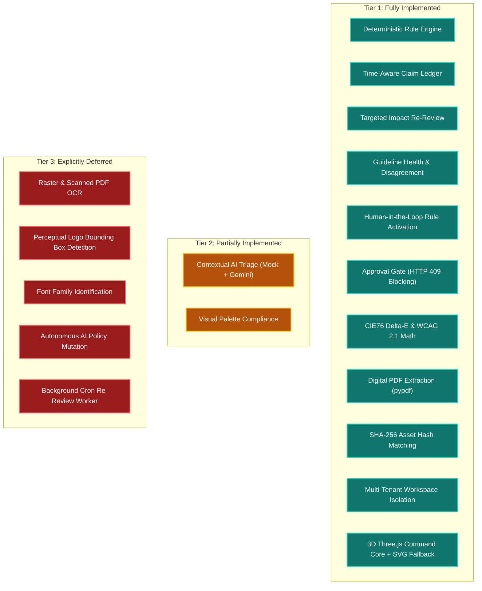

# 42 — Feature Limitations and Deferred Roadmap

## Purpose

This document provides a transparent, rigorous accounting of implemented features, partially implemented capabilities, and explicitly deferred roadmap items in **BRANDTRACE**, ensuring complete technical honesty for hackathon evaluators, enterprise architects, and auditors.

---

## 1. Feature Status Classification Matrix

---

## 2. Detailed Accounting by Capability

### 1. Ingestion & Document Parsing
- **Implemented**: Digital PDF text extraction (`pypdf`), raw copy/markdown ingestion, image file uploading (`.png`, `.jpg`).
- **Deferred — Raster OCR**: BRANDTRACE does **not** perform optical character recognition (OCR) on flattened raster images or scanned non-digital PDFs. Ingested PDFs must contain an extractable digital text layer.

### 2. Visual Compliance & Asset Verification
- **Implemented**: Exact binary SHA-256 hash matching against the Brand Asset Registry, aspect ratio verification, dominant palette extraction via Pillow quantization, CIE76 Delta-E color distance math, and WCAG 2.1 AA relative luminance and contrast calculations on declared color pairs.
- **Deferred — Logo Object Detection**: Bounding-box perceptual object detection (e.g. YOLO/detectron for locating logos inside complex photographic scenes) is **not implemented**. BRANDTRACE matches discrete uploaded brand assets against registered cryptographic hashes.
- **Deferred — Font Identification**: Automatic typographic font family identification from rendered raster images is **not implemented**.

### 3. Claim Lifecycle & Governance
- **Implemented**: Time-Aware Claim Ledger with ISO-8601 UTC validity windows, 30-day `EXPIRING_SOON` warnings, dependency tracking between facts and draft reviews, and on-demand **targeted re-review execution** (`POST /api/governance/re-review-impact`).
- **Deferred — Automated Background Daemon**: Automated recurring background cron worker polling for expired facts is **not implemented**. Re-review is triggered intentionally by authorized users.

### 4. Rule Evolution & AI Policy Refinement
- **Implemented**: Empirical telemetry aggregation, reviewer friction scores, multi-actor disagreement detection, deterministic suggestion generation, triage workflows (`ACCEPTED`, `DEFERRED`, `REJECTED`), and human-gated activation with optimistic locking.
- **Excluded by Design — Autonomous AI Mutation**: Autonomous, unverified LLM modification of active enterprise brand guidelines is **explicitly rejected**. All rule modifications require explicit human authorization and version bumping.

### 5. Contextual AI Triage
- **Partially Implemented**: Pluggable AI adapter architecture (`backend/app/ai_adapter.py`). Operates entirely offline with a deterministic heuristic mock by default, with an optional Google Gemini Interactions SDK adapter enabled when `AI_PROVIDER=gemini` and API credentials are supplied.
