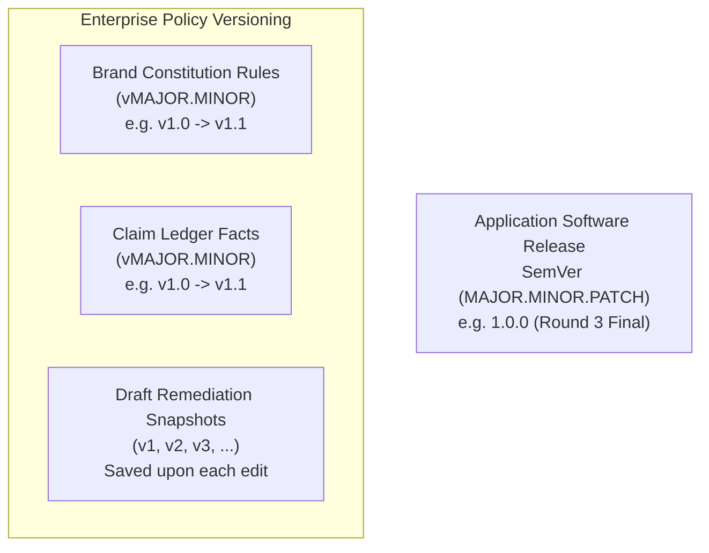

# 43 — Release and Versioning Policy

## Purpose

This document outlines the release engineering lifecycle, versioning semantics for software and enterprise governance assets, and quality gate requirements in **BRANDTRACE**.

---

## 1. Multi-Tier Versioning Model

BRANDTRACE applies semantic versioning across three distinct layers:



### 1. Application Releases (SemVer)
- **Format**: `MAJOR.MINOR.PATCH`
- **Current Version**: `1.0.0` (CodeAxis Hackathon Round 3 Final Release)
- **Release Cadence**: Tagged releases on `main` following verification gates.

### 2. Brand Constitution Rules
- **Format**: `vMAJOR.MINOR`
- **Mechanism**: Tracked in `rules` and `rule_versions` tables.
- **Rules of Evolution**: Patch increments (e.g., `v1.0` $\to$ `v1.1`) occur when a human administrator activates an accepted rule suggestion. Historical snapshots remain permanently stored for audit reproducibility.

### 3. Claim Ledger Facts
- **Format**: `vMAJOR.MINOR`
- **Mechanism**: Tracked in `facts` and `fact_versions` tables.
- **Rules of Evolution**: Updates to substantiated claim values or validity expiration dates bump the version and record the previous state in immutable snapshots.

---

## 2. Git Branching Strategy

- **`main`**: The single source of truth and production branch. Commits merged into `main` trigger automatic deployment to the live Vercel environment.
- **Feature Branches**: Ephemeral feature and repair branches (e.g. `feat/3d-command-core`, `fix/route-reconciliation`).
- **Commit Convention**: Structured Conventional Commits (`feat:`, `fix:`, `docs:`, `refactor:`, `test:`).

---

## 3. Mandatory Release Verification Gates

Before any tag or deployment is accepted as a production candidate:

1. **Static Analysis & Type Check**:
   ```bash
   npm run build
   ```
   *Must complete with 0 TypeScript compiler errors and 0 Vite bundle warnings.*

2. **Automated Backend Regression Suite**:
   ```bash
   pytest backend/tests
   ```
   *Must execute with 100% test success (144 passed, 1 skipped).*

3. **Isolated Headless Browser QA**:
   ```bash
   python run_isolated_browser_qa.py
   ```
   *Must execute with 32/32 checks passing across all 9 views.*

4. **API Route Reconciliation**:
   *Introspected FastAPI route count must match documented endpoints in `08_API_REFERENCE.md`.*
