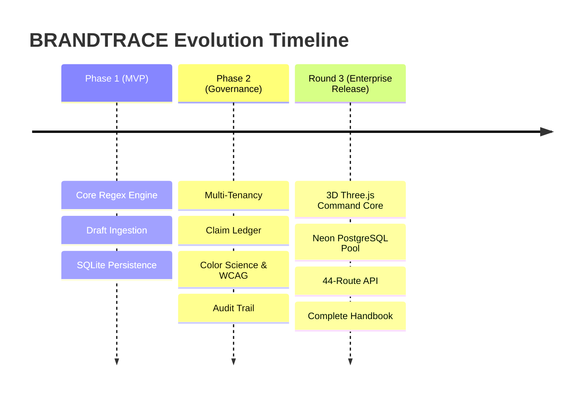

# 45 — Changelog and Release History

## Purpose

This document chronicles the developmental history, architectural milestones, defect repairs, and feature releases of **BRANDTRACE** leading up to the CodeAxis Hackathon Round 3 final release.

---

## Release History Overview

---

## Version 1.0.0 — Round 3 Final Release (October 2026)

### Highlights
- **3D AI Command Core**: Integrated interactive Three.js visualization for guideline networks and review dependencies, featuring raycasting inspection and seamless SVG topology fallback.
- **Dark Obsidian Enterprise Theme**: Complete Apple-inspired visual overhaul with deep obsidian surfaces (`#0B0F17`), subtle borders, emerald accents, and clear typography hierarchy.
- **Route Introspection & Reconciliation**: Introspected and verified all 44 FastAPI endpoints, aligning route definitions, schemas, and documentation.
- **Dual-Mode Security Architecture**: Hardened separation between `production` mode (strict bearer tokens and isolated API keys) and `demo` mode (persona simulation for hackathon judges).
- **Hard Approval Gating**: Hardened `/approval` endpoint returning `HTTP 409 Conflict` if any high-risk findings remain unadjudicated.
- **Serverless PostgreSQL Resilience**: Implemented pre-ping verification (`pool_pre_ping=True`) and connection recycling (`pool_recycle=300`) for serverless Neon database environments.
- **Verification Suites**: Verified 144 passed backend tests (1 skipped cloud probe) and 32 passed headless browser QA checks.
- **Complete Documentation Library**: Authored 45 comprehensive technical documents under `docs/handbook/`.
- **Live Continuous Deployment**: Continuous edge deployment verified at [https://brandtrace-woad.vercel.app](https://brandtrace-woad.vercel.app).

---

## Version 0.2.0 — Phase 2 Governance & Visual Science (October 2026)

### Highlights
- **Time-Aware Claim Ledger**: Added `facts` and `fact_versions` tables with ISO-8601 UTC validity windows and 30-day `EXPIRING_SOON` alerting.
- **Claim Impact Map**: Developed graph traversal engine linking historical draft reviews to active and expired facts, enabling targeted user-triggered re-reviews.
- **Guideline Health Intelligence**: Built empirical telemetry aggregator tracking reviewer friction, multi-actor disagreement detection, and data confidence gating (`SUFFICIENT` vs `INSUFFICIENT`).
- **Color Science & Accessibility Engine**: Implemented sRGB linearization, CIE XYZ conversion, CIELAB coordinates, Euclidean CIE76 Delta-E distance, and WCAG 2.1 AA relative luminance and contrast calculations.
- **Brand Asset Registry**: Added cryptographic SHA-256 binary hash matching for uploaded brand logos and icons, plus aspect ratio validation.
- **Multi-Tenant Workspace Isolation**: Implemented tenant scoping across all relational tables using parameterized `workspace_id` queries.
- **Digital PDF Ingestion**: Integrated `pypdf` for extracting text layers from digital PDF documents.
- **Immutable Audit Trail**: Provisioned the append-only `audit` ledger.

---

## Version 0.1.0 — Phase 1 Initial MVP

### Highlights
- Initial FastAPI application setup and React/TypeScript client scaffolding.
- Exact-span regex pattern matching for prohibited superlatives and required terminology.
- Draft creation, score calculation, and finding display.
- Local SQLite database persistence.
- Initial persona definition (`creator`, `reviewer`, `brand_admin`, `auditor`).
